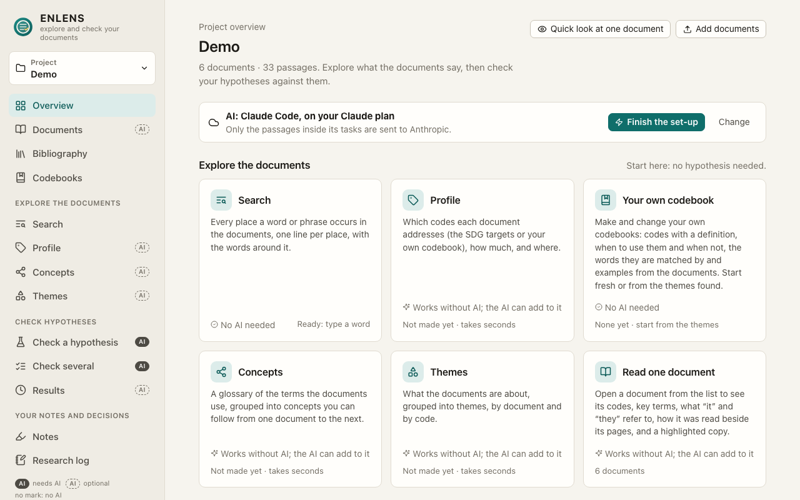

# ENLENS

ENLENS helps researchers explore their own reports, papers and interview notes and check whether they support a
statement, with every quote checked against the source, on their own computer and with Claude on their own plan.

## Install

1. **Paste one line.** On a Mac or Linux, open *Terminal*; on Windows, open *PowerShell*. Paste the line for your
   system and press Enter:

   | System | Where | Paste this |
   | --- | --- | --- |
   | macOS, Linux | Terminal | `curl -fsSL https://github.com/dvaud/claim_checker_demo/releases/latest/download/install.sh \| sh` |
   | Windows | PowerShell | `powershell -ExecutionPolicy Bypass -c "irm https://github.com/dvaud/claim_checker_demo/releases/latest/download/install.ps1 \| iex"` |

   It needs no git, no Python and no administrator rights. When it is done, ENLENS opens in your browser, and its
   icon is with your other programs.
2. **Press *Set up Claude*** on the first screen. It installs Claude Code if it is missing (it shows you the command
   first), opens a window where you sign in once with your Claude plan, and connects ENLENS to it.
3. **Name a project and add your documents** (PDF, Word, web pages, text, or a zip of them). ENLENS asks who may read
   them with AI: *Claude may read them*, *Only a local AI*, or *No AI*.
4. **Explore and check.** Where AI work waits, press **Start Claude Code**; the results appear as they come in.

No Claude plan? Choose *A model on this computer* on the first screen. Used ENLENS on another computer? Choose
*Import from another computer*. Installing it for someone else, and every option:
[section 1 of the manual](docs/MANUAL.md#1-install).

## Update

1. Type `enlens update` in Terminal or PowerShell, or paste the install line again (on Windows, quit ENLENS first).
2. Quit ENLENS (*Quit ENLENS* at the bottom of the sidebar) and open it again from its icon.

ENLENS also tells you when a new version is ready; on a Mac or Linux, *Update and restart* in its pop-up does both
steps for you. Your projects and settings (the `enlens` folder in your home folder) are never touched.

## What ENLENS does

- **[Explore your documents](docs/MANUAL.md#exploring-the-documents-07)** before you claim anything: every place a word
  occurs, the codes each document addresses (the SDG targets or your own codebook), a glossary, themes, references.
- **[Check a statement against them](docs/MANUAL.md#checking-a-hypothesis)**: supported, partly supported,
  contradicted or mixed evidence, with the words of each source and every quote checked against the source text.
- **[Review the AI's judgements](docs/MANUAL.md#reading-and-reviewing-a-result)** as you would a co-coder's: your
  judgements count, and the Excel download keeps them next to the AI's.
- **[Keep your bibliography beside your documents](docs/MANUAL.md#the-bibliography-zotero-013)**: bring in a Zotero
  collection or a reference file, and see which works you have and which you still need to find.
- **[Use a model on your own computer](docs/MANUAL.md#5-local-models)**, or no AI for some documents; whoever installs
  ENLENS can remove every cloud option for good (`--local-only`).
- **[The SDG and value chain pack](docs/MANUAL.md#9-the-sdg-pack-impact-claims-and-the-value-chain-assessment)**:
  impact claims tagged with UN SDG targets and compared with an expert Value Chain Assessment.

## New in 0.14: work on a project together

- **Share a project with a colleague.** Each of you keeps a copy on your own computer and plan, sends your work as a
  file, and merges the other's with *Bring in a colleague's work*. No server; nothing changes until you bring work in.
- **Each person's judgements.** A judgement of an excerpt keeps the name of who made it, and yours always count in
  your copy. **Can change results:** where you made none, a colleague's judgement now counts, marked with their name.
- **Newer versions come in, clashes keep both.** A result only your colleague changed is brought up to date in your
  copy (**can change results**); one you both changed comes in beside yours, marked *sync clash*.
- **The stricter AI setting wins.** A document your colleague keeps from Claude is kept from Claude in your copy too
  (**can change results** of later checks), and what you removed stays removed.
- **The one-line install works on a Mac again** (0.14.1). Since 0.10.0 it stopped after its first step in most Mac
  Terminals; the line under *Install* now works as it is. Does not change results.

How it works: [working on a project together](docs/MANUAL.md#working-on-a-project-together-014) in the manual. Every
release, with what was not tested: [CHANGELOG.md](CHANGELOG.md).

## How to cite ENLENS

ENLENS has no `CITATION.cff` or DOI yet. Until it does, cite the repository and name the version you used (it is at
the top of every *Settings* tab). For version 0.14.0, for example:

> ENLENS, version 0.14.0. https://github.com/dvaud/claim_checker_demo

Every Excel download ends with *How these results were made*: the models, their versions and the prompt versions
behind each answer. It belongs in your methods section or supplementary material.

## Privacy and your documents

Your documents, results, judgements and settings stay on your computer. With Claude (the default), only the passages
inside the AI's tasks are sent to Anthropic, through Claude Code on your own Claude plan (or the Claude API, when a
shared installation switched it on), and only from documents marked *Claude may read it*; ENLENS records every passage
it sends (*Sent to Claude* on the *Documents* page). To keep a document from Claude, mark it *Only a local AI* or *No
AI*. To keep everything on the computer, choose *A model on this computer* in *Settings → AI*, or put
`ENLENS_LOCAL_ONLY=1` before the install line, which removes every cloud option for good. Apart from the AI you chose
and looking for a new version on GitHub, ENLENS sends nothing anywhere and has no telemetry; bringing in a colleague's
work only reads the file they sent you. The details, and what Anthropic's terms say for each plan, are in
[section 8 of the manual](docs/MANUAL.md#8-privacy-and-copyright).

## Documentation

- [The manual](docs/MANUAL.md): the app, the command line, the connector for the Claude app, local models, privacy
  and the SDG pack.
- [Which model each task needs](docs/MODEL_CHOICE.md): how the models are chosen, and (once made) the runs on the pilot.
- [The app's HTTP API](docs/API.md), for scripts and other programs.
- Add-ons: [building an app on ENLENS](docs/EXTENDING.md), with an add-on's own [manual](docs/ADDON_MANUAL.md) and
  [API](docs/ADDON_API.md).
- [What changed in each release](CHANGELOG.md), with the defects fixed.

## For developers

A git copy, the tests, the layout of the code and how a release is made: [docs/DEVELOPING.md](docs/DEVELOPING.md).
