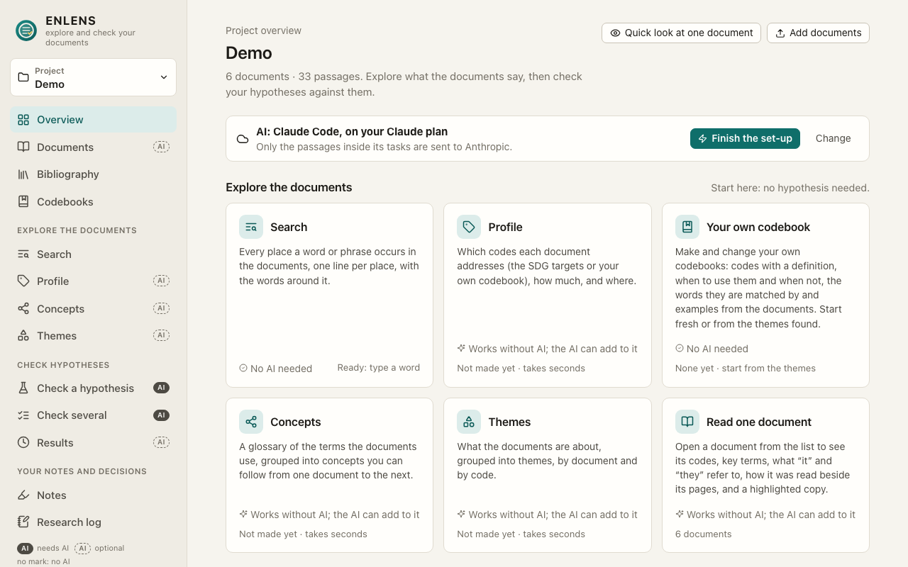
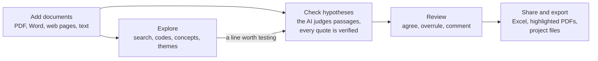

# ENLENS manual

ENLENS helps you **explore** your own documents and **check hypotheses** against them. Exploring comes first: search,
codes (the SDG targets or your own codebook), concepts and themes, mostly without AI. To check a statement, ENLENS
finds the passages that bear on it, has an AI judge each one, verifies every quoted word, and tells you whether your
documents support, partly support, contest or contradict it, with the document, page and quote behind every judgement.

## How it fits together

Three things hold everywhere:

- **Your judgement wins.** You review the AI as you would a co-coder. Your judgements replace its own, always count,
  and are kept beside them in the Excel download.
- **Every quote is checked.** A quote that is not word for word in the source is sent back and never used.
- **You decide what the AI may read.** Only the passages in its tasks leave your computer. Any document can be kept to
  a model on your own computer, or from AI altogether, and an installation can rule out the cloud for good.

## Five-minute start

1. **Install**: paste one line in Terminal or PowerShell, or double-click a file. → [Install](manual/install.md)
2. **Set up Claude**: press *Set up Claude* on the first screen; it installs Claude Code and signs you in. No Claude
   plan? Choose a model on your computer. → [First steps](manual/first-steps.md)
3. **Add documents**: name a project, choose files or a folder, and say who may read them with AI.
4. **Check a hypothesis**: in *Hypotheses*, type one sentence that could be true or false and press *Check*. With
   Claude Code, press *Start Claude Code* when the page asks. → [Check a hypothesis](manual/check.md)
5. **Review**: *Next to review* takes you through the judgements that matter first: *Agree*, *Not about this* or
   *Judge differently…* → [Read and review a result](manual/review.md)

Would you rather be walked through it, with sample documents? [Your first project, start to finish](manual/first-project.md).

## The manual

Arranged by what you need: to **learn**, to **do** something, to **look something up**, or to **understand**.

### Start here

| Page | What it covers |
| --- | --- |
| [Your first project, start to finish](manual/first-project.md) | A walk through six invented documents, from adding them to the Excel file |
| [Install and update](manual/install.md) | The install, scanned PDFs, updating |
| [First steps](manual/first-steps.md) | The first screen, the sidebar, the finder, the AI mark |

### How to…

| Page | What it covers |
| --- | --- |
| [Check a hypothesis](manual/check.md) | Writing one, *Look before checking*, parts, many at once |
| [Read and review a result](manual/review.md) | The result page, excerpt cards, downloads, the evidence map |
| [Explore your documents](manual/explore.md) | Search, Codes, Concepts, Themes, theory documents |
| [Make your own codebook](manual/codebooks.md) | Codes of your own, and how labels follow |
| [Look at how a document was read](manual/reading.md) | The reading view, *Leave out*, a new reader |
| [Your bibliography](manual/bibliography.md) | Zotero beside your documents, retractions |
| [Notes, the research log and earlier versions](manual/notes-and-log.md) | Highlights, notes, the log, compare and restore |
| [Work together](manual/together.md) | Sharing, the Team tab, clashes, moving |
| [A storage space of your team's own](manual/storage-space.md) | Set-up, invites, joining |
| [Choosing the shared folder](manual/shared-folder.md) | Cloud folders, the folder window |
| [Roles, proposals and what waits for your word](manual/roles.md) | Owner, Co-owner, Member |
| [Claude Code](manual/claude-code.md) | Setting it up and starting it; Claude in a chat |
| [A model on your own computer](manual/local-models.md) | Getting, tuning and testing one |

### Look it up

| Page | What it covers |
| --- | --- |
| [Settings](manual/settings.md) | The five tabs, reporting a problem, installing for others |
| [Which model does what](manual/models.md) | The model of each task; what every answer records |
| [Glossary](manual/glossary.md) | The words of the app and their technical names |
| [Troubleshooting and limits](manual/troubleshooting.md) | Problems by topic; what ENLENS cannot promise |
| [The command line](manual/command-line.md) | `enlens-gui`, `enlens` and the project's database |

### How it works

| Page | What it covers |
| --- | --- |
| [How a check reaches its answer](manual/how-a-check-works.md) | The steps, how sure the AI must be, what each answer means |
| [How documents are read](manual/how-documents-are-read.md) | What is read and left out, the readers, measuring |
| [How two copies of a project come together](manual/how-two-copies-come-together.md) | What happens to what a colleague sends |
| [How the AI is used and limited](manual/how-the-ai-is-used.md) | Where it is used, how it is checked, what it cannot promise |
| [Privacy](manual/privacy.md) | What leaves your computer, who may read each document with AI |

### SDG pack

| Page | What it covers |
| --- | --- |
| [The SDG pack](manual/sdg-pack.md) | Impact claims, the Value Chain Assessment pipeline |

## I want to…

| I want to… | Go to |
| --- | --- |
| learn ENLENS by doing one small project | [Your first project, start to finish](manual/first-project.md) |
| find every place a word occurs | [Search](manual/explore.md#search) |
| see which SDG targets (or codes of my own) a document addresses | [Codes](manual/explore.md#codes) |
| test whether my documents back a statement | [Check a hypothesis](manual/check.md) |
| understand what an answer means, and how it was reached | [How a check reaches its answer](manual/how-a-check-works.md) |
| highlight or note words of a document | [Highlights and notes](manual/notes-and-log.md#highlights-and-notes) |
| overrule the AI on an excerpt | [An excerpt card](manual/review.md#an-excerpt-card) |
| write a methods section, or an ethics application | [METHODS.md](METHODS.md), [PRIVACY.md](PRIVACY.md) |
| know which AI models a result used, for a methods section | [Notes and downloads](manual/review.md#notes-and-downloads), [What every answer records](manual/models.md#what-every-answer-records) |
| keep a licensed PDF or an interview away from Claude | [Who may read each document with AI](manual/privacy.md#who-may-read-each-document-with-ai) |
| use ENLENS with no cloud at all | [A model on your own computer](manual/local-models.md), [For whoever installs ENLENS](manual/settings.md#for-whoever-installs-enlens) |
| fix a document that reads badly | [The reading view](manual/reading.md#the-reading-view) |
| find a feature or page without hunting for it | [The finder](manual/first-steps.md#the-finder) |
| see what was decided in a project, and when | [The research log](manual/notes-and-log.md#the-research-log) |
| go back to an earlier version of my themes, judgements or codebook | [Earlier versions](manual/notes-and-log.md#earlier-versions) |
| move ENLENS to a new computer | [Moving to another computer](manual/together.md#moving-to-another-computer) |
| report a problem | [Reporting a problem](manual/settings.md#reporting-a-problem) |

---

This manual describes the current version of ENLENS. What changed in each version is in the
[changelog](../CHANGELOG.md); how to change ENLENS itself is in [DEVELOPING.md](DEVELOPING.md).
