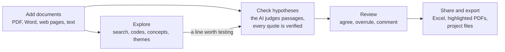

# ENLENS manual

ENLENS helps you **explore** your own documents and **check hypotheses** against them. Exploring comes first: every
place a word occurs, the codes each document addresses (the SDG targets or your own codebook), concepts you follow
across documents, themes. Most of it needs no AI. When you have a statement that could be true or false, ENLENS finds
the passages that bear on it, has an AI judge each one, verifies every quoted word against the source, and tells you
whether your documents support, partly support, contest or contradict it, with the document, page and quote behind
every judgement.

## How it fits together

Three things hold everywhere:

- **Your judgement wins.** You review the AI's judgements as you would a co-coder's. Yours replace the AI's, always
  count, and are kept beside the AI's in the Excel download.
- **Every quote is checked.** A judgement whose quote is not word for word in the source is sent back to the AI and
  never used.
- **You decide what the AI may read.** The AI is Claude, through Claude Code on your own Claude plan; only the
  passages in its tasks leave your computer. Any document can be kept to a model on your own computer, or from AI
  altogether, and an installation can rule out the cloud for good.

## Five-minute start

1. **Install**: paste one line in Terminal or PowerShell, or double-click a file. → [Install](manual/install.md)
2. **Set up Claude**: press *Set up Claude* on the first screen; it installs Claude Code and signs you in. No Claude
   plan? Choose a model on your computer. → [First steps](manual/first-steps.md)
3. **Add documents**: name a project, choose files or a folder, and say who may read them with AI.
4. **Check a hypothesis**: in *Hypotheses*, type one sentence that could be true or false and press *Check*. With
   Claude Code, press *Start Claude Code* when the page asks. → [Check a hypothesis](manual/check.md)
5. **Review**: *Next to review* takes you through the judgements that matter first: *Agree*, *Not about this* or
   *Judge differently…* → [Read and review a result](manual/review.md)

## The manual

| | Page | What it covers |
| --- | --- | --- |
| **Get going** | [Install and update](manual/install.md) | The one-line install, the files to double-click, scanned PDFs, updating, the icon |
| | [First steps](manual/first-steps.md) | The first screen, adding documents, the sidebar, the finder, the AI mark |
| **Your work** | [Check a hypothesis](manual/check.md) | The *Hypotheses* place: what a check does, the answers, hypotheses in parts, checking many at once |
| | [Read and review a result](manual/review.md) | The result page, excerpt cards, second opinions, downloads, the list of answers, the evidence map |
| | [Explore your documents](manual/explore.md) | Search, Codes, Concepts, Themes, a document's panels, Quick look |
| | [Make your own codebook](manual/codebooks.md) | Codes of your own: from the themes, a copy or a CSV file; try them, change them, labels follow |
| | [How documents are read](manual/reading.md) | What is read and what is left out, the reading view, moving to a new reader |
| | [Your bibliography](manual/bibliography.md) | Zotero next to your documents: what you have, what to find |
| | [Notes, the research log and earlier versions](manual/notes-and-log.md) | Highlights and notes, the dated record of decisions, compare and restore |
| | [Work together](manual/together.md) | Sharing a project with colleagues (a shared folder, the Team tab, the owner), sync clashes, moving to another computer |
| **The AI and your privacy** | [Privacy](manual/privacy.md) | What leaves your computer, who may read each document with AI, working together, how it is enforced |
| | [Claude Code](manual/claude-code.md) | Starting it, its speed and helpers, the queue; Claude in a chat (the connector) |
| | [A model on your own computer](manual/local-models.md) | Getting one, choosing and tuning it, testing it |
| | [Which model does what](manual/models.md) | The model of each task and of each Claude plan; what every answer records |
| **Reference** | [Settings](manual/settings.md) | The five tabs, new versions early, reporting a problem, installing for others |
| | [Glossary](manual/glossary.md) | The words of the app and their technical names |
| | [Troubleshooting and limits](manual/troubleshooting.md) | Problems by topic, with their fixes; what ENLENS cannot promise |
| | [The command line](manual/command-line.md) | `enlens-gui`, `enlens` and the project's database |
| **SDG pack** | [The SDG pack](manual/sdg-pack.md) | Impact claims, the Value Chain Assessment pipeline and its report |

## I want to…

| I want to… | Go to |
| --- | --- |
| find every place a word occurs | [Search](manual/explore.md#search) |
| see which SDG targets (or codes of my own) a document addresses | [Codes](manual/explore.md#codes) |
| test whether my documents back a statement | [Check a hypothesis](manual/check.md) |
| make my own codebook | [Make your own codebook](manual/codebooks.md) |
| highlight or note words of a document | [Highlights and notes](manual/notes-and-log.md#highlights-and-notes) |
| overrule the AI on an excerpt | [An excerpt card](manual/review.md#an-excerpt-card) |
| know which AI models a result used, for a methods section | [Notes and downloads](manual/review.md#notes-and-downloads), [What every answer records](manual/models.md#what-every-answer-records) |
| keep a licensed PDF or an interview away from Claude | [Who may read each document with AI](manual/privacy.md#who-may-read-each-document-with-ai) |
| use ENLENS with no cloud at all | [A model on your own computer](manual/local-models.md), [For whoever installs ENLENS](manual/settings.md#for-whoever-installs-enlens) |
| fix a document that reads badly | [The reading view](manual/reading.md#the-reading-view) |
| see which works of my Zotero library I still need to find | [Your bibliography](manual/bibliography.md#the-four-lists) |
| find a feature or page without hunting for it | [The finder](manual/first-steps.md#the-finder) |
| see what was decided in a project, and when | [The research log](manual/notes-and-log.md#the-research-log) |
| go back to an earlier version of my themes, judgements or codebook | [Earlier versions](manual/notes-and-log.md#earlier-versions) |
| share a project with a colleague | [Work together](manual/together.md) |
| work through a folder the team shares | [Through a shared folder](manual/together.md#through-a-shared-folder) |
| know what a shared folder holds | [Privacy: working together](manual/privacy.md#working-together) |
| move ENLENS to a new computer | [Moving to another computer](manual/together.md#moving-to-another-computer) |
| make Claude Code go faster, or easier on my plan's limits | [How fast it works](manual/claude-code.md#how-fast-it-works) |
| update ENLENS | [Update](manual/install.md#update) |
| report a problem | [Reporting a problem](manual/settings.md#reporting-a-problem) |

---

This manual describes the current version of ENLENS. What changed in each version is in the
[changelog](../CHANGELOG.md); how to change ENLENS itself is in [DEVELOPING.md](DEVELOPING.md).
