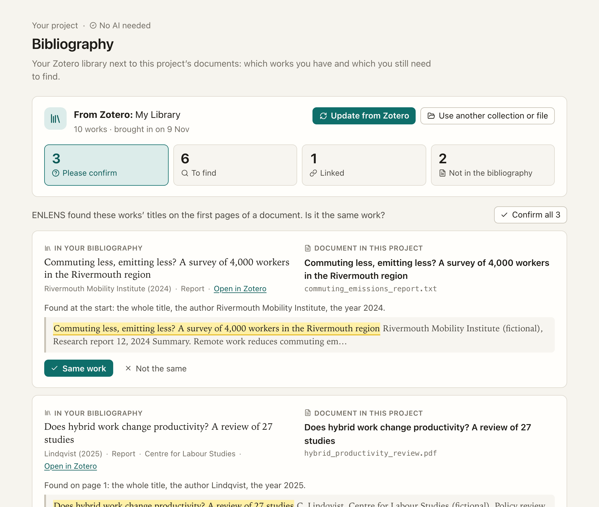

[Manual](../MANUAL.md) › Your bibliography

# Your bibliography (Zotero)

> **In short**
> - *Bibliography* (in the sidebar, under *Documents*) puts your Zotero library, one collection, or works you choose
>   next to the project's documents.
> - It answers three questions: which works do I have, which do I still need to find, and which documents are not in
>   my bibliography?
> - It uses no AI, nothing goes over the internet, and Zotero is only read, never changed.

## Bringing it in

ENLENS reads Zotero from the Zotero app on this computer. It needs **Zotero 7 or later, open**, with *Settings →
Advanced → Allow other applications on this computer to communicate with Zotero* ticked once. No Zotero account or
key is needed.

1. Choose the library (*My Library*, or a group library), a collection (or *The whole library*), and whether its
   subcollections come along.
2. Press *Bring in the bibliography*.

**Only some works, even one?** Tick *Choose the works one by one*. A list of the library's works appears (or of the
collection chosen above), searched by title, author or year as in Zotero's own search box. Tick the works you want:
they stay ticked while you search or switch collections, and stand above the list (click one to leave it out). Then
press *Bring in 1 work* (or *2 works*, and so on).

The page says plainly when Zotero is not open, does not allow it yet (with the box to tick), or is too old.

**Without the Zotero app**, *Use an exported file instead* takes a file exported from Zotero (right-click a collection
→ *Export Collection…*: BibTeX, RIS, CSL JSON or CSV) or from Mendeley, EndNote and other reference managers (BibTeX
or RIS). With Zotero's CSV and BibTeX, the paths of the files Zotero keeps come along too.

## The four lists

Four tiles at the top count them and open each one.

| Tile | What is in it | What you do |
| --- | --- | --- |
| **Please confirm** | A work that seems to be one of your documents, side by side with the document, the place where its title stands highlighted, and what was found (*Found on page 1: the whole title, the author Lindqvist, the year 2025*). | *Same work* links them. *Not the same*: the pair is never proposed again. *Confirm all* takes every pair at once. |
| **To find** | The works without a document, with their authors, year, type, where they were published, a DOI link, their web address and *Open in Zotero*. | *Download the list*: your to-download list as a spreadsheet. *Add these files to the project* (below). *Link a document* says by hand which document a work is. |
| **Linked** | Each work with its document, and how they were linked: *Same file*, *Same DOI*, *You confirmed it* or *You linked it*. | *Unlink* undoes a link for good (*Undo* in the message brings it back). |
| **Not in the bibliography** | The documents no work is linked to. | Add them to Zotero and press *Update from Zotero*, or *Link to a work* by hand. |

**Add these files to the project.** When Zotero keeps a file (a PDF, a saved web page, a Word file) for works still to
find, a card offers to add them. They are read where Zotero keeps them (nothing is copied), after you say who may read
them with AI (the project's choice is preselected), and each is linked to its work. When a work has several files,
the real document is added: its PDF first, then a Word file, then a text file, and a saved web page (Zotero's
snapshot of a landing page) only when nothing else can be read.

**A linked document takes its work's title** everywhere in ENLENS: in the Documents list, on the document page, in
Search, in a check's excerpts and in the exports. When the file's own title says something else, the document page
shows it too (*Title in the file: …*), and it comes back when no work is linked any more. The document also shows its
reference (*Verhoeven and Okafor (2025)*) in the Documents list, and on its page with its DOI and *Open in Zotero*.

How works and documents are matched

| Link | When |
| --- | --- |
| *Same file* | A file Zotero keeps for the work is the very file you added (by its checksum). |
| *Same DOI* | The document prints the work's DOI on its title page or in its file name. |
| Proposed (*Please confirm*) | The work's title stands on the first pages of the document, with an author or the year (the reference list of a short document is not read as its first pages); or the document only mentions the work's DOI somewhere on its first pages (it may cite the work). A work with neither author nor year (Zotero often saves a *Web Page* that way) is proposed when its title is long (six words that count or more) and stands whole on the document's title page. |

**What the matching does not do.** A scanned PDF without a text layer has no title to find until text recognition has
read it. The same title in different years (an annual report) is told apart by the year printed nearest the title;
when both are close, both pairs are shown for you to choose. A book and one of its chapters, or a translation, are at
best proposed. A document that only cites a work is not taken for it: the title must stand on its first pages as a
title, not as words spread over them.

## Keeping it up to date

- **Update from Zotero** reads the same collection again, or the same chosen works. A work deleted from Zotero goes,
  and a title edited in Zotero follows. With chosen works, a work newly added to Zotero does not come along: choose
  it.
- **Use another collection or file** replaces the bibliography. For chosen works it is called *Choose other works or a
  file*, and the works you chose last time start ticked, so adding one more is one tick away.
- **Your decisions are kept** for every work that is still there, even when it comes from another source (matched by
  its Zotero key, else its DOI, else its title and year).
- **Documents you add later** are matched as they come in: the message after adding says how many were linked and how
  many wait for you.
- **Remove the bibliography** takes the works and links out of the project. Your documents and Zotero stay as they
  are.

ENLENS talks to Zotero only through the Zotero app's own connection on this computer (`127.0.0.1`, port 23119), never
through Zotero's servers. The works' details stay in the project; nothing about them is sent to Claude.

---

Next: [Work together →](together.md)
