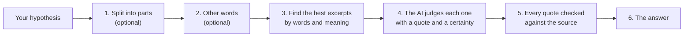

[Manual](../MANUAL.md) › Check a hypothesis

# Check a hypothesis

> **In short**
> - In *Hypotheses*, write one sentence that could be true or false (or several, one per line) and press *Check*
>   (<kbd>Ctrl</kbd>+<kbd>Enter</kbd>).
> - ENLENS finds the excerpts that bear on it, the AI judges each with a quote, and every quote is checked against
>   the source.
> - The answer counts only judgements the AI is sure enough about, and always yours.

## Writing the hypothesis

*Hypotheses* (under **Check** in the sidebar, marked *Uses the AI*) has one box for what you want to test, with the
answers listed under it and an *Evidence map* tab ([Read and review a result](review.md#the-list-of-answers)). By the
*Check* button, *Claude, on your plan, reads the excerpts it needs* says which AI reads your text.

The box takes one hypothesis, or several ([below](#checking-many-at-once)). One sentence that could be true or false: *Remote work lowers commuting emissions in large cities*, *Green hydrogen
production increases water stress in arid regions*. When it contains "and", "but" or a semicolon, the app offers to
**check each part separately**. *What happens when you check* explains the steps.

*More options*:

- let the AI think of other words your documents might use;
- tag the hypothesis with a code of a codebook (an SDG target, or a code of your own);
- limit the check to some documents.

**Look before checking** shows first how the hypothesis will be checked: the parts the AI would split it into (with
*Check each part separately*) and the extra words it would search for. Change, remove or add a part; remove search
words that do not fit and add words your documents use; then *Check*. The result records that you set them.

## What a check does

1. *(optional)* The AI splits the hypothesis into the claims that must all hold.
2. *(optional)* It writes other words for each claim: synonyms, technical words, the opposite phrasing.
3. The best excerpts are picked by their words (BM25), together with search by meaning when the project has it, and
   at most a few per document, so one long report cannot fill every place.
4. The AI judges each excerpt that bears on the claim: *supports*, *partly supports* or *contradicts*, with a quote
   and a certainty.
5. Every quote is checked character by character against the excerpt, as whole words ("legal" is not found in
   "illegal"), and has at least three words (or 15 characters) and at most 600. An answer that fails is sent back with its problems
   listed, and so is one a local model could not finish (cut off, stuck); the check goes on with its other parts.
6. The answer counts the judgements the AI is sure enough about, and yours ([below](#the-answers)).

**While it runs**, the page shows each step as it finishes: the parts, the other words searched for, how many
excerpts from how many documents, the AI reading them. *Technical details* shows what the model does second by
second. Remarks about the round appear under the steps (excerpts of restricted documents read on this computer, or
waiting for you). *Stop* ends the check and leaves nothing behind; with a model on this computer it also stops the
model. You can use the rest of the app meanwhile.

With Claude Code as the AI, the check may wait for you to press *Start Claude Code*
([Claude Code](claude-code.md#start-claude-code)).

## How sure the AI must be

Each judgement comes with the AI's **certainty**: its own estimate (0–100%) of how sure it is, shown as high
(≥ 80%), medium (≥ 60%) or low. It is not a check of whether the AI is right.

The **strictness** (60% by default) is how sure the AI must be for a judgement to count. Weaker judgements stay
visible, marked *Not counted*. Strictness applies to every result, old and new; change it in
[*Settings → Checking*](settings.md#the-five-tabs), where ENLENS also shows how often you agreed with the AI at each
certainty and, after 20 of your judgements, may suggest a strictness.

**Your own judgement always counts**, whatever the strictness.

## The answers

| | The app says | Meaning |
| --- | --- | --- |
| 🟢 | **Supported by your documents** | At least one excerpt says what the hypothesis says (and counts), and none says the opposite. |
| 🟠 | **Partly supported** | No excerpt says it all, but one says an important part of it. |
| 🟣 | **Mixed evidence** | Some excerpts support the hypothesis (fully or partly) and others contradict it. Read both sides: do they concern the same place, group or period? |
| 🔴 | **Contradicted by your documents** | An excerpt says the opposite, and none supports it. |
| ⚪ | **Only uncertain evidence** | Excerpts were judged, but the AI was not sure enough about any of them for your strictness. Judge them yourself, or lower the strictness. |
| ⚪ | **No evidence found** | None of the excerpts read was about the hypothesis. This is not proof that no document says it: read more, search with other words, or add documents. |
| ⚪ | **Nothing in your documents matched** | No excerpt shares words (or meaning) with the hypothesis. |
| ⚪ | **Not finished yet** | No excerpt has been judged yet. *Waiting for your judgement* when every excerpt read comes from documents no AI may read: judge them yourself. |
| ⚪ | **The check did not work** | The AI's answers did not pass the checks three times. |

Excerpts waiting for your own judgement (from documents marked *No AI*) count towards no answer until you judge them.
Nobody has read them, so they are not "not about the hypothesis" either.

> [!TIP]
> *No evidence found* is about the excerpts read, not about your documents. Under the evidence, *Read more excerpts*
> and *Search with other words* look further: documents often say "telework" where you wrote "remote work".

### A hypothesis checked in parts

The parts must all hold. The first row that applies decides:

| If… | the whole hypothesis is… |
| --- | --- |
| a part is contradicted | **contradicted**, even when other parts are supported |
| otherwise, a part has mixed evidence | **mixed evidence** |
| every part is supported | **supported** |
| some parts are supported or partly supported | **partly supported** |
| there is only uncertain evidence | **only uncertain evidence** |
| otherwise | **no evidence found** |

The app says which part decides (*Part 2 has mixed evidence, so the whole hypothesis has mixed evidence*). A part
whose check failed, or that waits for your judgement, gives no evidence either way, but the whole hypothesis
is then at most partly supported: it holds only if every part does, and that part is not known yet. A failed part
also makes the result say it is incomplete.

### Who says what

The documents behind an answer, by side. A document counts as **supporting** if one of its counted excerpts
supports, as **partly supporting** only if none supports, and as **contradicting** if one contradicts. So a document
can be on both sides, and the app says so. The **lean** (−1 only contradicting, +1 only supporting) summarises the
excerpts read; it is not a measure of truth.

## Checking many at once

The same box checks a list of hypotheses one after the other. Write them one per line, or load a spreadsheet or CSV
with a column `hypothesis` (or `claim`, `text`, `statement`) and optional `framework` and `code` columns. The button
counts what it will check (*Check 3*). *Look before checking* is for one hypothesis at a time. A hypothesis that
cannot be checked is listed and the next one is checked; a problem with the AI stops the set and keeps what was
done. Each answer then appears in the list under the box.

---

Next: [Read and review a result →](review.md)
