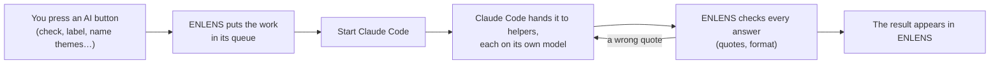
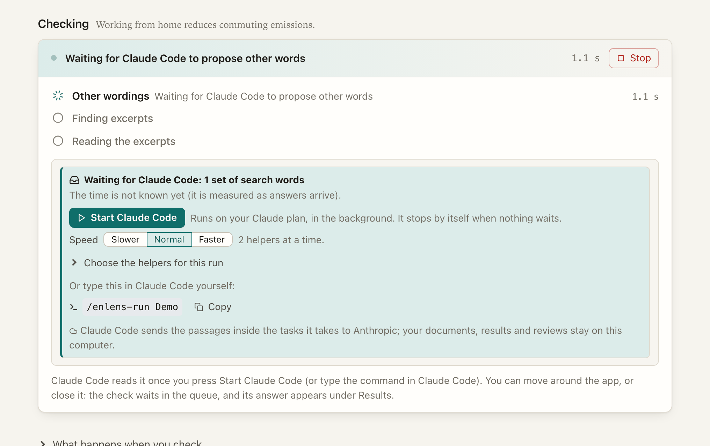

[Manual](../MANUAL.md) › Claude Code

# Claude Code, and Claude in a chat

> **In short**
> - With Claude Code signed in with your own Claude plan, every AI button of ENLENS is answered by Claude. No API key.
> - ENLENS prepares the work in a queue and checks every answer; Claude Code only reads. Nothing runs until you press
>   *Start Claude Code*.
> - Separately, the **connector** lets you check claims against your documents inside an ordinary Claude chat.

## How it works



Claude Code answers every kind of AI task: labels of codes, concept links, theme names, references, checks, reading an
excerpt again, second opinions, the model tests, and the [SDG pack](sdg-pack.md)'s tasks. ENLENS never sees your
Claude login (Claude Code uses its own) and never runs on anyone else's plan.

For a shared installation that runs unattended, use the **Claude API** with the team's key instead: the same queue and
the same models per task (`enlens queue run --backend anthropic`).

## Set it up once

On the first screen, or in *Settings → AI → Claude Code*, press **Set up Claude**
([First steps](first-steps.md#1-the-ai)). It installs Claude Code if it is missing (after showing you the command),
opens a window for the one-time sign-in and waits for it, then writes the plugin into your ENLENS folder
(`claude-plugin/`) and adds it to Claude Code by running the same two commands you would type (`claude plugin
marketplace add …`, `claude plugin install enlens-run@enlens`). Nothing else in Claude Code's settings changes. The
checklist then shows three ticks.

- From a terminal, `enlens claude-setup` does the same (`--print-only` only prints the two lines).
- ENLENS finds the `claude` program on the PATH or where its installers put it; `ENLENS_CLAUDE=/path/to/claude` names
  it.
- When ENLENS is moved or installed again (a new Python), it writes the plugin again on its next start and adds it
  again, quietly. The Claude desktop app's connector entry is pointed at the new Python too when the old one is gone.

## Start Claude Code



Press an AI button in ENLENS. The page says what waits, for example *Waiting for Claude Code: 120 passages to label ·
about 25 minutes*, with **Start Claude Code**. ENLENS then starts Claude Code in the background for that project,
allowed only the ENLENS queue tools and its helpers, so a passage that tries to give it instructions can do nothing
else. The page and the foot of the sidebar say *Claude Code is working on it*, with *Stop Claude Code*. It stops by
itself when nothing waits.

> [!NOTE]
> Until you press *Start Claude Code*, nothing is answered. A button left unpressed for about five seconds while work
> waits pulses, and the line beside it says *Nothing runs until you press it.* (with reduced motion switched on in
> your computer's settings, it has a still ring instead). The pulse stops once you press it, or once Claude Code
> started some other way takes the work.

The button is wherever work waits: a check's progress, an answer that waits, the status area at the foot of the sidebar
(*Start*), and the line
of a follow-up on a result (reading an excerpt again, reading new documents, a second opinion, a stronger model).

- *Stop Claude Code* returns the batches it had taken to the queue at once.
- Pressing *Start* twice (or in two tabs) starts one run, and each project's run works in a folder of its own.
- *Quit* and *Update and restart* stop the runs first. A run still working when ENLENS was closed some other
  way is recognised when ENLENS opens again: the page shows it as working, *Stop Claude Code* stops it, and *Start*
  does not start a second one beside it.
- If a run ends with a problem (a usage limit, say), the page shows the end of its report.
- The first start also adds the plugin, if that was not done yet.

### How much thought

**How much thought: Energy efficient · Balanced · Intelligence**, beside every *Start Claude Code*, says which Claude
models answer each kind of task, and how hard they think ([Which model does what](models.md#how-much-thought)). The
choice is kept: it is the same one as in *Settings → AI*, and picking it beside *Start Claude Code* changes it from
that run on. It is for Claude only: a local model keeps its own choice.

### How fast it works

**Helpers at once** (Slower · Normal · Faster) is how many helpers work at once. You choose it in *Settings → AI*
only; each *Start Claude Code* says it (*2 helpers at a time*) with a link there.

| Helpers at once | How many | Trade-off |
| --- | --- | --- |
| Slower | 1 | Takes longest; easiest on your plan's limits. |
| Normal | 2 | The default. |
| Faster | 4 | Done sooner; uses your plan's limits faster. |

A run already working keeps what it started with; the line *Claude Code is working on it* says how many helpers it
has (*· 4 helpers at once*).

### At your plan's usage limit

When Claude Code stops because your plan's usage limit is reached, the queue keeps the work, and *Settings → AI → At
your plan's usage limit* decides what happens next: **Wait and continue later** (start Claude Code again when the
limit resets; the page says when, if Claude Code said it), or **Carry on with the local model**, which answers what
waits on this computer, where it may (a local model must be chosen). Answers the local model gives count like any
other and record which model gave them.

**Choose the helpers for this run**, folded under that line beside *Start Claude Code*, lists each helper that has work waiting, with its model,
what it would answer and how much waits (*Labeller haiku · Codebook labels · 7,868 waiting*). Set how many of each
work at once (0 leaves that work for a later run) and **Helpers at once, in all** (1 to 8). The fold then says
*changed* and the line *2 helpers at a time* greys out; picking the number again undoes it. Work that comes in during the
run for a helper not listed (an unsure answer for the auditor, a check's excerpts after its search words) gets one
helper. The choice is for that run only.

### Or type it yourself

The same work can be started in Claude Code, opened in any folder:

```text
/enlens-run Pilot              # every kind of task waiting in the project Pilot
/enlens-run Pilot label        # only the labels
/enlens-run Pilot --parallel 4 # four helpers at once: faster, but uses your plan's limit faster
/enlens-run Pilot --helpers checker=2,labeller=1   # only these helpers, this many of each at once
```

Without `--parallel`, a typed run goes at the speed chosen in ENLENS. With `--helpers`, the helpers not named do
nothing in that run, and `--parallel` (if given) caps the total. The helpers are *labeller*, *linker*, *namer*,
*reader*, *extractor*, *checker* and *auditor*. ENLENS works out how many helpers each kind of task gets, in the
queue's order, and never more than it has batches for. The speed counts the helpers of one run: Claude Code started
both from ENLENS and in a terminal at the same time runs both runs' helpers.

`/enlens-run` hands each kind of task to its helper on the model ENLENS names for it
([Which model does what](models.md)) and reports what is done and what is left. The helpers can use only the ENLENS
queue tools: they see nothing but the passages handed out and write nothing but answers. Every answer is
quote-checked; a wrong quote is sent back and answered again. An unsure answer (certainty under 0.6), or one rejected
twice, goes once to a stronger model.

## Following the work

You follow the progress in ENLENS: on the page that waits, and at the foot of the sidebar, where the work takes the
place of the line that says where your text goes: what runs, for how long, how many tasks wait and the AI's name.
*Settings → AI → Work waiting for Claude Code* lists what waits, per kind (waiting, being answered, done, the model
and helper, the estimate), and lets you put a task first (*Do first*), keep it back (*Hold*) or take it out
(*Remove*).

| The foot of the sidebar says | Meaning |
| --- | --- |
| *1 task running*, with a pulsing dot | Claude Code is taking or answering the work. |
| *1 task not running · Waiting for Claude Code to start*, in the warning colour, with a *Start* button | Work waits but nothing answers it (Claude Code not started, no `/enlens-run` working, no answer in the last two minutes). |
| *Paused at 340 of 7,868 labels. To go on, type /enlens-run Pilot in Claude Code.* | Answers stopped arriving. |

A check waits under *Hypotheses* as *Waiting for Claude Code*: its search runs in ENLENS at once, and only its search
words, parts and judging wait. It finishes when the answers arrive, even if the app was closed meanwhile.

**Stopping.** A run can stop at any moment (a usage limit, a closed laptop, <kbd>Ctrl</kbd>+<kbd>C</kbd>). A batch
taken and not answered returns to the queue after 30 minutes, and the next `/enlens-run` goes on where it stopped:
nothing is lost. *Stop* on a waiting page takes its tasks that no session has taken yet out of the queue (a waiting
check is removed whole).

**Model tests with Claude Code.** *Compare a sample* (labels of codes) and the *Model test* (Settings) put their tasks
in the queue of a temporary copy of the project, named on the waiting page (type `/enlens-run "<that name>"`). The
copy is removed when the test ends, so nothing is stored. The labels are read by the label model, and the model test
answers each kind on its own model. *Test: repeatable answers?* says that Claude Code takes no seed.

<details>
<summary>The connector's queue tools (used by the plugin, not meant for a chat)</summary>

`queue_status`, `next_tasks` (a batch, claimed for 30 minutes), `submit_answers` (each answer quote-checked: stored,
or its problems listed), `release`. ENLENS starts Claude Code for a project with
`claude -p "/enlens-run:enlens-run <project>"`, run in the ENLENS folder.

</details>

## Claude in a chat: the connector

The connector lets Claude check claims and hypotheses against your documents inside an ordinary chat, in the Claude
desktop app or in Claude Code. Claude does the reading and judging on your Claude plan, with no API key; only the
passages shown to it (about 8,000 characters a round) leave the computer. The connector, a small program on your
computer, keeps the projects, picks the passages, checks every quote against the source and keeps the history. It
uses the same projects as the app, so a check made in the chat appears in the app (judged by "claude (chat)") and
the other way round.

### Set it up

```bash
enlens-mcp --install-claude-desktop      # adds the connector to the Claude desktop app's config (keeps a .bak copy)
```

Quit and reopen the Claude desktop app. `enlens-mcp --print-config` prints the block for the desktop app's config file
(to add by hand) and the exact `claude mcp add …` command for Claude Code. Both start the connector with the Python it
was installed in. Add `--home FOLDER` to either command if your projects are not in `~/enlens`. (A git copy needs the
`connector` extra.)

### Use it

Write in the chat as you would to a colleague:

- "Make a new project called Morocco from ~/Downloads/morocco_sources.zip" (give a path: files attached to the chat
  do not reach the connector)
- "Use my pilot folder ~/enlens/pilot as a project called Pilot"
- "In Pilot, check this hypothesis: hydrogen leakage along the value chain undercuts its climate benefits, because
  leaked hydrogen extends the lifetime of methane." (Claude splits a compound hypothesis into parts and checks each)
- "Read more passages", or "Try a different search", when nothing was found
- "Show me my recent checks in Pilot"
- "In Pilot, where do the documents talk about electrolyser imports?", "Which SDG targets does the IEA Africa outlook
  address?", "What does Pilot call PEM electrolysis, and in which documents?"

<details>
<summary>The connector's tools</summary>

`list_projects`, `create_project`, `add_sources`, `use_folder_as_project`, `list_documents`, `list_frameworks`,
`suggest_targets`, `start_check`, `submit_grades`, `more_passages`, `get_check`, `list_checks`, `search_corpus`
(concordance lines, so Claude can look around before proposing a hypothesis), `document_profile` (a document's codes
with their passages) and `find_concept` (a concept's wordings and documents). A recorded demo of a session is in
[connector_demo.html](../connector_demo.html).

</details>

If the Claude app does not show the connector, look for an error in its connector settings. Running `enlens-mcp` in a
terminal shows any start-up problem (it then waits for the app; stop it with <kbd>Ctrl</kbd>+<kbd>C</kbd>).

---

Next: [A model on your own computer →](local-models.md)
