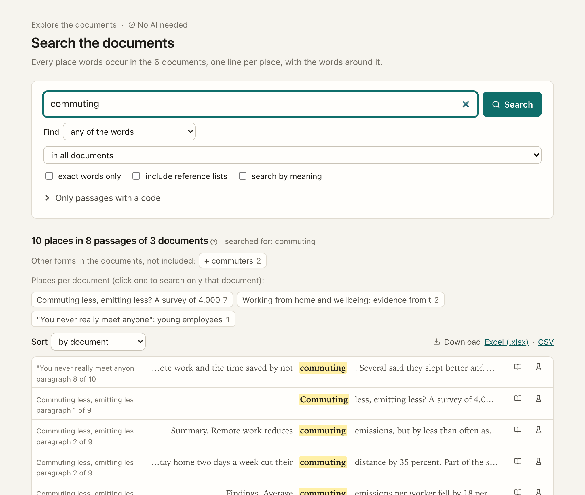
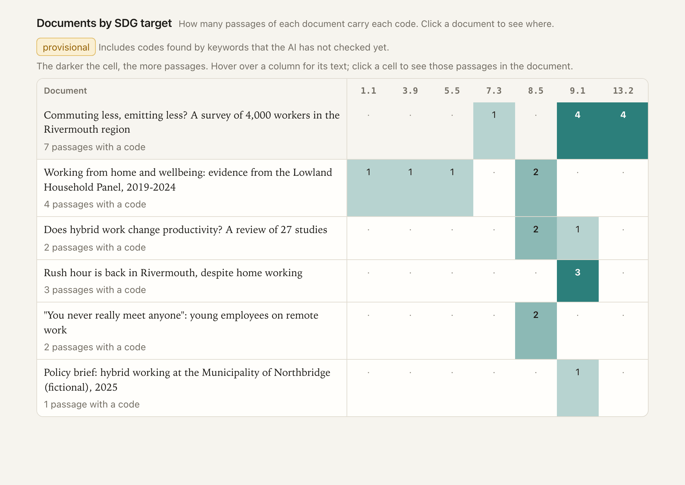
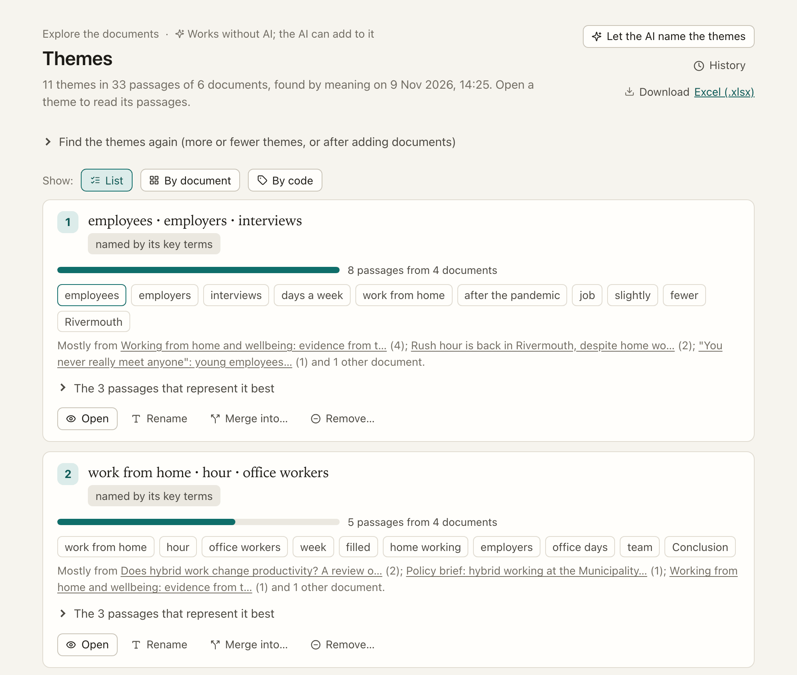

[Manual](../MANUAL.md) › Explore your documents

# Explore your documents

> **In short**
> - Before or beside checking, the places in the sidebar's **Explore** group show what your documents say and where.
> - Search, key terms, the keyword codes, the glossary and themes by words need **no AI**. The AI only adds
>   readings on top, and each one quotes the text and is checked against it.
> - Every line, code and theme opens the document at its place.

| Place | What it gives | AI? |
| --- | --- | --- |
| [Search](#search) | Every place words occur, with the words around them; phrases, near, other forms, words nearby; Excel/CSV | no |
| [Codes](#codes) | The codes each document addresses, how much and where, with the words or quote and reason behind each | keywords first; the AI confirms |
| [Concepts](#concepts) | A glossary of terms grouped into concepts (abbreviations, wordings, your links), and where each appears | optional |
| [Themes](#themes) | Themes across the documents, by document and by code; rename, merge, move, remove | optional (names) |
| [A document](#in-a-document) | Its codes, key terms, references ("it", "they"), search, a highlighted copy, how it was read | references only |

## Search

Every place words occur, one line per place with the words before and after (a concordance), with the count per
document first.

| You want | Do |
| --- | --- |
| Any of the words, all of them in one passage, a phrase, or words near each other | Choose it under *Find* (*near*: within N words). In a phrase search, words typed next to a "quoted phrase" must also be in the passage. |
| Other endings too ("price" finds "prices") | The default. *Exact words only* turns it off. Forms the search did not include are listed under the count (*Other forms in the documents: commuters*), to add with one click. |
| To grow the search from what you see | Click a word in a line to add it; <kbd>Shift</kbd>-click to make a phrase. |
| To see patterns | Sort by document, by the words before or by the words after. |
| The words around your search | *Words that often appear nearby*: the words within 2 to 10 words of the places found, most often or most typical first (point at one for both figures; within one document or code, "typical" is measured against that document's or code's own passages). |
| To test what a line says | Its link *Check this* takes the line to *Hypotheses*, where you check it. |
| A list for later | Download every line for Excel or as CSV. |

Every searched word is marked in the lines, and in the passages that search by meaning finds. A line shows its
document's title; point at it for the place (page, paragraph). Click the title to open the document at its words. A *passage* is the stretch of text the app reads as one unit: a
paragraph, up to about 1,100 characters ([How documents are read](how-documents-are-read.md)). The place shown (page, paragraph) is
that of the original. Setting up search by meaning runs once per project: a second press, or a reload while it
runs, follows the same job.

*Search by meaning* is a tick box above the results. With no model chosen it stays off, and a line under the search box
leads to *Settings → Documents*. With a model chosen but the project not (fully) set up, the Search page itself says
so, with how much is covered and the button *Set up search by meaning* (the same job as on the Documents page, with
its progress); a job already running shows as progress, never a second button. When it ends the tick box can be used
at once, without reloading the page.

## Codes

*Codes* has two views, under the title: *By document* and *Codebooks* ([Make your own codebook](codebooks.md)).
*By document* shows which codes of a codebook each document addresses, how much and where. The codebook is the 169 SDG targets
by default, the 17 goals, or a codebook of your own ([Make your own codebook](codebooks.md)).

1. **Keywords first.** When documents are added, the app finds candidate codes in seconds by their keywords (and by
   meaning, with an embedding model): *provisional* codes.
2. **The AI confirms.** *Let the AI label the passages* has the AI read each passage with a candidate code and say
   which codes really apply (main topic or mentioned; for the SDGs, whether the passage says it helps or hinders the
   aim), with a quote and a reason. Afterwards it says how many keyword codes it confirmed, did not confirm, and
   added.
3. **You decide.** In a document, the **Codes** panel shows every code with its passages, quotes, reasons or the
   words that found it (highlighted in the text). Agree, change how it applies, reject (with *Undo*), or add a code
   of your own. Your labels always count: a keyword label you agreed with or changed stays even after the AI has
   read the passage.

Count by code or by group (the SDG goals). The grid opens the passages behind each cell; a long grid draws its first
documents at once and the rest as you scroll down (or *Show more documents*). *Technical details* shows
the model, its exact version (digest), the prompt and the seed, and warns when they differ from the last run.

When you change the codebook, a notice above the grid says so: the codebook changed since the keyword pass (*Find the
codes again* takes seconds), codes were reworded after the AI labelled with them, or labels of removed codes wait and
are not counted. *Open the codebook* goes to its editor ([What happens to labels](codebooks.md#what-happens-to-labels)).

## Concepts

A **glossary** of the terms the documents use (one or more words, found by the C-value method; running heads and page
furniture are left out), grouped into **concepts**:

- abbreviations and their long forms ("proton exchange membrane (PEM)");
- wordings close in meaning (with an embedding model);
- links found in the sentences themselves (0.18.1, see below);
- links the AI proposes and you accept, and links of your own.

A concept card shows how the documents write it (*Not the same* splits a wording off), which documents discuss it and
where it first appears, every line where it occurs, and related concepts (the same, broader, narrower, related,
often together). *Ask the AI for other wordings* lists wordings the documents use: add them, or say *Not the same*
and they are not proposed again.

**Links found in the text (0.18.1).** When the glossary is made, ENLENS proposes links from the sentences, without AI,
only between two terms the glossary knows and only when the connecting words alone stand between them:

| The sentence says | The link proposed |
| --- | --- |
| "X such as Y, Z and W" | X is broader than Y, Z and W |
| "Y, Z and other X" | Y and Z are kinds of X (narrower) |
| "X, also called Y", "X (also known as Y)", "X, i.e. Y" | the same |
| "X leads to / causes / reduces / increases / results in Y" | X *leads to* Y |
| "X instead of Y" | X *replaces* Y |

Words inside quotation marks are passed by. Each proposal, marked *found in the text*, shows the sentences it was
found in with their document and page, and waits for *Yes, right* or *No* like any proposed link. English sentences
only, for now.

**Paths to another concept (0.18.1).** On a concept's card, type another concept and *Find the paths*: the shortest
chains between them, through links you accepted and concepts the documents mention together more often than by chance
(pointwise mutual information). Each step shows the passages that mention both its concepts: a way into an argument
the corpus already makes. A list, not a drawn map.

**Over time and across groups (0.18.1).** *By year* shows, for each publication year, how many documents mention the
concept, how they word it and what it is mentioned with. The year is that of the work the document is in your
[bibliography](bibliography.md); documents without one are counted apart. *Compare two sets of documents* does the
same for two sets you tick (policy against academic, one country against another); the sets are not kept.

**The concept map.** The *Map* tab beside *Glossary* draws the concepts mentioned in the most passages (60 at first;
*Concepts on the map* gives 30 to 150) as a map, made on this computer without AI:

- **A line** joins two concepts the documents mention together, in two passages or more, more often than by chance
  (pointwise mutual information): two common words that turn up together only as often as chance would give are not
  joined, however many passages they share. The thicker the line, the more often than by chance. Each concept keeps
  its strongest lines only, so the map stays readable.
- **Groups** are concepts that are mentioned with each other more than with the rest; the legend names each group's
  concepts in the most passages. Groups 1 to 5 are each a filled shape in a colour of their own (circle, square,
  diamond, triangle, hexagon); groups 6 to 10 are the same five shapes outlined, in the same five colours; groups 11
  and on, the smallest, are all grey stars, and *The map as lists* says which concepts each holds. A concept with no
  line is in no group: a grey dashed circle. So no two kinds of mark differ by colour alone.
- **Links** (those you accepted or added, the AI's confident ones and the abbreviations) are darker lines with their
  words: *is part of* and *leads to* point the way they run, *is used instead of*, *is related to*. Two concepts with
  links of two types (two wordings you joined, or two sources) have one line with both. Two wordings you joined as
  *the same* are one concept, so they are one mark.

Choose a concept to open its page. Choose a line to see, under the map, the passages that mention both (and, for a
link, its sentences); *The map as lists* gives the groups, every line and the links as lists, with *Show the
passages* on each. Pointing at a concept dims everything it is not joined to. Marks that would cover each other are
pushed apart a little, and on a narrow screen they are smaller.

When fewer than 30 passages are counted (one short document, a narrow filter), the page says so: a line that rests on
two or three passages can look strong by chance.

The filters above the map narrow the passages it counts, and the map is drawn again from those passages alone:
*Documents*, a *Theme* (of the latest set, with your merges and moves), a *Code* of a codebook (the passages labelled
with it), and the years a document was *Published from* and *until* (from the [bibliography](bibliography.md);
documents without a year are then left out). The same project and filters always give the same map. On the command
line: `enlens --ws myproject concept-map`.

Theory and working documents are left out of the glossary, of key terms, of both cards and of the map.

### Words the glossary leaves out

No term starts or ends with a common word of its passage's language: "because" and "themselves" in English, "dan",
"wel", "maar" and "ja" in Dutch. ENLENS tells each passage's language by the common words it uses (lists for 58
languages come with it; a passage too short to tell, such as "Ja.", takes the language of the one before it). A Dutch
word that is also English ("net", "door") is left out only in Dutch passages, so "net zero" stays a term of an English
report. The key terms of themes come from the glossary, so they leave out the same words.

Under *Words the glossary leaves out* on the Concepts page:

- **Languages found**, with how many passages each. Switch one off to read its passages as English; a language with a
  few passages is often a table or a reference list. English common words are always left out.
- **Your own words**, one per line: a speaker label such as "Interviewer" or "R1", or a word that says nothing in your
  project. No term starts or ends with a word listed here; a phrase ("zeg maar") leaves out just that term.

*Save and update the glossary* makes the glossary again. Themes found before keep their key terms; the Themes page
says which of them are now left out, and finding the themes again gives key terms without them. Search is not
changed: it still finds every word.

## Themes

What the documents are about, grouped into themes. Each theme has key terms, a size, the documents it comes from and
the passages that represent it best; grids show themes by document and by code. The same documents and settings
always give the same themes (spherical k-means on the passages' embeddings, or on their terms without an embedding
model). A small project gets fewer themes than asked: about three passages a theme.

- **Rename, merge, move passages.** Your edits are kept, and carried to a new set with the same settings after
  documents were added: an edit follows its theme by the passages they share, and stays behind when no theme of the
  new set has them.
- *Let the AI name the themes* gives names and short descriptions, with checked quotes.
- **History** on a set of themes lists its earlier versions, to compare and restore
  ([Earlier versions](notes-and-log.md#earlier-versions)); removing a theme or a set asks *Why?* for the research log.
- **Remove** a theme that is not relevant to you (running headers, reference lists, a topic outside your question):
  its passages are left out of the themes, the grids and the downloads. It waits under *Removed themes* at the foot
  of the list, where *Bring it back* undoes it.
- **Remove and find a new theme** also looks for a new theme in its place, on this computer and without AI.

How <i>Remove and find a new theme</i> chooses

Among the passages that fit their own theme least well, it finds the group that sits closer to a new centre than to
the theme it is in, and moves it into a new theme named by its key terms (the themes it takes passages from keep their
names). It never takes passages that are closer to a theme you removed, so the removed theme does not come back under
another name. A new theme says which theme it replaces and where its passages come from; remove it too to find
another. Removals and new themes belong to that set of themes only.

## In a document

A document's page shows its text as the reader found it ([How documents are read](how-documents-are-read.md)), with panels beside
it:

| Panel | What it does |
| --- | --- |
| **Codes** | Every code with its passages ([Codes](#codes)). |
| **Key terms** | The terms that set the document apart; point at one to underline it in the text. |
| **References** | *Follow the references*: the AI reads the document three passages at a time and links "it", "they" or "the study" to the name they stand for. Select a name in the text to see every later mention. |
| **Search** | Search within the document. |
| **Notes** | Your highlights and notes on this document's words ([Notes, the research log and earlier versions](notes-and-log.md#highlights-and-notes)). |
| **Reading**, **Page** | How well it was read, and the original page beside the text ([How documents are read](how-documents-are-read.md)). |

*Download a highlighted copy* gives the PDF with highlights for the judgements, codes, concepts or references you
choose (exact boxes with the PDF layout reader, whole lines otherwise, text recognition for scanned pages), and a note
listing any quote it could not place. Other documents come as an HTML copy.

### Theory documents

A book or paper your research is read *through* (a theory of practice, a systems text) is not evidence about your
field. Mark it as **theory** (0.18.1): in *Documents*, a row's menu → *Mark as theory…*, or on the document's page,
*Mark as theory*. A small *Theory* tag then stands beside its title.

A theory document is still read, searched (*Search* finds it), opened and noted as any other. It is **left out** of
the themes, the labelling with codebooks, the excerpts a check reads, key terms and the glossary's counts, and so of
the evidence map. You mark it; ENLENS never guesses: a study that *uses* a theory is still evidence. A check you
limit to the theory document by hand still reads it.

Marking or unmarking changes no result by itself. The document's page lists what was made with it in (sets of themes,
codebook labels, checks), with links to make them again without it; a check is run again from its own page. *Mark as
evidence* takes the mark back. In a shared project the mark travels like *Leave out*: the owner's or a Co-owner's
holds at once, a Member's is a proposal ([Roles](roles.md)). A theory is also where a codebook can start
([Make your own codebook](codebooks.md#make-one)).

### Working documents

Your own draft or notes can be kept in the project beside the corpus (0.18.8). Mark it as **your working document**:
in *Documents*, open a row → *Role* → *Mark as my working document…*, or on the document's page, *Mark as my working
document*. A *Working document* tag then stands beside its title. A colleague's or another author's draft you study is
evidence, not your working document.

A working document is read, searched, opened, noted and labelled with your codebooks as any other, but it is **never
a source**: it is left out of the themes, the excerpts a check reads, key terms, the glossary's counts and the
evidence map. Its codes show on its own page and as its own row at the foot of the *Codes* grid, never in the
corpus's counts, so you see what your draft covers beside what the corpus does.

To check one of its claims, select the sentence in its text and choose **Check against the corpus**. *Hypotheses*
opens with the words filled in: turn them into the claim you want to check, then press *Check*. A line above the box
says that the check will be listed on the document's page and who will read these words, by the document's AI
setting:

- *Claude may read it*: the AI you chose, as for any hypothesis.
- *Only a local AI*: only a local model on this computer reads the words and the excerpts they are checked against
  (Claude reads none of them); without a local model, you judge the excerpts yourself. With Claude Code as the AI,
  the hypothesis is checked as written, without parts or other search words.
- *No AI*: no model reads the words. ENLENS finds the excerpts with the words as written, and you judge them.

A check from a document marked *Only a local AI* or *No AI* is not shown to a Claude chat connected to ENLENS. The
document's page lists every check started from it, newest first, each with its answer now (the first eight, the
others under *and N more checks*), and each check's page links back to the document. The check remembers the
document, not the sentence. A box of several lines is a list, which is not tied to the document.

A document has one role: evidence, theory or your working document. In a shared project the mark travels like the
theory mark; everyone in the team needs this version, since an older ENLENS reads a working document as evidence.

### Non-scientific documents

A news article, a press release, a company brochure or a blog reports no method or data of its own. Mark it as
**non-scientific**: in *Documents*, open a row → *Scientific* → *Mark as non-scientific…*, or on the document's page,
*Mark as non-scientific*. A newspaper icon then stands beside its title in the list.

It stays in everything a theory document leaves: themes, codebook labels, the excerpts a check reads and key terms.
Its excerpts are still read and judged, and shown with *Not counted: non-scientific*, but **no judgement of them
counts in an answer**, yours neither. On their own they make a hypothesis neither supported, nor mixed, nor
contradicted: a hypothesis only non-scientific documents support reads *No scientific evidence found*. Beside a
scientific study they change nothing: a study that partly supports it and a press release that fully supports it give
*Partly supported*. The assessment under the answer says what the non-scientific documents say, and what the answer
would be counting them.

Unlike the theory mark, this one **changes answers at once**: the dialog says how many checks read the document, and
afterwards the document's page lists each check with its answer now and the answer counting the non-scientific
documents, or, for a check set to count them, *counted in this check (set on the hypothesis)*. *Count as scientific*
takes the mark back. A document can be theory and non-scientific at once. You mark it; ENLENS never guesses. Do not
mark documents that are your material: when you study what newspapers or companies say, they are your evidence. In a
shared project the mark travels like *Leave out*.

**When they are the material of one hypothesis.** Some hypotheses are about what newspapers, blogs or companies say
(*Local newspapers framed the plant as a job engine*): there they are the evidence. Under the answer of such a
hypothesis, turn on **Count non-scientific documents in this check**. Its answer then counts them as any document,
for every part of it, and changes at once; every other check still leaves them uncounted. The page, the assessment
under the answer and the Excel download say plainly that they count here and why, with the answer the check would have
without them, and their excerpts read *Non-scientific, counted here*. The research log keeps each change with the
answer before and after; so does a new reason given while it is on. The switch is shown only where the check read a
non-scientific document, and travels with the check in a shared project, as its note does: when the check is a
colleague's, a line under the switch says so, and your change reaches their copy beside theirs, as a sync-clash
copy.

**A suggestion from your bibliography.** When a document's work in the [bibliography](bibliography.md) is a kind that is
usually not scientific (a newspaper or magazine article, a blog or forum post, a web page, a podcast or a broadcast),
its page and its row in *Documents* show one quiet line: *Your bibliography lists this as a newspaper article. Mark it
as non-scientific?* *Mark* opens the usual dialog; *No* keeps it as it is, and the research log keeps your answer.
Nothing is marked by itself, and theory and working documents are never suggested. In a project with an owner, the
Owner's or a Co-owner's *No* holds in every copy; a Member's hides the suggestion in their own copy only. Whoever said
*No* can take it back on the document's page with *Suggest again* (the Owner and Co-owners can take back anyone's).
Grouping *Documents* by *Scientific or not* lists the suggested ones together.

**On the evidence map** a non-scientific document has a column too: what it says is drawn with the symbol unfilled
and a dashed edge (*Non-scientific: read, not counted*). It changes no answer, count or colour of the map, and it
still counts among the documents with no excerpt that counts, as in *Documents* (*Behind no answer*). In a
hypothesis that counts them, its cells are drawn as any other. The Excel summary has the answer counting them,
filled where it differs, and whether the hypothesis counts them.

## Quick look

*Quick look at one document* (on the Overview and *Manage projects*) reads one file into a
temporary project and opens it at its key terms: search it, see its codes and references at once. A banner offers
*Keep as a project* or *Discard now*; otherwise it goes to the trash after 7 days. A quick look opened while a project
is open can use that project's codebooks, without changing them; its own labels stay in the quick look.

## For NVivo, ATLAS.ti and MAXQDA

*NVivo, ATLAS.ti, MAXQDA (.qdpx)* (beside *Download all* on the Hypotheses page, beside *Excel* on the Codes page, and
among a result's downloads; `enlens export-qdpx` on the command line) downloads the project in the REFI-QDA exchange
format that these programs open. It holds every document as plain text (without the blocks left out), each codebook
with labels and your own codebooks as codes with their definitions, and each hypothesis as a code with *Supports*,
*Partly supports* and *Contradicts* under it. The labels and judgements that count are codings on their quotes: the
person whose decision it was codes it (your name from Settings), or "ENLENS AI" with the model's name, so you can tell
them apart in the other program. Your notes and highlights become memos on their words, and the research log one memo.
The file holds your private work too: it is for your own analysis, not for a colleague. A codebook alone downloads as
a REFI-QDA codebook from the codebook's page (*Download as .qdc*). No AI is used, and nothing leaves the computer.

## For FlexiConc and the Cross-Doc SDG Explorer

*For FlexiConc / Cross-Doc* (on the Projects page; `enlens export-flexiconc` on the command line) downloads the project
as one SQLite file in the FlexiConc layout of the Cross-Doc SDG Explorer: documents, sentences with their code,
reference chains, theme clusters and, with an embedding model, embeddings.

Where the parts of the Cross-Doc SDG Explorer went

The explore pages replace the Cross-Doc SDG Explorer, one of the two tools ENLENS grew out of.

| Cross-Doc | ENLENS |
| --- | --- |
| Single-document concordance (AND / OR), token strip | Search (any / all / phrase / near), across all documents or one |
| SDG classifier, dual consensus | Codes: keywords and meaning first, the AI confirms with a quote and a reason |
| Explainability (integrated gradients, span masking, keyphrases) | Key terms per document and passage; the words and reason behind every label |
| Coreference (fastcoref, LingMess) | References in a document (the AI follows "it" and "they"); checks say what a quote's "it" is |
| Global coreference (trie) across documents | Concepts: one concept followed across every document, with its wordings |
| SciCo clusters, communities and summaries | Themes, named by the AI with checked quotes |
| `pdf_highlight_post.py` | Highlighted copies of a document, an answer, a column of the evidence map |
| FlexiConc SQLite | *For FlexiConc / Cross-Doc* on the Projects page, `enlens export-flexiconc` |

---

Next: [Look at how a document was read →](reading.md)
