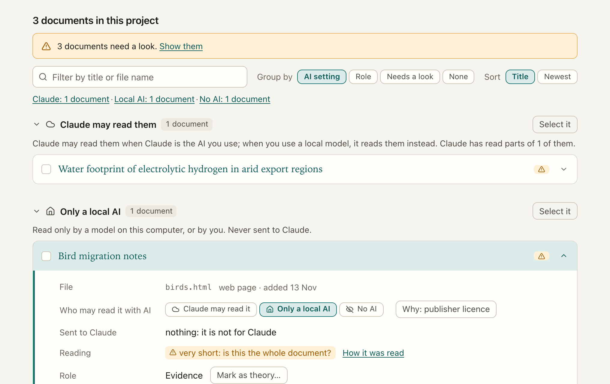
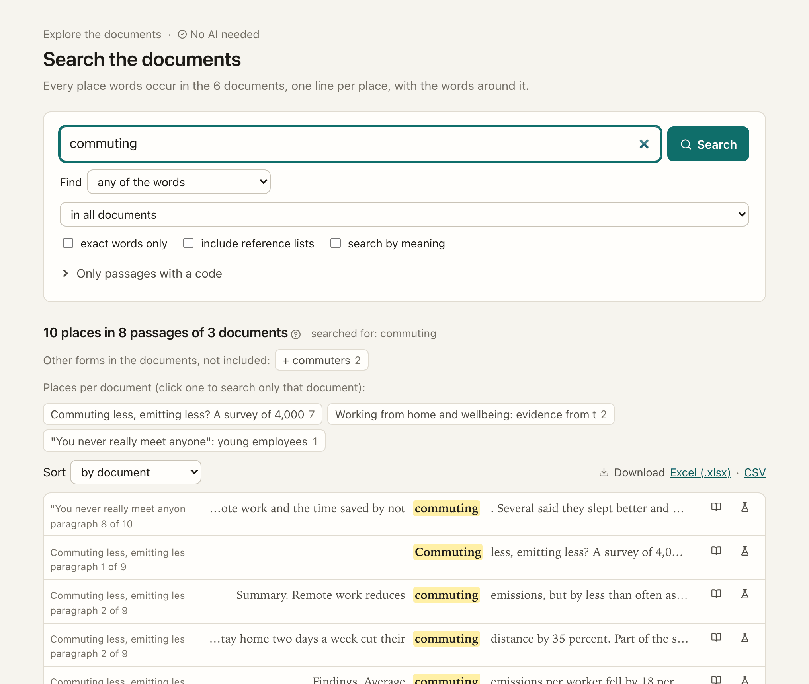
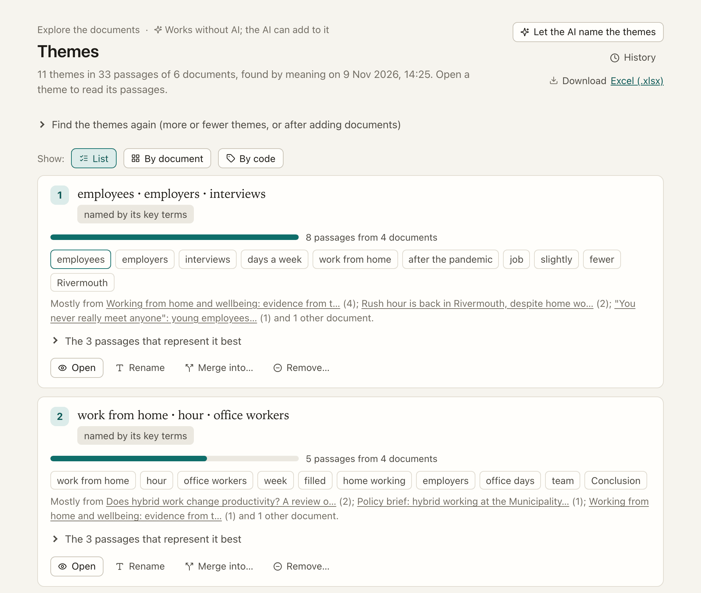
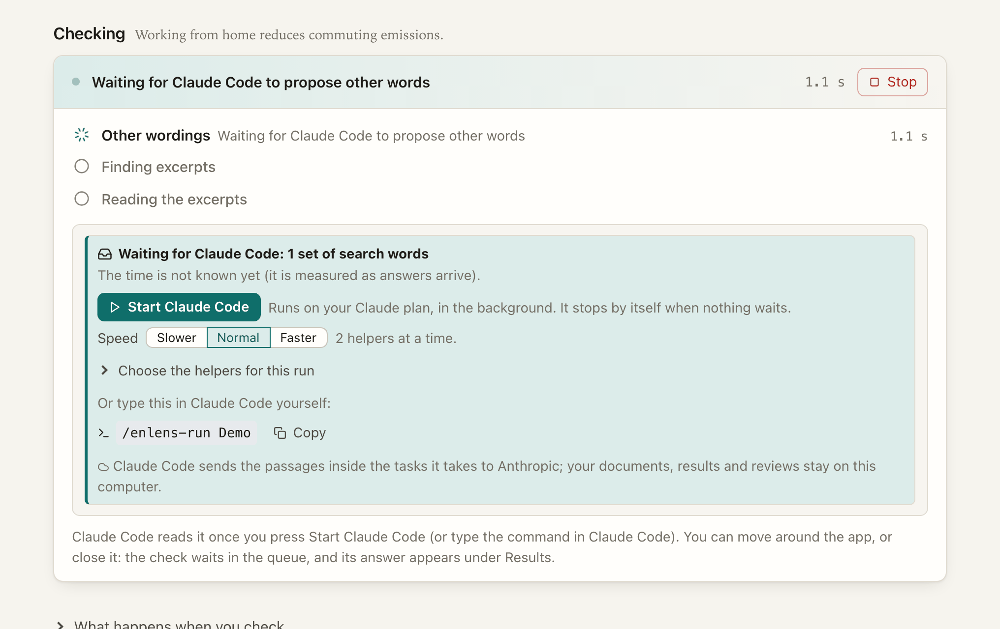
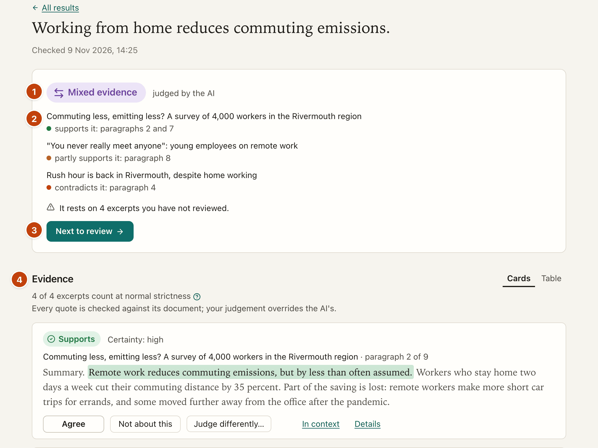
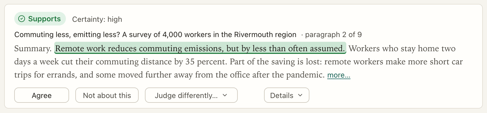

[Manual](../MANUAL.md) › Your first project, start to finish

# Your first project, start to finish

> **In short**
> - A walk through one small project: add six documents, look around, check one hypothesis, read the answer, judge one
>   excerpt and download the result.
> - It uses the invented *remote work* documents that ship with ENLENS, so you cannot spoil anything. With your own
>   documents every step is the same.
> - Each step says what you should see, and links to the page that explains it.

## Before you start

You need ENLENS installed ([Install and update](install.md)) and an AI chosen on its first screen: *Set up Claude* if you
have a Claude plan, or a model on your own computer ([First steps](first-steps.md)). Without an AI, steps 1 to 3 work
and the checking steps wait.

The documents are six invented ones about remote work: a survey report on commuting emissions, a panel study of
wellbeing, a review of hybrid productivity, interviews with young employees, a municipal policy brief and a news
article about traffic. Every author, organisation and figure in them is fictional. In a git copy of ENLENS they are in
`tools/demo_corpus/`. No demo folder? Use five or six of your own reports or papers instead: everything below works the
same, only the words you search for change.

## 1. Add the documents

1. On the first screen, under *Give your project a name*, type a **Project name** (*Remote work*, say) and press
   *Create the project*.
2. Press *Add documents on the Documents page*. You land on **Documents**.
3. Drop the files on *Drop your documents here*, or press *Choose files* and pick them all. They appear in a list.
4. Choose **who may read them with AI**: *Claude may read it*, *Only a local AI* or *No AI*. These documents are
   invented, so *Claude may read it* is fine. For your own interviews or licensed PDFs you would choose again
   ([who may read each document with AI](privacy.md#who-may-read-each-document-with-ai)).
5. Press *Add these 6 documents to the project*.

A progress card reads the files. When it says *Documents added*, you see *6 documents added.* and the list shows each
document's title. A saved web page, a PDF and plain text files read alike: ENLENS turns them all into passages, the
stretches of text that search, codes, themes and checks read ([How documents are read](how-documents-are-read.md)).

Open one document from the list. Beside its text are panels: **Codes**, **Key terms**, **References**, **Search**,
**Notes** and **Reading**. *Reading* says how well it was read. Nothing needs doing here yet.

## 2. Look around

No hypothesis is needed to explore. The **Explore** group of the sidebar has **Search**, **Codes**, **Concepts** and
**Themes**, and most of it needs no AI ([Explore your documents](explore.md)).

**Search.** Open **Search** and type `commuting` in the box, then press *Search*. You get the count per document, then
one line per place with the words around it. Click a word in a line to add it to the search. Try `"short car trips"` in
quotes to find a phrase. Every line has a link, *Check this*, that takes it to *Hypotheses*: a line worth testing
becomes a hypothesis in one click.

**Key terms.** On a document's page, open **Key terms**: the terms that set this document apart from the others. Point at
one to underline it in the text.

**Themes.** Open **Themes**. In *Find the themes of your documents*, leave *How many themes* as it is and press *Find
themes*. After a moment you see what the documents are about, each theme with its key terms, its size and the documents
it comes from. A small project gets fewer themes than a large one. Open a theme to read the passages that represent it.
*Let the AI name the themes* is optional: without it, each theme is shown with its key terms.

Two more places you can try later: **Concepts** (*Make the glossary* groups the terms the documents use into concepts)
and **Codes** (which of the 169 SDG targets, or codes of your own, each document addresses).

## 3. Check a hypothesis

A hypothesis is one sentence that could be true or false. Open **Hypotheses**, under **Check** in the sidebar.

1. Click the box *Your hypothesis* and type:

   > Remote work lowers commuting emissions in large cities.

2. Press *Check* (or <kbd>Ctrl</kbd>+<kbd>Enter</kbd>, <kbd>⌘</kbd>+<kbd>Enter</kbd> on a Mac). Under the button, a line says
   which AI reads your text.
3. With Claude Code as your AI, the page waits for you: press **Start Claude Code**. ENLENS puts the work in a queue,
   Claude Code reads it, and ENLENS checks every answer before it appears ([Claude Code](claude-code.md#start-claude-code)).
   A model on your own computer needs no start button.

While it runs, the page shows each step as it finishes: the other words searched for, how many excerpts from how many
documents, the AI reading them. You can use the rest of the app meanwhile; *Stop* ends the check.

What happens in between is explained in [How a check reaches its answer](how-a-check-works.md): the best excerpts are found by
their words (and by meaning when the project has it), the AI judges each one with a quote, and every quote is checked
against the document word for word.

*Look before checking*, beside *Check*, would first show how the hypothesis will be searched, so you can change the parts
and the extra words. Try it on the next hypothesis ([Check a hypothesis](check.md)).

## 4. Read the result

The result page opens at the answer, and who judged it. Judged by the AI, you will see one of: *Supported by your
documents*, *Partly supported*, *Mixed evidence*, *Contradicted by your documents*, or one of the grey answers (for
example *No evidence found*). What each means is in [The answers](how-a-check-works.md#the-answers).

For this hypothesis the commuting report says remote work lowers commuting emissions, but not by much and with rebound
effects; so look for support with cautions rather than a clean yes. What you see depends on the AI that read, and may
word things differently.

Read the page from the top:

- **The answer**, and *who says what*: one row per document, with a coloured dot for each side and where in the document.
  Green *supports*, amber *partly supports*, red *contradicts*.
- **The evidence**: every excerpt read, with its judgement and a quote. Each quote is highlighted in the excerpt and
  was found word for word in the document.
- **Next to review** takes you to the next excerpt worth your look.

If the answer says *No evidence found*, that is about the excerpts read, not about your documents: under the evidence,
*Read more excerpts* and *Search with other words* look further.

## 5. Judge an excerpt

The AI is your co-coder, and you review it. Press **Next to review**. It opens an excerpt card: the AI's judgement, the
document and where the quote is, and the quote itself. Read the quote in its excerpt, then choose:

- **Agree**, if the AI is right. Your agreement counts, whatever the AI's certainty.
- **Not about this**, if the excerpt has nothing to do with the hypothesis. It moves out of the evidence.
- **Judge differently…**, to choose another judgement (*Supports*, *Partly supports*, *Contradicts* or *Not about this*)
  or to add a comment.

Each choice saves at once and offers *Undo*. If it changes the answer, the page says so under the answer. **Your own
judgement always counts**, and replaces the AI's in the answer and the downloads; the card still shows what the AI said
([Read and review a result](review.md#an-excerpt-card)).

Keep pressing *Next to review* until it is done, or stop when you have seen enough. The answer says whether it rests on
your judgements.

## 6. Download the result

Further down the result page, the **Download** card has a button for each file:

- **Excel (.xlsx)**: the answer, every excerpt and judgement, and your notes. It ends with *How these results were made*,
  which lists the AI models used, for a methods section.
- **Highlighted documents (.zip)**: each document, with the quotes marked.

Under **Hypotheses**, *Download all* gets the same Excel file for every hypothesis you checked
([Notes and downloads](review.md#notes-and-downloads)).

## What next

- Check another hypothesis: *Working from home increases loneliness among young employees* has a panel study and a set of
  interviews to read. Or write one on a theme you saw. Several at once, one per line, are checked together
  ([Checking many at once](check.md#checking-many-at-once)).
- Make codes of your own from the themes ([Make your own codebook](codebooks.md)).
- Highlight and note words of a document, and keep the research log ([Notes, the research log and earlier
  versions](notes-and-log.md)).
- Share the project with a colleague ([Work together](together.md)).
- Understand what you did: [How a check reaches its answer](how-a-check-works.md), [How the AI is used and
  limited](how-the-ai-is-used.md) and [Privacy](privacy.md).

---

Next: [Check a hypothesis →](check.md)
