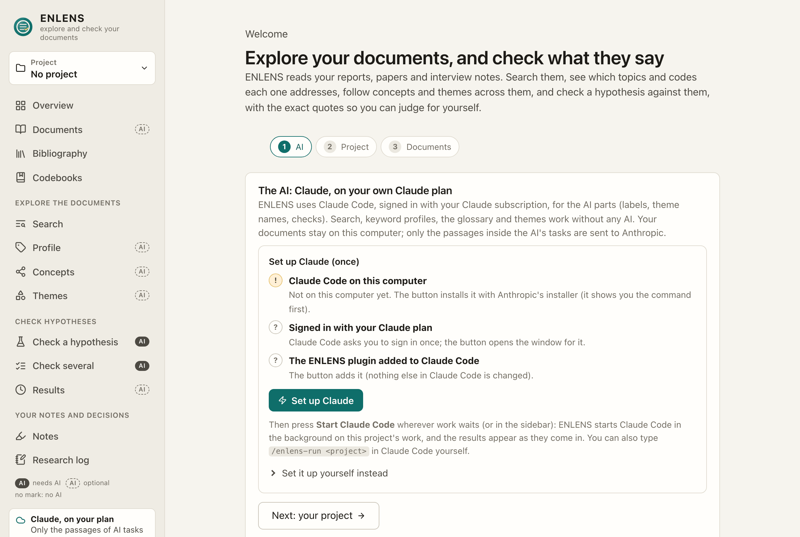
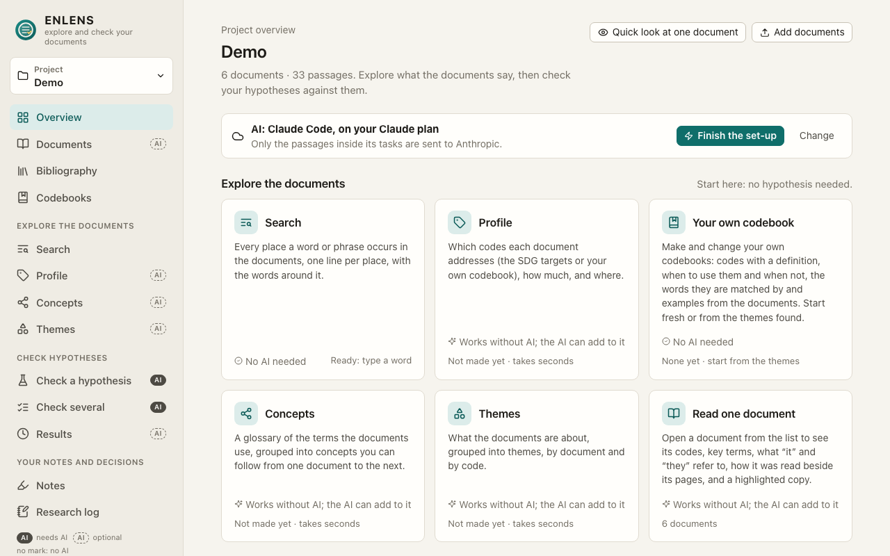

[Manual](../MANUAL.md) › First steps

# First steps

> **In short**
> - The first screen has three steps: **the AI** (*Set up Claude* does it all), **a project**, then **documents**.
> - No Claude plan? Choose a model on your own computer, or no AI for now.
> - The sidebar has seven parts, a finder (<kbd>Ctrl</kbd>+<kbd>K</kbd>) and a line that always says where your text goes.

## The first screen

### 1. The AI

ENLENS uses **Claude Code**, signed in with your own Claude plan. The step shows a checklist (Claude Code on this
computer, signed in, the ENLENS plugin added) and one button, **Set up Claude**, which does every step still open, in
order:

| Step still open | What *Set up Claude* does |
| --- | --- |
| Claude Code is not on the computer | Shows the command of Anthropic's installer (`curl -fsSL https://claude.ai/install.sh \| bash`, or `irm https://claude.ai/install.ps1 \| iex` on Windows) and runs it when you choose *Install Claude Code*. No administrator rights; a minute or two. *Anthropic's set-up page* is linked if you would rather do it yourself. |
| Not signed in | Opens a Terminal (macOS) or PowerShell (Windows) window already running Claude Code. Sign in there with your Claude plan (it opens a page in your browser), then close the window. ENLENS checks every few seconds and goes on by itself; *I have signed in* checks at once. If no window can be opened, the page shows the line to type. |
| The plugin is not added | Adds the ENLENS plugin to Claude Code. |

ENLENS never sees your login: it stays with Claude Code. The sign-in window starts in an empty folder of ENLENS
(`claude-runs/sign-in` in the data folder), with Claude Code's tools for reading files, running commands and browsing
switched off, so it cannot open your files. ENLENS runs Claude Code the same way for its work
([how this is enforced](privacy.md#how-it-is-enforced)).

*Set it up yourself instead* keeps the lines to type.

**No Claude plan?** *No Claude plan? Other options* offers a model on this computer, or no AI for now. A model on
this computer needs no terminal:

1. With no model server running, *Install Ollama* gets **Ollama** (free): it says the size of the download first
   (about 1.7 GB on Windows, 230 MB on a Mac), then installs and starts it, with a progress bar. If Ollama is on the
   computer but not running (after an install, or on a later day), ENLENS starts it by itself and waits until it
   answers: there is nothing to open and nothing to type. *Start Ollama* stays for when that did not work.
2. With Ollama running but no model yet, ENLENS suggests the models that **fit this computer**, from its memory, free
   disk space and graphics card: one recommended, a smaller and quicker one, and a larger and more careful one
   beside it, each with its download size, how quick it will be here and what it is good for. *Download …* gets the
   one you chose, with *Also …* for search by meaning (a small one for English, a larger one for many languages), a
   progress bar and *Stop* (Ollama keeps what it has and goes on from there). A model that does not fit is not offered.
3. The downloaded model becomes the AI and is tested at once.

3. The downloaded model becomes the AI and is tested at once.

Ollama fetches the model from ollama.com; none of your documents are sent. When whoever installed the app already
chose a local model that answers, this step is skipped. More in [A model on your own computer](local-models.md).

### 2. A project

Name a **project**: one per set of documents. Used ENLENS on another computer before? *Import from another computer*
brings every project and the settings in one go ([Moving to another computer](together.md#moving-to-another-computer)).

### 3. Documents

Choose files or a folder. ENLENS reads:

| Kind | Notes |
| --- | --- |
| PDF | Text, columns and tables are read from the layout ([How documents are read](reading.md)). Scanned pages need [Tesseract](install.md#scanned-pdfs-optional). |
| Word (.docx) | Keeps its paragraphs, headings and the pages Word marked. Older .doc files are not read: save them as .docx or PDF. |
| Web pages (HTML), text (.txt), Markdown (.md) | Files that are not UTF-8 (a Hungarian text saved by Notepad, an old Latin-1 page) are read as they were written. |
| Zip | Opened, and the files inside are added. |

Then ENLENS asks **who may read these documents with AI**: Claude, only a local AI, or no AI
([Privacy](privacy.md#who-may-read-each-document-with-ai)).

The list shows the title read from each file and warns about unreadable text and very short files (often a landing
page saved instead of the report). A file that cannot be read (password-protected, damaged) is listed with the reason,
and the others are added. *Stop* also stops the text recognition of a long scanned PDF. A large batch is read up to
three files at a time, on the computer's spare processors, and added in the order of the files; the result is the same
as reading them one by one. The list draws its first rows at once and the rest as you scroll; *Select every document*
selects all of them.

*Open an existing ENLENS project folder (advanced)* links a project made with the command line, without copying it.

## Finding your way

**The sidebar** has seven parts, from top to bottom:

| Part | What is there |
| --- | --- |
| The name | *ENLENS*, and the project switch under it. |
| *Find a feature or page* | The finder ([below](#the-finder)). <kbd>Ctrl</kbd>+<kbd>K</kbd>, or <kbd>⌘</kbd>+<kbd>K</kbd> on a Mac, opens it from anywhere. |
| The project | *Overview*, *Documents*. |
| **Explore**, marked *AI on request* | *Search*, *Codes*, *Concepts*, *Themes* ([Explore](explore.md)). |
| **Check**, marked *Uses the AI* | *Hypotheses* ([Check a hypothesis](check.md)). |
| The foot | One status area, then *Settings*, *Quit* and the theme icon. |

Each of these is a **place**. A place's other parts are **views**, shown as tabs under the page title:

| Place | Views |
| --- | --- |
| *Overview* | *Overview*, *Research log* ([Notes, the research log and earlier versions](notes-and-log.md#the-research-log)) |
| *Documents* | *Documents*, *Notes* ([Highlights and notes](notes-and-log.md#highlights-and-notes)), *Bibliography* ([Your bibliography](bibliography.md)) |
| *Codes* | *By document* (which codes each document addresses, [Explore](explore.md#codes)), *Codebooks* ([Make your own codebook](codebooks.md)) |
| *Hypotheses* | *Answers*, *Evidence map* ([Read and review a result](review.md#the-evidence-map)) |

Links from earlier versions of ENLENS, and bookmarks to them, open the new home of the page.

### The finder

*Find a feature or page* (or <kbd>Ctrl</kbd>+<kbd>K</kbd>, <kbd>⌘</kbd>+<kbd>K</kbd> on a Mac) opens a box: type what
you want and press <kbd>Enter</kbd>. Typos are fine. It suggests places, views and actions, and always offers
*Search the documents for "…"* with your words. It uses no AI. The *Overview* has the same finder at the top, under
*What do you want to do?*.

### The AI mark

One mark says whether a feature uses the AI: a chip icon with *Uses the AI*, *AI on request* (it works without the AI,
and the AI adds to it only when you ask) or *No AI*. It sits on the sidebar groups, on each page's top line and beside
actions that start AI work. A cloud icon marks only where your text goes (the line at the foot of the sidebar, and
the line by the *Check* button). The marks are grey: green, amber, red and purple are kept for judgements and answers.

### The foot of the sidebar

One status area of a fixed size, so the sidebar does not jump.

- **Normally** it says where your text goes ([below](#where-your-text-goes)).
- **While work runs or waits**, the work takes its place: what runs, for how long, how many tasks wait, and the name
  of the AI. When work waits for Claude Code and nothing answers it, the area turns to the warning colour with a
  *Start* button ([Claude Code](claude-code.md#start-claude-code)).

Under it are *Settings*, *Quit* and **the theme icon**: a screen follows your computer, a sun is light, a moon is dark.
Click it for the next one; hover it to see which is in use. When an update is ready, *Update* takes *Quit*'s place
([Update](install.md#update)); *Quit* is then in *Settings → Technical*.

### The Overview

The *Overview* shows the finder, then every feature with one line on what it does, whether it uses the AI and what is
already made in the project (codes by document, a glossary, a set of themes, answers). The AI in use, and anything
left to set up, is at the foot of the sidebar (below). *Quick look at one document* is here too ([Explore](explore.md#quick-look)).

### Where your text goes

The line at the foot of the sidebar always says it:

| The line says | Meaning |
| --- | --- |
| *Claude, on your plan · Only the passages of AI tasks leave this computer* | The default: Claude Code on your plan. |
| *Claude, on your plan · Set up Claude Code* (or *Finish the set-up*) | Claude Code is chosen but not ready yet: click it to set it up. |
| *A model on this computer · The AI runs on this computer* | A local model. |
| *No AI model set up yet · Exploring works; checking needs one* | A model on this computer, or the Claude API, is chosen but cannot run yet (no model downloaded, no key): click it to set it up. |
| *Claude, through an API key* | A shared installation that allowed the Claude API. |
| *Demo mode · A stand-in, not an AI* | The word-overlap stand-in: its results are not findings. |

Hover the line (or reach it with <kbd>Tab</kbd>) for a short card: with Claude Code it names the account Claude Code
is signed in to (*Signed in to Claude Code as you@university.nl*, and on a Team or Enterprise plan the organisation),
where the text goes and where to change it. <kbd>Esc</kbd> closes it. *Settings → AI* and `enlens claude-setup` name
the account too; ENLENS reads it from Claude Code (`claude auth status`).

### Every page looks alike

A title with the AI mark and one short line under it, the views as tabs, a longer explanation behind a small **(?)**
that opens on hover or click, and downloads as one quiet line of links (*Download Excel (.xlsx) · CSV*). Model names
and other technical facts sit under *Technical details* and *Settings → Technical*, never on a working screen.

The **Research log** button at the top right of every page opens a panel on the right: write an entry that is kept
with the page you are on, and see that page's entries (*This page*) or all of them (*All*)
([The research log](notes-and-log.md#the-research-log)). In a project with a team, the **Team** row under the
project's name opens the panel's second tab, **Team**, where you work with colleagues (0.17.0;
[Work together](together.md#through-a-shared-folder)).

---

Next: [Check a hypothesis →](check.md)
