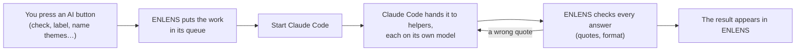

[Manual](../MANUAL.md) › How the AI is used and limited

# How the AI is used and limited

> **In short**
> - The AI reads passages and answers with a quote; ENLENS prepares every task and checks every answer, and your own
>   judgement wins.
> - Which documents it may read is a setting of each document, enforced in code. Which model answers follows the kind
>   of task and your Claude plan.
> - Its answers are model output until you review them: a checked quote proves the words exist, not that the
>   judgement follows.

This page explains the AI's part. How to set up and start Claude Code is in [Claude Code](claude-code.md); the privacy
details are in [Privacy](privacy.md) and, for an ethics application, [PRIVACY.md](../PRIVACY.md); the method is in
[METHODS.md](../METHODS.md#the-ais-part-and-reproducibility).

## Where the AI is used

Most of ENLENS needs no AI: search, key terms, the keyword codes, the glossary and themes by words
([Explore your documents](explore.md)). The AI adds readings on top, each one with a quote: the labels of a codebook's
codes, links between terms, theme names, references ("it", "they"), a check's judgements, reading an excerpt again,
a second opinion, and the [SDG pack](sdg-pack.md)'s tasks. Each starts when you press its button ([below](#how-it-works)).

## How it works

Claude Code answers every kind of AI task: labels of codes, concept links, theme names, references, checks, reading an
excerpt again, second opinions, the model tests, and the [SDG pack](sdg-pack.md)'s tasks. ENLENS never sees your
Claude login (Claude Code uses its own) and never runs on anyone else's plan.

For a shared installation that runs unattended, use the **Claude API** with the team's key instead: the same queue and
the same models per task (`enlens queue run --backend anthropic`).

## What it may read

Every document has a setting: *Claude may read it*, *Only a local AI* or *No AI*. ENLENS enforces it where each task
is made and run, never by an instruction in a prompt, so a task that names a restricted document is not handed to a
model that may not read it. What goes where, and how it is enforced: [Privacy](privacy.md#what-goes-where) and
[How it is enforced](privacy.md#how-it-is-enforced).

## Which model answers

Each kind of task goes to the model that suits it (many quick labels on a small model, judging on a larger one), and an
unsure answer steps up to a stronger model once. A model you choose yourself always comes first. The table, how much
thought each task gets and the mix of local and Claude models: [Which model does what](models.md).

## What keeps it honest

- **Every quote is checked** against the source, word for word. A quote that is not in the text is sent back and is
  never used ([How a check reaches its answer](how-a-check-works.md#what-a-check-does)).
- **Your judgement wins.** You review the AI as you would a co-coder; yours replace its own and always count.
- **Every answer records how it was made**: the model, the prompt version, the route and the ENLENS version. Claude Code
  and the Claude API take no seed, so their answers are not repeatable the way a seeded local model's are
  ([What every answer records](models.md#what-every-answer-records)).
- **ENLENS redoes nothing by itself** when a new version comes: results stay as they were made
  ([Results across versions](models.md#results-across-versions)).

## What it cannot promise

A judgement is model output until you review it; "nothing found" is about the passages read, not your documents; and a
model's certainty is its own estimate, not a measure of being right. These and the other limits, with how to work with
each: [Troubleshooting and limits](troubleshooting.md#limits).

---

Next: [Privacy: what leaves your computer →](privacy.md)
