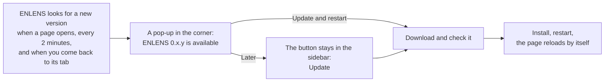

[Manual](../MANUAL.md) › Install and update

# Install and update

> **In short**
> - Paste one line in Terminal (macOS, Linux) or PowerShell (Windows), or download a file and double-click it. No
>   Python, no git and no administrator rights needed.
> - Then press *Set up Claude* on the first screen ([First steps](first-steps.md)).
> - When a new version is out, ENLENS says so and *Update and restart* installs it. Your projects are never touched.

## Install

### The one-line install

| System | Open | Paste this |
| --- | --- | --- |
| macOS, Linux | Terminal | `curl -fsSL https://github.com/dvaud/claim_checker_demo/releases/latest/download/install.sh \| sh` |
| Windows | PowerShell | `powershell -ExecutionPolicy Bypass -c "irm https://github.com/dvaud/claim_checker_demo/releases/latest/download/install.ps1 \| iex"` |

The line says what it does as it goes, in four steps:

1. It gets **uv**, a small installer for Python programs from Astral, unless uv is already there.
2. It downloads the ENLENS package of the latest release and checks it against the release's checksums
   (`SHA256SUMS`).
3. It installs ENLENS with uv, which brings its own Python 3.12 and keeps it apart from any other Python on the
   computer.
4. It makes the **ENLENS icon** and opens ENLENS: on macOS in Applications and on the Desktop, on Windows in the Start
   menu and on the Desktop, on Linux in the applications menu.

The package has everything: the connector for Claude, faster search, the PDF layout reader and the Python parts of
text recognition, so no feature needs a later install. Only the program Tesseract, for scanned PDFs, is separate
([below](#scanned-pdfs-optional)).

Running the same line again installs the newest release over the one you have. Your projects in `~/enlens` stay as
they are. On Windows, quit ENLENS and close Claude Code first: both run programs from ENLENS's folder, which Windows
does not let the install replace. If one still runs, the line names it and waits until it has closed (0.15.5).

**Options** are environment variables placed before `sh`, for example
`curl -fsSL …/install.sh | ENLENS_LOCAL_ONLY=1 sh`. In PowerShell, first type `$env:ENLENS_LOCAL_ONLY = "1"` in the
same window, then the line.

| Option | What it does |
| --- | --- |
| `ENLENS_LOCAL_ONLY=1` | Nothing may leave the computer: no cloud AI at all. Built into the icon. |
| `ENLENS_HOME=<folder>` | Keep projects and settings in another folder. Built into the icon. |
| `ENLENS_VERSION=0.10.0` | Install that release instead of the latest. |

### Or download a file and double-click it

Every release also has the install as a file, for whoever would rather not open Terminal or PowerShell. It does the
same four steps in a window of its own (the options above need the line).

| System | Download | The first time |
| --- | --- | --- |
| Windows | [Install-ENLENS-Windows.cmd](https://github.com/dvaud/claim_checker_demo/releases/latest/download/Install-ENLENS-Windows.cmd) | Double-click it. If the browser warns about the file, keep it. If Windows says it protected your PC, click *More info*, then *Run anyway*. At the end the window waits for a key, so you can read what happened. |
| macOS | [Install-ENLENS-macOS.zip](https://github.com/dvaud/claim_checker_demo/releases/latest/download/Install-ENLENS-macOS.zip) | Open the zip (Safari does it for you) and double-click *Install ENLENS.command*. macOS says it could not verify the file: click *Done*, open *System Settings → Privacy & Security*, scroll to *Security*, click *Open Anyway* next to *Install ENLENS.command* and confirm with your password or Touch ID. Terminal opens and installs ENLENS. |

> [!NOTE]
> Windows and macOS trust a downloaded program at once only when a registered developer has signed it. These files
> are not signed, hence the questions. They are the same install scripts as the line (the Windows file is a few lines
> for the command prompt followed by `install.ps1`, the Mac file is `install.sh`), and the release's `SHA256SUMS`
> lists their checksums. On a Mac the line is quicker, because nothing asks about it. On Linux, use the line.

### Scanned PDFs (optional)

A PDF page without a text layer is a picture of text. ENLENS can read it on your computer with the free program
**Tesseract**. The one-line install already has everything else it needs.

| System | Install Tesseract |
| --- | --- |
| macOS | `brew install tesseract tesseract-lang` |
| Debian, Ubuntu | `sudo apt install tesseract-ocr tesseract-ocr-nld` (one package per language) |
| Windows | the installer the Tesseract project links to (UB Mannheim) |

ENLENS finds Tesseract where these installers put it, even when that folder is not on the PATH (Homebrew's folder
when ENLENS is started from its icon, `C:\Program Files\Tesseract-OCR` on Windows), and notices a new installation
within a minute. Choose the languages in *Settings → Documents* (`eng+nld` for English and Dutch).

Text recognition runs one page at a time, at low priority and on one processor thread, so a local model working at
the same time is not slowed down. Without Tesseract, a scanned PDF is listed as *Scanned: no text*, and the app says
how to get Tesseract on your system (after you add the document, and in *Settings → Documents*).

### Installing it for someone else

Run the install line on **their** account, so the icon and the data folder are theirs. Put `ENLENS_LOCAL_ONLY=1`
before `sh` to remove every option that sends text off the computer. Scanned PDFs also need Tesseract (above).
[Settings → For whoever installs ENLENS](settings.md#for-whoever-installs-enlens) has the rest.

### From a git copy (developers)

With Python 3.10 or newer, in a clone of the repository:

```bash
pip install -e '.[connector]'    # the app, the command line and the connector (recommended)
pip install -e .                 # core only: the app and the command line
pip install -e '.[fast]'         # numpy: faster search by meaning on large projects
pip install -e '.[pdfminer]'     # the PDF layout reader (columns, tables)
pip install -e '.[anthropic]'    # the Claude API (cloud, opt-in)
pip install -e '.[ocr]'          # scanned PDFs on this computer (also needs Tesseract, above)
pip install -e '.[dev]'          # pytest
```

Then give yourself an icon with `enlens-gui --make-launcher` ([below](#the-enlens-icon)), and check the install with
`pytest` (about 15 seconds, no network). [DEVELOPING.md](../DEVELOPING.md) has the rest.

The programs are `enlens-gui` (the app), `enlens` (the [command line](command-line.md); also
`python -m enlens_claims`) and `enlens-mcp` (the [connector](claude-code.md#claude-in-a-chat-the-connector)).

## Update



**In the app.** ENLENS looks for the latest release (or, for a git copy, new commits) when a page opens, every two
minutes after, and when you come back to its tab. When there is a new version, a pop-up in the corner names it (*ENLENS
0.15.5 is available*), with *Update and restart* and *Later*, and an *Update* button takes the place of *Quit* at the
foot of the sidebar. *Later* puts the pop-up away for that version; the button stays until you update.

*Update and restart* installs the new version and restarts ENLENS on the same address. The open page shows
*Starting ENLENS …* and opens the new version by itself; started from the icon, ENLENS restarts the same way without
a new browser tab. Anything still running (a check, documents being added) stops first, and the dialog says so. If
the update fails, the reason is shown and nothing restarts.

**On Windows**, where a running program's files cannot be replaced, *Update and restart* downloads and checks the new
version, closes ENLENS, installs it and opens ENLENS again: the page says *Installing ENLENS …* and follows in a
minute or two. This works from 0.15.4 on; the update *to* 0.15.4 is still made by hand (quit ENLENS and run the
install line). If the install cannot finish, ENLENS opens again as it was, with a note in the corner saying why. Most
often Claude Code still had ENLENS connected, which holds its files: close Claude Code, then press *Update* again.
The details are in `logs/update.log` in the data folder. If ENLENS cannot open at all after an update, a PowerShell
window opens by itself and installs it again.

**Looking yourself.** *Settings → Technical → Updates → Check for updates* looks now and says why a look failed (the
version at the top right of every Settings tab opens it). Looks that fail (offline, files of a git copy edited by
hand) otherwise stay quiet. A look never waits for a password and gives up after 90 seconds. ENLENS reads the newest
version from GitHub's release page, which GitHub's limit of 60 questions an hour does not count, so several
computers in one office can all look every two minutes.

**In a terminal**, `enlens update` does the same, the way ENLENS was installed (`enlens update --check` only looks):

| Installed with | What `enlens update` does |
| --- | --- |
| The one-line install | Asks GitHub for the latest release, downloads its package, checks it against the checksums, installs it with uv, and brings the Claude Code plugin up to date (also Claude Code's own copy, so the next run uses the new instructions). On Windows it says to press *Update* in the app, or to quit ENLENS, close Claude Code and run the install line again (or a newly downloaded `Install-ENLENS-Windows.cmd`). |
| A git copy | Fetches the new version into the same folder, reinstalls into the same Python only when the requirements changed (with the extras you have), refreshes the Claude Code plugin, and says to restart the app if it runs. If installing the requirements fails (offline), the next `enlens update` installs them. It changes nothing when files of the copy were edited by hand. |

Either way, the data folder is never touched. The version you have is at the top of every *Settings* tab, and
*Settings → Technical* says how this copy was installed.

## The ENLENS icon

The one-line install makes it. From a git copy, run this once as the person who will use the app:

```bash
enlens-gui --make-launcher        # add --home FOLDER and/or --local-only if the app is used that way
```

It puts an **ENLENS** icon on the Desktop, and also in Applications (macOS), the Start menu (Windows) or the
applications menu (Linux). On Linux desktops that ask for it, right-click the icon and choose *Allow launching* once.

- **Double-click** starts ENLENS in the background, without a terminal window, and opens it in the browser.
  Double-clicking it again while ENLENS runs just opens it again.
- **After an update**, the copy still running is the old version. The icon quits it and starts the new one, unless a
  check or documents being added still run in it: then every page says *ENLENS X is installed, but Y is still
  running*, with *Restart now*.
- If your AI is Ollama on this computer and Ollama is not running, the icon starts it too.
- **Quit** at the foot of the sidebar (with an update ready, in *Settings → Technical*) stops it (it asks first when
  a check is still running). What ENLENS would print goes to `logs/enlens.log` in the data folder.

The icon calls the Python ENLENS was installed in, so another `enlens-gui` earlier on the PATH (an old one in
Anaconda, say) cannot get in the way.
