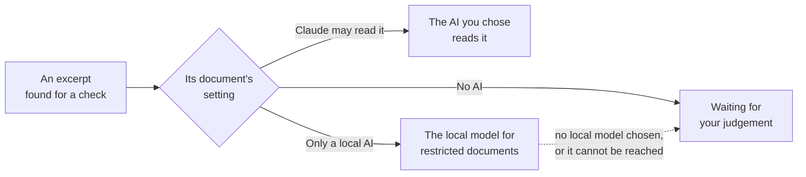

[Manual](../MANUAL.md) › Privacy

# Privacy: what leaves your computer

> **In short**
> - Your documents, results and reviews stay on your computer. With Claude Code (the default), only the passages
>   inside the AI's tasks are sent to Anthropic, on your own Claude plan.
> - Every document has a setting: *Claude may read it*, *Only a local AI*, or *No AI*. ENLENS enforces it in code.
> - ENLENS records every passage it sends to Claude, and you can download that list.

## What goes where

| Where it goes | What |
| --- | --- |
| **Stays on your computer** | Projects (plain folders with one SQLite database each) and settings, in `~/enlens` or `ENLENS_HOME`. The documents themselves, your judgements, notes, highlights, the research log and reviews. They go to a colleague only inside a project zip you send yourself ([Work together](together.md)), and never to the AI. |
| **To Anthropic, on your Claude plan** | With Claude Code: only the passages inside the tasks it takes, from documents Claude may read. ENLENS never sees your Claude login. |
| **To Anthropic, on a team key** | With the Claude API, only after *Allow cloud models* is switched on (or `--backend anthropic` on the command line): the hypothesis and the passages read. |
| **Into your chat** | With the [connector](claude-code.md#claude-in-a-chat-the-connector): the passages shown to Claude are part of your chat. |
| **Nowhere** | With a model on this computer, every word stays on it. |

Apart from the AI you chose, ENLENS itself goes online only to look for a new version on GitHub, and, when you ask for
them, to get Claude Code or a local model. There is no telemetry. The app is a small server on `127.0.0.1` with a token
per run, and the page loads nothing from the internet (no CDN, fonts or analytics). Bringing in a colleague's work reads
the file on this computer and sends nothing. Zotero is only read (never changed), through the Zotero app on this
computer and never through Zotero's servers, and nothing about your works is sent to Claude.

Whoever installs ENLENS can remove every cloud option for good (`--local-only`,
[Settings](settings.md#for-whoever-installs-enlens)).

## Who may read each document with AI

One project can mix documents Claude may read with documents that must stay on the computer: a licensed PDF, an
interview transcript.

| Setting | Who may read its text |
| --- | --- |
| *Claude may read it* | The AI you chose: Claude Code, the Claude API, or a local model. |
| *Only a local AI* | A model server on this computer, or you. |
| *No AI* | You only. Search, the keyword Profile, Concepts and Themes without AI still work. |

> [!IMPORTANT]
> Documents you mark as local stay on this computer. ENLENS never sends their text to Claude, in any feature, and
> shows you how much of every other document it has sent.

**Where you set it.**

- **When you add documents**, the page asks *Who may read these documents with AI?*; one answer covers everything
  added at once. The first answer in a new project becomes its default (nothing is preselected the first time); later
  the default is preselected.
- **On the Documents page**, the *AI* column has a small dropdown per document; tick several documents to change them
  together. A note (*Why*, for example "publisher licence") is kept with the document and exported with the project;
  it changes nothing.
- **For large corpora**, a `manifest.csv` may have `ai_access` (`cloud`, `local` or `none`) and `ai_note` columns.

Projects made before 0.11 keep *Claude may read it* for every document until you change it; a project zip made before
0.11 asks once when it is imported. On an installation without cloud models the default is *Only a local AI*, and
Claude is not offered.

### What happens in each feature

Finding passages is unchanged: every document competes in every check. Only the **reading** is split:

- **In a check**, the round stays one round and each excerpt says who read it. The answer counts every excerpt that
  was judged: the AI's, the local model's and yours. An excerpt waiting for your judgement counts once you judge it;
  until then the answer rests on the others, and when every excerpt waits for you, it is *Waiting for your judgement*.
- **When the AI's own answers failed**, the check *did not work*, whatever the local model read, and none of that
  search's AI judgements count anywhere (Excel marks them *Not counted: the check did not work*).
- **The AI's written note** speaks only for the excerpts it read, and is told how many others there are. The check's
  summary is always the main model's, never the local model's.
- **Every other AI task** (a second opinion, reading an excerpt again, the Profile's AI pass, theme names, concept
  links, references) takes the setting of the most restricted document it touches. A theme whose passages are all
  restricted is named by the local model or keeps its key terms; two concepts found only in restricted documents are
  linked by the local model or not at all.
- **A check started in a Claude chat** (the connector) shows Claude only the excerpts it may read; the result page then
  offers *Read them now on this computer* for the local ones. When the main model runs on this computer, it also
  reads the excerpts marked *Only a local AI*, so its summary and notes are left out of a Claude chat (the connector
  says so).
- **When the local model's answers cannot be used** (three tries), the result says so and shows those excerpts without
  a judgement. *Read them again on this computer* tries once more (after choosing another local model, say), or you
  judge them yourself.
- **Search by meaning**: an embedding server on another computer receives neither the restricted passages (they are
  found by their words) nor glossary terms found only in them.

### The local model and your computer's memory

While Claude reads its excerpts, the progress says when your local model reads the ones marked *Only a local AI*:
*Your local model (…) is reading 3 excerpts…*, with what it is doing and *Stop*.

A local model needs about as much memory as its size (a 9-billion-parameter model about 8 GB). On Ollama, ENLENS does
not start it when this computer clearly has too little free: starting it anyway pushes every other program into swap
and can all but freeze the computer. The check then finishes with the rest, the progress says why, and those excerpts
wait on the result (*Waiting for your local model*). Close programs you do not need and press *Read them now on this
computer*, or choose a smaller local model in *Settings → AI*. If it still says too little is free, *Start it anyway*
starts it regardless.

A model that takes more than a third of this computer's memory is let go as soon as it has read, instead of being
kept for 15 minutes. A local model you chose as the **main** AI is not checked this way: you start it yourself and see
it load.

## What Claude has read

ENLENS writes down every passage at the moment it leaves for Claude (Claude Code, the Claude API, a Claude chat through
the connector).

- The column *Sent to Claude* on the Documents page shows the share of each document's text; click it for the
  passages, when, and for which feature.
- *Settings → Technical → What was sent to Claude* downloads the whole list (CSV), for example for a data management
  plan. For a project made before 0.11 the list starts with the results ENLENS recorded then.
- Changing a document to *Only a local AI* applies to everything not yet answered; what Claude already read stays in
  the results and the list. Removing a document takes its passages out of everything still waiting for Claude Code.
  A check that was waiting for Claude Code when a document's setting changed stops waiting and says so: its excerpts
  are then for the local model or for you.

**A cap.** In a document's dialog you can set *Claude may read at most N %*. Once Claude has read that much, its
further passages are treated as *Only a local AI*. It is checked when tasks are made, so a check that is running can
go over by one round of excerpts.

## How it is enforced

In code, where every AI task is made and run, never by an instruction in a prompt:

- each task is labelled with the most restricted setting of the documents it names;
- a task is refused before any model is asked when its setting does not allow that model;
- the queue for Claude Code only ever hands out tasks Claude may read;
- the connector's tools (search, concepts, document profiles, checks) give Claude counts instead of restricted text,
  leave out what a model wrote in its own words when it read restricted text, and show a document marked *No AI* as
  *Restricted document 3*, because a title can name a person;
- a project zip holds the files of the documents the project has now, not those of documents you removed.

**The Claude Code run that ENLENS starts works in a box of its own.** It starts in an empty folder, away from the
projects' databases, and has no tool that reads, writes or searches files, runs commands or browses: only the one that
starts its helpers. It takes nothing from your own Claude Code either (not your settings, hooks or `CLAUDE.md`
instructions, not your other plugins or your claude.ai connectors) and loads only ENLENS's plugin. So all it can see
are the passages ENLENS puts in its tasks. The sign-in window ENLENS opens also starts in an empty folder without
those tools.

The Claude Code options behind this

These are options of Claude Code itself (`--tools`, `--restricted`, `--plugin-dir`), used when your Claude Code knows
them; an older Claude Code is only denied the file, shell and web tools by name.

## Your Claude account and licences

*Set up Claude* and *Settings → AI* show **What happens to the text Claude reads**:

| Plan | Terms |
| --- | --- |
| Personal (Pro, Max) | Consumer terms. Anthropic may use your sessions for training when the account's model-improvement setting is on: turn it off at claude.ai/settings/data-privacy-controls before Claude reads licensed documents. |
| Team, Enterprise, the Claude API | Commercial terms. |

The panel cites Anthropic's data-usage page and the date it was checked; that page is the authority. Documents that
must stay in the EU: mark them *Only a local AI*.

> [!CAUTION]
> For paywalled literature, check with your library whether your licences allow text and data mining with an outside
> service, or keep those documents to a local model.

---

Next: [Claude Code →](claude-code.md)
