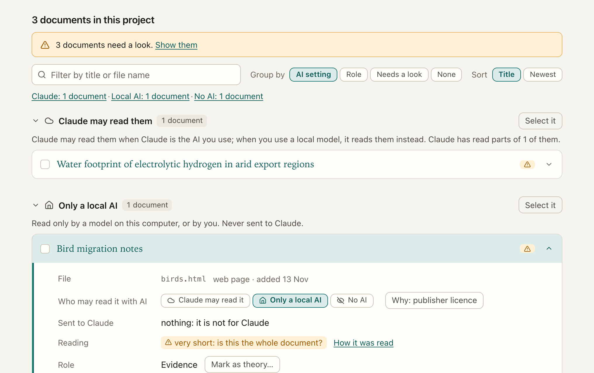
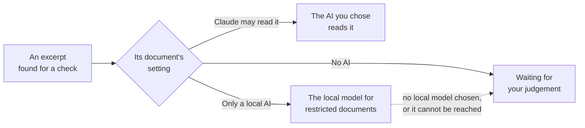

[Manual](../MANUAL.md) › Privacy

# Privacy: what leaves your computer

> **In short**
> - Your documents, results and reviews stay on your computer. With Claude Code (the default), only the passages
>   inside the AI's tasks are sent to Anthropic, on your own Claude plan.
> - Every document has a setting: *Claude may read it*, *Only a local AI*, or *No AI*. ENLENS enforces it in code.
> - ENLENS records every passage it sends to Claude, and you can download that list.
> - Working together, only what you share goes to colleagues, with the documents (0.17.0): never your private work.

## What goes where

| Where it goes | What |
| --- | --- |
| **Stays on your computer** | Projects (plain folders with one SQLite database each) and settings, in `~/enlens` or `ENLENS_HOME`. The documents themselves, your judgements, notes, highlights, the research log and reviews. They go to a colleague only as you choose: a project zip you send yourself, or a folder your team shares ([Working together](#working-together)); never to the AI. |
| **To a folder your team shares** (0.17.0) | Only once you choose one for a project: the documents' text and files, and what you shared of your own work. Your cloud service or network drive carries it from there ([Working together](#working-together)). |
| **To Anthropic, on your Claude plan** | With Claude Code: only the passages inside the tasks it takes, from documents Claude may read. ENLENS never sees your Claude login. |
| **To Anthropic, on a team key** | With the Claude API, only after *Allow cloud models* is switched on (or `--backend anthropic` on the command line): the hypothesis and the passages read. |
| **Into your chat** | With the [connector](claude-code.md#claude-in-a-chat-the-connector): the passages shown to Claude are part of your chat. |
| **Nowhere** | With a model on this computer, every word stays on it. |

Apart from the AI you chose, ENLENS itself goes online only to look for a new version on GitHub, and, when you ask for
them, to get Claude Code or a local model. There is no telemetry. The app is a small server on `127.0.0.1` with a key
(an access token) per run, and the page loads nothing from the internet (no CDN, fonts or analytics). Bringing in a colleague's work reads
the file on this computer and sends nothing. A shared folder is written and read on this computer too: ENLENS itself
sends nothing for it, and your cloud service or network drive carries what is in it. Zotero is only read (never
changed), through the Zotero app on this computer and never through Zotero's servers, and nothing about your works is
sent to Claude.

**Who can open ENLENS on this computer.** Only you. Since 0.17.2 the page itself carries no key, so another account
on a shared computer cannot use ENLENS by opening its address. The ENLENS icon (or `enlens-gui`) opens a link with the
key after `#`; the browser keeps it for that tab only and takes it out of the address bar. ENLENS also keeps the key
in a file that only your account can read (`app-token-<port>.json` in the data folder), so the icon can open the copy
already running. On Windows that file is protected by your user folder, which other accounts cannot read; with a data
folder outside it (on another drive, say) the file goes to your `AppData\Local\ENLENS` instead. Your projects in such
a folder are only as private as the folder: keep the data folder in your user folder (the default) if other people
sign in to the same computer. The address on its own, or a bookmark of it,
shows *Open ENLENS from its icon*. *Settings → Technical → Your link to ENLENS* copies the link with the key: whoever
has it can open ENLENS while it runs, so keep it to yourself.

Whoever installs ENLENS can remove every cloud option for good (`--local-only`,
[Settings](settings.md#for-whoever-installs-enlens)).

## Who may read each document with AI

One project can mix documents Claude may read with documents that must stay on the computer: a licensed PDF, an
interview transcript.

| Setting | Who may read its text |
| --- | --- |
| *Claude may read it* | The AI you chose: Claude Code, the Claude API, or a local model. |
| *Only a local AI* | A model server on this computer, or you. |
| *No AI* | You only. Search, the keyword codes, Concepts and Themes without AI still work. |

> [!IMPORTANT]
> Documents you mark as local stay on this computer. ENLENS never sends their text to Claude, in any feature, and
> shows you how much of every other document it has sent.

**Where you set it.**

- **When you add documents**, the page asks *Who may read these documents with AI?*; one answer covers everything
  added at once. The first answer in a new project becomes its default (nothing is preselected the first time); later
  the default is preselected.
- **On the Documents page**, the *AI* column has a small dropdown per document; tick several documents to change them
  together. A note (*Why*, for example "publisher licence") is kept with the document and exported with the project;
  it changes nothing.
- **For large corpora**, a `manifest.csv` may have `ai_access` (`cloud`, `local` or `none`) and `ai_note` columns.

Projects made before 0.11 keep *Claude may read it* for every document until you change it; a project zip made before
0.11 asks once when it is imported. On an installation without cloud models the default is *Only a local AI*, and
Claude is not offered.

### What happens in each feature

Finding passages is unchanged: every document competes in every check. Only the **reading** is split:

- **In a check**, the round stays one round and each excerpt says who read it. The answer counts every excerpt that
  was judged: the AI's, the local model's and yours. An excerpt waiting for your judgement counts once you judge it;
  until then the answer rests on the others, and when every excerpt waits for you, it is *Waiting for your judgement*.
- **When the AI's own answers failed**, the check *did not work*, whatever the local model read, and none of that
  search's AI judgements count anywhere (Excel marks them *Not counted: the check did not work*).
- **The AI's written note** speaks only for the excerpts it read, and is told how many others there are. The check's
  summary is always the main model's, never the local model's.
- **Every other AI task** (a second opinion, reading an excerpt again, the AI pass of *Codes*, theme names, concept
  links, references) takes the setting of the most restricted document it touches. A theme whose passages are all
  restricted is named by the local model or keeps its key terms; two concepts found only in restricted documents are
  linked by the local model or not at all.
- **A check started in a Claude chat** (the connector) shows Claude only the excerpts it may read; the result page then
  offers *Read them now on this computer* for the local ones. When the main model runs on this computer, it also
  reads the excerpts marked *Only a local AI*, so its summary and notes are left out of a Claude chat (the connector
  says so).
- **When the local model's answers cannot be used** (three tries), the result says so and shows those excerpts without
  a judgement. *Read them again on this computer* tries once more (after choosing another local model, say), or you
  judge them yourself.
- **Search by meaning**: an embedding server on another computer receives neither the restricted passages (they are
  found by their words) nor glossary terms found only in them.

### The local model and your computer's memory

While Claude reads its excerpts, the progress says when your local model reads the ones marked *Only a local AI*:
*Your local model (…) is reading 3 excerpts…*, with what it is doing and *Stop*.

A local model needs about as much memory as its size (a 9-billion-parameter model about 8 GB). On Ollama, ENLENS does
not start it when this computer clearly has too little free: starting it anyway pushes every other program into swap
and can all but freeze the computer. The check then finishes with the rest, the progress says why, and those excerpts
wait on the result (*Waiting for your local model*). Close programs you do not need and press *Read them now on this
computer*, or choose a smaller local model in *Settings → AI*. If it still says too little is free, *Start it anyway*
starts it regardless.

A model that takes more than a third of this computer's memory is let go as soon as it has read, instead of being
kept for 15 minutes. A local model you chose as the **main** AI is not checked this way: you start it yourself and see
it load.

## What Claude has read

ENLENS writes down every passage at the moment it leaves for Claude (Claude Code, the Claude API, a Claude chat through
the connector).

- The column *Sent to Claude* on the Documents page shows the share of each document's text; click it for the
  passages, when, and for which feature.
- *Settings → Technical → What was sent to Claude* downloads the whole list (CSV), for example for a data management
  plan. For a project made before 0.11 the list starts with the results ENLENS recorded then.
- Changing a document to *Only a local AI* applies to everything not yet answered; what Claude already read stays in
  the results and the list. Removing a document takes its passages out of everything still waiting for Claude Code.
  A check that was waiting for Claude Code when a document's setting changed stops waiting and says so: its excerpts
  are then for the local model or for you.

**A cap.** In a document's dialog you can set *Claude may read at most N %*. Once Claude has read that much, its
further passages are treated as *Only a local AI*. It is checked when tasks are made, so a check that is running can
go over by one round of excerpts.

## Working together

Nothing of yours goes to a colleague until you send it: in a file you send yourself, or through a folder your team
shares that you chose for the project (0.17.0; [Work together](together.md#through-a-shared-folder)). ENLENS writes into
that folder on this computer; your cloud service (OneDrive, Dropbox) or your network drive then carries it, under your
institution's terms.

### What goes into the shared folder

- **What you shared**, and nothing else of your own work: the checks, sets of themes, codebooks, notes and highlights,
  entries of your own and links between terms you pressed *Share* on, whole, and again whenever they change. A shared
  check carries the words its excerpts quote, the judgements on them under each person's name, and the AI's answers.
- **What belongs to the project:** the documents' text and original files (once for the whole team), who may read each
  with AI, the bibliography (without where its attachments are on your computer), the AI's work on the documents and
  people's reviews of it, the entries ENLENS writes in the research log about the documents, the proposals to the
  project's owner and Co-owners with their answers, and who holds which role. Also your name, your ENLENS version and the project's name, so colleagues
  know whose work is whose.
- **With the switch *Keep documents marked Only a local AI or No AI out of the shared folder* on**, those documents'
  text and files stay on your computer, with the AI's work on them and the passages of them a check handed to the AI.
  Your shared items still carry what you shared about them: **the words their excerpts quote, your notes on them, the
  judgements, and the documents' titles** (colleagues need the title to know which file to add). To keep such a
  document's words out of the folder altogether, do not share the checks or notes that quote it. Once anyone in the
  team turns the switch on, it holds in every copy.

### What never goes there

Your private items, and a colleague's private item that reached you in their whole-project zip. Nor does a check still
being worked on (it goes once it is done), the earlier versions you keep (*History*), your search index and glossary,
your settings, the project's database itself, or any path on your computer. Before it writes, ENLENS checks what it is
about to write: a round that would carry anything you have not shared writes nothing. It also refuses a shared folder
that holds the project or ENLENS's own folder, since the cloud service would then copy your whole database to the team.

### Who can read the folder

Anyone who has access to it, as with any other file there: your colleagues, and whoever your institution's storage
lets in. The files are ordinary zip files, not encrypted, and not signed: someone else who can write in the folder
could still write in a colleague's name. What that can no longer do: send a document to a cloud AI from your computer
without your click (a looser setting is only ever offered to you), remove a document for good (a removal can be
restored for 30 days), or make someone else the owner for you without being seen (it waits for your word). It cannot
act under your own name in your copy either: it is refused and the Team tab says so. Share the folder only with your
team, and use storage your institution approves for the documents you hold: a folder on the institution's OneDrive or
network drive keeps them within its storage.

### Stopping

- **Unshare** an item: it stops going, and at the next round it leaves your part of the folder (and what a colleague's
  copy wrote of it). Colleagues who already brought it in keep it, marked as withdrawn, and it reaches nobody else
  through them. A shared check or set of themes you remove is treated the same way.
- **Turn the switch on later**: at the next round, what your copy had written of the documents it keeps out leaves the
  folder. What a colleague already brought into their project stays with them.
- **Stop using this folder** (on the Team page): your copy stops writing and reading there. It removes nothing from the
  folder, so unshare first what should leave it.
- **A document removed from the project** leaves every copy, but not yet the folder: its reading and its file stay
  there, where anyone with access to the folder can still open them (to be fixed in a later release). The exception
  is a document marked *Only a local AI* or *No AI* while the switch above is on: what your copy wrote of it leaves
  the folder at the next round, also after you removed it.
- A cloud service may keep earlier versions of files, or deleted ones, for a while (its version history or bin):
  something taken out of the folder may still be there for a time.

### Through a storage space of your team's own (0.18.0rc2)

A storage space (at Backblaze or Cloudflare; [Work together](storage-space.md))
holds the same things as a shared folder, with three differences:

- **Everything is locked before it leaves your computer.** Each file is encrypted with the project's key (AES-256-GCM)
  and signed with your own key (Ed25519). The project's key travels only inside an invite link, after its `#`, and to
  each member sealed with their own key; the storage company never holds it. It sees how many files there are, how
  large they are and when they change, nothing of what is in them: no text, no names of people or documents (a
  document's reading and file are stored under a name made from a key the company does not have).
- **A file in someone else's name is set aside.** Your copy takes a file only when it is signed by the member whose
  part of the space it is in, as the list of members signed by the space's keeper (the owner) says. A file anyone else
  put there never comes into your project; the *Team* tab lists it. At Backblaze, each colleague's key can write only
  in their own part in the first place.
- **Removing a colleague** deletes their keys to the space, so they can no longer read or write it, and replaces the
  project's key for those who stay: what is written afterwards does not open for them. What they already had stays
  with them, as with *Unshare*.

The keys (the project's, your own, the space's) are kept in this computer's keychain (on a computer without one, in a
file in ENLENS's folder that only you can read), never in the project, a zip or the space. The space is never the
only copy of anything: every copy holds the whole project, so a space lost or deleted loses nothing (*Move to another
storage space*). Deleting files in the space takes a day to be final at Backblaze (it keeps only the latest version of
each file, and a deleted one for a day).

### The owner and who may read with AI

In a project with an owner ([Work together](together.md#the-owner-and-proposals-0170)):

- **Stricter, at once.** Anyone may make a document stricter (*Only a local AI*, *No AI*): it holds in every copy at
  once, and is never a proposal.
- **Looser, only with your own click.** Letting more AI read a document is for the owner and the Co-owners to decide.
  A Member's looser setting takes effect nowhere, not even in their own copy, until one of them accepts it. And even
  then, nothing loosens on your computer by itself, whoever wrote it and whatever a file says: your Team tab offers it
  (*Allow here* or *Keep it stricter here*, with a tick box for each document) and a document you leave alone stays
  stricter here. When the switch keeps the document out of the shared folder, accepting asks first: its text and
  file then go into the folder too.
- **Co-owners** change the documents' settings for everyone, as the owner does: a Co-owner's stricter setting holds
  at once, and a looser one reaches other copies as an offer.

A project without an owner keeps the stricter setting of the copies, as before 0.17.0.

### Files instead of the folder

*Send what you shared* gives a colleague the documents and what you shared, and nothing private: not even in parts of
the file a program could still read after a deletion, nor where your documents' files are on your computer. *Download
the whole project* is for moving the project to another computer of yours: it holds your private work too, and says
whose each item is, so a colleague's private item that reaches you this way stays theirs and is never passed on from
your copy. A colleague who opened it with ENLENS 0.17.0rc5 or earlier would see all of it, so ENLENS asks before it
downloads. Bringing in a colleague's file reads it on this computer and sends nothing.

### Moving to another computer

*Move ENLENS to another computer* makes a file with your projects and, if you choose, your settings
([Work together](together.md#moving-to-another-computer)). It stays on your computers, and it always asks what you are
doing before anything is imported. An address of another computer's server (for what ENLENS reads, or for text
recognition) is never taken silently: each one that is not on the new computer has its own tick box, off, and a back
end left without its address goes back to its default. A saved Claude API key is never in the file. A document removed
by a colleague's word is kept aside on your computer for 30 days, so it can be restored; it is not in a zip, and then
it is deleted.

## How it is enforced

In code, where every AI task is made and run, never by an instruction in a prompt:

- each task is labelled with the most restricted setting of the documents it names;
- a task is refused before any model is asked when its setting does not allow that model;
- the queue for Claude Code only ever hands out tasks Claude may read;
- the connector's tools (search, concepts, document profiles, checks) give Claude counts instead of restricted text,
  leave out what a model wrote in its own words when it read restricted text, and show a document marked *No AI* as
  *Restricted document 3*, because a title can name a person;
- a project zip holds the files of the documents the project has now, not those of documents you removed;
- a zip for a colleague and the shared folder read what each shared item covers from one place, so the two can never
  disagree about what is private, and a round that would write anything not shared writes nothing (0.17.0).

**The Claude Code run that ENLENS starts works in a box of its own.** It starts in an empty folder, away from the
projects' databases, and has no tool that reads, writes or searches files, runs commands or browses: only the one that
starts its helpers. It takes nothing from your own Claude Code either (not your settings, hooks or `CLAUDE.md`
instructions, not your other plugins or your claude.ai connectors) and loads only ENLENS's plugin. So all it can see
are the passages ENLENS puts in its tasks. The sign-in window ENLENS opens also starts in an empty folder without
those tools.

The Claude Code options behind this

These are options of Claude Code itself (`--tools`, `--restricted`, `--plugin-dir`), used when your Claude Code knows
them; an older Claude Code is only denied the file, shell and web tools by name.

## Your Claude account and licences

*Set up Claude* and *Settings → AI* show **What happens to the text Claude reads**:

| Plan | Terms |
| --- | --- |
| Personal (Pro, Max) | Consumer terms. Anthropic may use your sessions for training when the account's model-improvement setting is on: turn it off at claude.ai/settings/data-privacy-controls before Claude reads licensed documents. |
| Team, Enterprise, the Claude API | Commercial terms. |

The panel cites Anthropic's data-usage page and the date it was checked; that page is the authority. Documents that
must stay in the EU: mark them *Only a local AI*.

> [!CAUTION]
> For paywalled literature, check with your library whether your licences allow text and data mining with an outside
> service, or keep those documents to a local model.

---

Next: [Claude Code →](claude-code.md)
