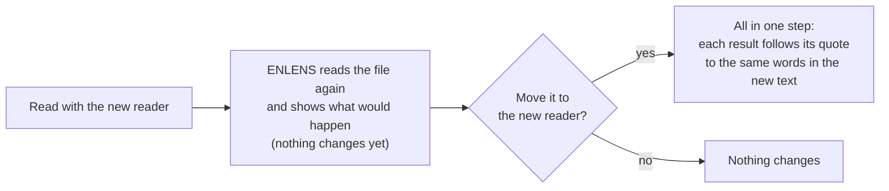

[Manual](../MANUAL.md) › Look at how a document was read

# Look at how a document was read

> **In short**
> - The reading view shows each document the way it was read: what counts, and what was left out. *Leave out* and
>   *Restore* put it right.
> - The *Reading* panel says how well it was read and what to look at; *Checked: it reads well enough* clears the mark.
> - A document read by an older reader can be moved to the newest, one at a time or many at once; every result follows
>   its quote.
> - How a file becomes text, and what each reader changed: [How documents are read](how-documents-are-read.md).

## What the reader does

The reader decides what counts as the document's own text. A PDF is read by its layout (columns, tables, figures),
running heads, page numbers, author details, notes and the reference list are set aside, broken words are repaired,
and a passage is a paragraph. Text files and books are read by rules on the text alone; Word files and web pages with
the same repairs. All of it, reader by reader: [How documents are read](how-documents-are-read.md#what-the-reader-does).

> [!TIP]
> If you have the PDF of a text file, add the PDF instead: it reads better. The *Reading* panel says when a text
> file looks copied out of a PDF, when many of its words still run together, and when a PDF was read without its
> layout (a git copy gets the layout reader at its next `enlens update`).

## The reading view

A document's page shows its text the way the reader found it: headings, paragraphs, captions and tables, a mark where
each page begins, and what was set aside folded under *Left out of the text* on each page. Point at a block, and under
where it is cited you get:

| Button | What it does |
| --- | --- |
| **Leave out** | Searches, codes, themes and checks will not read this block. It greys and folds away into the line *Left out of the text*, which lights up for a moment. |
| **Restore** | They will read it again. |
| **All like this** | On a short block that comes back (a running head, a page number): leaves out, or restores, every block that looks the same, numbers aside. One click for a running head on every page. |
| **Text starts here** | On a block in the first third: leaves out everything before it (a book's title pages). *Undo start* takes it back. |
| **Text ends here** | On a block in the last third: leaves out everything after it (notes, bibliography, index). *Undo end* takes it back. |
| **Excel** | On a table: downloads it. |

**A figure** (reader 5) shows its picture in the text, where it stands on the page: drawn from the original PDF when
it is shown, never stored. Beneath it are its caption and **Open the page**, which opens the *Page* panel at its page;
the words inside it, if any, are under a small fold *Words in the figure*. A figure is never read by searches, codes,
themes or checks, so it has no *Leave out* or *Restore*. A picture of a Word file or web page, or one whose PDF is no
longer there, shows only its alternative text or its words, folded under *Left out of the text* as before.

A heading goes with the text under it, and short paragraphs that share a passage go together. Your choice is kept by
the block's words, so it holds when the document is read again; *restored by you*, *left out by you* or *the text
starts here (you said)* stands beside the block. A block you restore before the start or after the end still counts.
Changing what counts makes keyword codes, key terms and themes out of date, as adding a document does.

**Reading** (a panel beside the text) says how well the document was read: *Read well*, *Read, with something to
check* or *Read badly*, with the reasons (pages without text, text recognised from scanned pages, a garbled text
layer, most of the text set aside), how many pages had columns, what was repaired, the tables found, and how many of
its passages the features read. *Show what was left out in the text* unfolds everything set aside.

The list of documents marks the ones that need a look (*something to check in its reading*, *read badly*). Each reason
in the *Reading* panel takes you to what it is about: **Look at the pages** opens the *Page* panel, **Show what was
left out** unfolds the text set aside. When you have looked and the text is good enough for your work, choose
**Checked: it reads well enough**: the mark in the list goes away, and the panel says who checked it and when (*Undo*
takes it back). A new reading of the document asks again.

**Page** (beside the text, for PDFs, with the OCR extra the one-line install has) shows the page of the original PDF
with every block the reader found outlined: solid for what counts, dashed for what was left out. It follows the text
as you scroll; click an outline to go to that block.

## Read with the new reader

A document read by an older reader keeps that reading, and the list of documents marks it (*read before 0.15*, or
*read by an earlier reader*). Its *Reading* panel offers **Read with the new reader** (the mark in the list opens it
with the preview already started). It is offered only where the new reader can change the reading: a PDF or web page
read by reader 3 was not offered reader 4, and a plain text file read by reader 4 is not offered reader 5, as each
would read the same. Reader 5 changes PDFs with ruled tables, tables over two pages or figures, and Word files and web
pages with pictures; the preview says what would change.

The preview says how many of your results (a check's judgements and yours, codes and your reviews of them, themes,
references) find their place in the new text, and which do not. **Move it to the new reader** then does it in one
step, or not at all:

- each result follows its quote to the same words in the new text, and a check keeps the excerpt it showed;
- keyword codes, key terms and the document's search index are made again;
- work still waiting for the AI about it is asked again;
- a set of themes is marked out of date where its passages changed;
- what cannot be placed is kept without a place in the text and listed (its check marks it *no place in the new
  reading*).

It needs the original file, unchanged, and no task of the document out with Claude Code. While other work of the
project runs (documents being added, a round of the shared folder), it waits its turn: *Queued: starts when … has
finished*, with *Cancel* (0.17.0). In a project shared with colleagues the document stays one document: each copy keeps
the reading it has, and a colleague's results are placed on yours by their words (0.17.0). In a project with an owner, a
colleague's move is a proposal; once the owner accepts it, every copy moves
([Work together](together.md#the-owner-and-proposals-0170)).

**Several at once.** Above the list of documents, **Read all with the new reader** (or *Read the selected with the new
reader*, when you tick some) first checks them, with nothing changed (0.18.0rc2): each file is read again, and ENLENS
says beforehand how many documents move cleanly (every result finds its place) and how many results would lose
their place, in which documents. Then you choose:

- **Move the ones that move cleanly.** The others are left as they were.
- **Review the results without a place.** One list of all of them, grouped by document, each with its quote and what
  it belongs to. **Move anyway** moves those documents as well: such a result is kept as a record that points at no
  words in the text (as when you move one document from its own page), and the move is written in the research log.
- **Review next** opens the documents that would lose results one at a time, each at its *Reading* preview.

A document that cannot be read again now (its file is missing or changed, or Claude Code is working on it) is listed
with the reason and left as it was. When the move ends, one line says how many documents moved and how many results
went with them, and a short table lists the documents with results that have no place (with *Review*). You can work on
meanwhile, or stop it: documents already moved stay moved.

## Measuring how well ENLENS reads

`enlens measure` shows in figures how well ENLENS reads, with no AI, on small PDFs whose text it knows. What it
measures, its options and the figures of reader 5: [Measuring how well ENLENS
reads](how-documents-are-read.md#measuring-how-well-enlens-reads).

---

Next: [Your bibliography →](bibliography.md)
