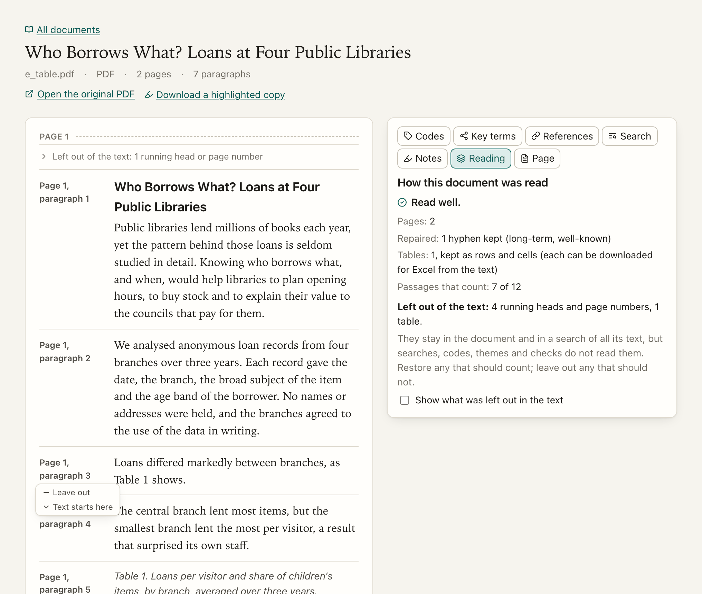
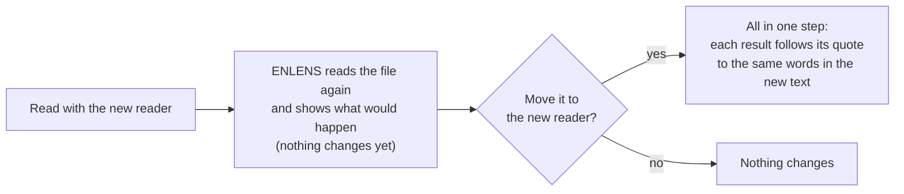

[Manual](../MANUAL.md) › How documents are read

# How documents are read

> **In short**
> - Before anything else, ENLENS turns each file into text and cuts it into passages. Search, codes, themes,
>   concepts and checks all read those passages.
> - What is not the document's own text (running heads, page numbers, author details, reference lists…) is set
>   aside, and tables are kept as tables.
> - The reading view shows what was read and what was left out, and lets you put it right with *Restore* and *Leave
>   out*.

The part of ENLENS that does this is the **reader**. Every document records the reader that read it, and a document
keeps that reading until you move it ([below](#read-with-the-new-reader)), so every quote and judgement in it stays
where it is.

| Reader | Since | Reads |
| --- | --- | --- |
| 1 | before 0.15 | Every document added before 0.15. |
| 2 | 0.15.0 | PDFs by their layout: columns, tables, what to set aside. |
| 3 | 0.15.1 | Reader 2, plus text files and books: running heads, page numbers, paragraphs and headings found from the text alone. |
| 4 | 0.17.2 | Reader 3, plus: a text file with one paragraph per line, and a Word file's content controls and tables inside tables (see *What reader 4 changed* below). PDFs and web pages read as with reader 3. |

## What the reader does

**With a PDF**, it looks at where each line stands on the page (with the PDF layout reader, which the one-line install
has; without it, it reads the PDF's text layer, without columns or tables):

- **Columns** are read one after the other, not across, and a title or abstract set across the page comes first.
- **What is not the document's own text is set aside**: running heads and footers, page numbers, line numbers in the
  margin, the words inside charts and diagrams, author names, affiliations, e-mail addresses and dates on the first
  page (*author and article details*), acknowledgements, funding, conflicts of interest, data availability and
  licence notes (*end notes*), footnotes, and the reference list. They stay in the document and in a search of all
  its text, but searches, codes, themes and checks do not read them. So themes no longer form around journal names,
  and checks no longer read a funding note.
- **Tables are kept as tables**, with their caption, rows and cells. They are left out of the passages (a table read
  as prose garbles a passage), and each can be downloaded for Excel.
- **Words are repaired**: a word cut at a line end is joined ("exam-ple" → "example"), a compound keeps its hyphen
  ("long-term"), words that ran together are split only where the document itself writes them apart ("ofthe" → "of
  the"), and ligatures (fi, fl), odd spaces and accents set apart from their letter are put right.
- **A passage is a paragraph.** Long ones are cut into parts of about equal size, short ones are put together, and a
  heading starts a new passage with the text under it. Paragraphs are numbered as quotes are cited: per page in a PDF
  (a heading with the text under it counts as one), every block between blank lines in a text file.

**Word files, web pages and text files** are read with the same repairs, their headings and reference list set aside
in the same way. A Word file's tables are read row by row, a table inside a table's cell after the row that holds it;
text in its content controls (a cover page, a contents box, form fields) is read like any other text, and Word's own
table of contents is set aside as a book's is. Footnotes, comments and text boxes are not read.

**Text files and books.** Many `.txt` and `.md` files are text copied out of a PDF by a converter: every running
head and page number is still in the text, while the pages, the headings and often the spaces between words are
gone. Reader 3 reads such files by rules on the text alone (no AI):

| It finds | How |
| --- | --- |
| Running heads and footers | They come back about once a page, next to a page break or at regular intervals ("Frontiers in Neurology 04 frontiersin.org"); a short one in capitals with its page number ("2 INTRODUCTION") from two pages, or from the contents. Answers that recur in an interview ("[P] Ja.") recur irregularly, mid-text: they stay. |
| Page numbers | Lines that are only a number, counting up a page apart. |
| Paragraphs and headings | A short line that ends a sentence ends its paragraph; a short line on its own is a heading. A Markdown file, web page or Word file that marks fewer than three headings gets headings this way too. |
| A book's parts | The table of contents (lines ending in page numbers that go up) is set aside, and its entries find the chapter headings. Front matter before the first chapter (half title, other books by the author, copyright page, dedication, lists of figures) is set aside, but an abstract, summary or preface stays. Notes, bibliography, index, *About the author* and acknowledgements at the end are set aside; an index is also known by its lines ("archetypes, 112–116, 191"). |
| Damaged text | Text printed twice ("TTIISS ffiinnaall" → "TIS final"), ligatures broken by a space ("fi nd" → "find"), and, only in a file that lost many of its spaces, words run together ("peoplelivingwithdementia" → "people living with dementia", using words the document itself writes apart; never into word endings). |

**What reader 4 changed.** Reader 4 reads three things otherwise than reader 3; everything else reads exactly as before:

- **A text file with one paragraph per line**, as Word saves "plain text": no blank line between paragraphs, each
  paragraph one long line. Reader 3 read such a file as a single paragraph, so every quote in it was cited as
  paragraph 1. Reader 4 takes each line as a paragraph. A file whose lines are wrapped to one width, or whose
  paragraphs have a blank line between them, reads as before.
- **A table inside a table's cell** in a Word file was read three times; it is now read once.
- **Text in a Word file's content controls** (and in custom XML) was left out without a word; it is now read.

> [!TIP]
> If you have the PDF of a text file, add the PDF instead: it reads better. The *Reading* panel says when a text
> file looks copied out of a PDF, when many of its words still run together, and when a PDF was read without its
> layout (a git copy gets the layout reader at its next `enlens update`).

## The reading view

A document's page shows its text the way the reader found it: headings, paragraphs, captions and tables, a mark where
each page begins, and what was set aside folded under *Left out of the text* on each page. Point at a block, and under
where it is cited you get:

| Button | What it does |
| --- | --- |
| **Leave out** | Searches, codes, themes and checks will not read this block. It greys and folds away into the line *Left out of the text*, which lights up for a moment. |
| **Restore** | They will read it again. |
| **All like this** | On a short block that comes back (a running head, a page number): leaves out, or restores, every block that looks the same, numbers aside. One click for a running head on every page. |
| **Text starts here** | On a block in the first third: leaves out everything before it (a book's title pages). *Undo start* takes it back. |
| **Text ends here** | On a block in the last third: leaves out everything after it (notes, bibliography, index). *Undo end* takes it back. |
| **Excel** | On a table: downloads it. |

A heading goes with the text under it, and short paragraphs that share a passage go together. Your choice is kept by
the block's words, so it holds when the document is read again; *restored by you*, *left out by you* or *the text
starts here (you said)* stands beside the block. A block you restore before the start or after the end still counts.
Changing what counts makes keyword codes, key terms and themes out of date, as adding a document does.

**Reading** (a panel beside the text) says how well the document was read: *Read well*, *Read, with something to
check* or *Read badly*, with the reasons (pages without text, text recognised from scanned pages, a garbled text
layer, most of the text set aside), how many pages had columns, what was repaired, the tables found, and how many of
its passages the features read. *Show what was left out in the text* unfolds everything set aside.

The list of documents marks the ones that need a look (*something to check in its reading*, *read badly*). Each reason
in the *Reading* panel takes you to what it is about: **Look at the pages** opens the *Page* panel, **Show what was
left out** unfolds the text set aside. When you have looked and the text is good enough for your work, choose
**Checked: it reads well enough**: the mark in the list goes away, and the panel says who checked it and when (*Undo*
takes it back). A new reading of the document asks again.

**Page** (beside the text, for PDFs, with the OCR extra the one-line install has) shows the page of the original PDF
with every block the reader found outlined: solid for what counts, dashed for what was left out. It follows the text
as you scroll; click an outline to go to that block.

## Read with the new reader

A document read by an older reader keeps that reading, and the list of documents marks it (*read before 0.15*, or
*read by an earlier reader*). Its *Reading* panel offers **Read with the new reader** (the mark in the list opens it
with the preview already started; a PDF or web page read by reader 3 is not offered reader 4, as it would read the
same):

The preview says how many of your results (a check's judgements and yours, codes and your reviews of them, themes,
references) find their place in the new text, and which do not. **Move it to the new reader** then does it in one
step, or not at all:

- each result follows its quote to the same words in the new text, and a check keeps the excerpt it showed;
- keyword codes, key terms and the document's search index are made again;
- work still waiting for the AI about it is asked again;
- a set of themes is marked out of date where its passages changed;
- what cannot be placed is kept without a place in the text and listed (its check marks it *no place in the new
  reading*).

It needs the original file, unchanged, and no task of the document out with Claude Code. While other work of the
project runs (documents being added, a round of the shared folder), it waits its turn: *Queued: starts when … has
finished*, with *Cancel* (0.17.0). In a project shared with colleagues the document stays one document: each copy keeps
the reading it has, and a colleague's results are placed on yours by their words (0.17.0). In a project with an owner, a
colleague's move is a proposal; once the owner accepts it, every copy moves
([Work together](together.md#the-owner-and-proposals-0170)).

**Several at once.** Above the list of documents, **Read all with the new reader** (or *Read the selected with the new
reader*, when you tick some) moves them one after the other. A document moves only when every one of its results finds
its place; one where any would not, and one that cannot be read again now (its file is missing or changed, or Claude
Code is working on it), is left as it was. The note afterwards lists them with the reason, each linked to its page,
where the preview shows what would be lost. You can work on meanwhile, or stop it: documents already moved stay moved.

## Measuring how well ENLENS reads

`enlens measure` shows in figures how well ENLENS reads, with no AI. It makes small PDFs whose text it knows (one and
two columns, running heads, line numbers, front and back matter, a table, footnotes), reads them with each reader,
and reports the share of the words kept, the share that belong, whether they come in order, words run together or
broken apart, and leftover boilerplate.

| Option | Adds |
| --- | --- |
| `--folder DIR` | Measures PDFs that have a `.txt` of their true text beside them. |
| `--ws PROJECT` | How many of a project's quotes still find their place in each reader's text (on a copy: the project never changes). |
| `--timings` | How long reading, search, *Words nearby*, the keyword pass, the *Codes* page, key terms and themes take. |
| `--report FILE.md` | Writes it all as a report. |

Each release carries this report as `validation-report.md`.

---

Next: [Your bibliography →](bibliography.md)
