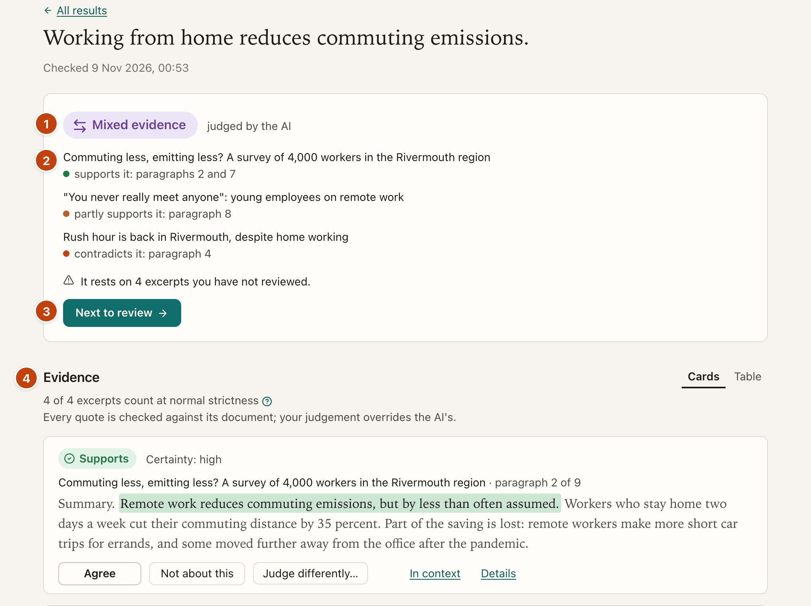
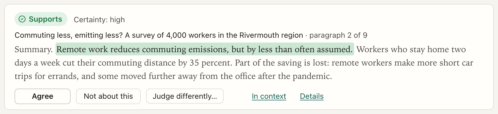
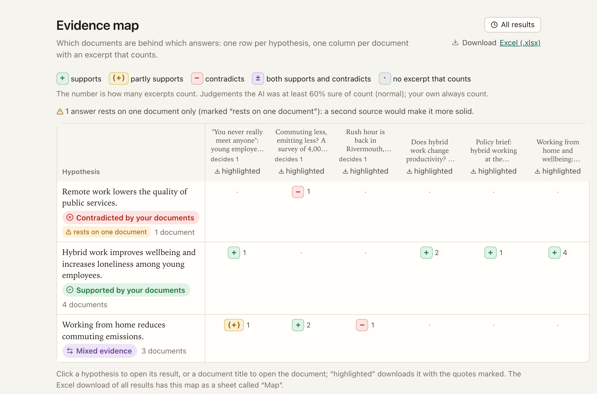

[Manual](../MANUAL.md) › Read and review a result

# Read and review a result

> **In short**
> - A result reads from top to bottom: **the answer**, **the evidence**, **other AI models**, then **notes and
>   downloads**.
> - Review the AI as you would a co-coder: *Next to review* takes you through the judgements that matter first.
> - Your judgement replaces the AI's, always counts, and is kept beside the AI's in the Excel download.

## The page at a glance

| | Part | What it is for |
| --- | --- | --- |
| 1 | **The answer** | The answer, and who judged it: *judged by the AI*, *partly reviewed by you* or *reviewed by you* (hover it for the AI model). |
| 2 | **Who says what** | One row per document, with a coloured dot per side and where: *supports it: paragraph 9 · contradicts it: paragraph 5*. |
| 3 | **Next to review** | Takes you to the next excerpt worth your look. |
| 4 | **The evidence** | Every excerpt read, as *Cards* or as a compact *Table*. |

The colours are the same everywhere: green *supports*, amber *partly supports*, red *contradicts*, purple *mixed
evidence*. *Technical details* and *Delete this result* close the page.

## The answer

Besides the answer and who says what, the card shows:

- **For a hypothesis checked in parts**, its parts instead of documents, each with its answer and its documents for
  and against, under one line on which part decides (*Part 1 decides the answer*; hover it: the hypothesis holds only
  if every part does). Click a part to go to its evidence. A document with excerpts on both sides counts once (*3
  documents for, one of them also against*).
- **At most one caution**, when the answer is fragile: *It rests on a single document and on two excerpts you have
  not reviewed* (for a hypothesis in parts, only the parts that decide the answer count).
- **Documents added since the check**, with *Read them*: a further search for this result. The check is not run
  again, so your reviews are kept.
- **Next to review**, in this order: the excerpts that count in the answer (first where a second opinion differs or
  the AI flagged another group), then the rest, then those you only commented on, then the excerpts the AI found not
  about the hypothesis.

When the AI was too unsure to count any excerpt, the card says so in one sentence, and *Next to review* takes you to
those excerpts: your own judgement always counts.

## The evidence

*Cards* or *Table* beside the title: the table has one row per excerpt, with your decisions; click a row to open its
card. Two lines under the title say how many excerpts count at your strictness (its **(?)** explains strictness and
offers *Try another strictness on this page*) and that *every quote is checked against its document; your judgement
overrides the AI's*. A hypothesis checked in parts shows each part under its own heading (*Part 1: …*), with its own
documents above its excerpts.

### An excerpt card

Each card shows, from top to bottom:

1. **The judgement**, with at most two quiet facts: *Certainty: medium*; *Not counted* and *Certainty: low* when it
   is below your strictness; *Second opinion: partly supports*; *You agreed with the AI*; *Your judgement (the AI
   said …)*.
2. **The document and where** the quote is (*paragraph 6 of 8*, or page and paragraph in a PDF).
3. **The quote**, highlighted in its judgement's colour, with one sentence before and after it (on a phone, the sentence
   before it). A short heading that opens the paragraph (*Recommendations.*) shows as a small heading above it. An
   excerpt also read for another part says *also in part 1* (hover it for your judgement there).

Cards that count come first; cards you have judged sit back (no fill, a dashed edge). Every card has the same row of
actions:

| Action | What it does |
| --- | --- |
| **Agree** | Makes the AI's judgement yours: it then counts, whatever the AI's certainty. A note at the bottom says so and whether the answer changed, with *Undo*. The button becomes **Take back**. |
| **Not about this** | Dismisses the excerpt in one click: it moves under the cards, with the excerpts not about the hypothesis. *Undo* is offered. |
| **Judge differently…** | The other judgements (each saves at once, with *Undo*), a comment (saved on <kbd>Enter</kbd> or when you leave the field), and the sentence you mean when the AI highlighted the wrong one: select it in the excerpt and press *Use it*, or pick it from a list. Called *Edit judgement…* once you have judged, and *Judge this excerpt…* when no AI may read it. |
| **In context** | The whole excerpt the AI read, with *Open the whole document at this place* (the quote highlighted; *Back to the result* returns), *the original file* (a PDF at the page, a text file with the quote highlighted, a web page scrolled to the quote where the browser can) and *a highlighted copy* of the document with this hypothesis's judgements marked. |
| **Details** | *Ask the AI to read this again* (this excerpt alone, with your comment as a hint; the card then shows what it was and what it is now, and your own judgement still counts), the certainty as a percentage, how the excerpt was found, and technical facts (span, id, earlier judgements). |

> [!NOTE]
> A comment without a judgement stays a comment: it is not a review. Your judgement replaces the AI's in the answer
> and in the downloads, and the card still shows what the AI said.

After a save, the card keeps its place on the screen and says where it moved in the list.

**About another group** under a quote means the AI thinks the excerpt is about another group, place or period than
your hypothesis (fully remote workers, for a hypothesis about hybrid work). It then counts at most as partly
supporting. A quote that starts with "it" or "they" says what it refers to (*"it" = green hydrogen*); when the AI
did not say, the excerpt is flagged *Check what the quote's first word refers to*.

Excerpts the AI found not about the hypothesis are folded under the cards, so you can check those too.

### Looking further

Under the cards:

- **Read more excerpts** reads the next excerpts that match the same words.
- **Search with other words** reads excerpts containing words you type (documents often say "telework" where the
  hypothesis says "remote work").

New excerpts are marked *new*, a *Just now* line in the answer says what was found, and when everything that matches
has been read, the line above the buttons says so.

## Ask another AI model

The section says what has happened so far (what a second opinion found, or that no stronger model is set, with *Set
one in Settings*), then offers two buttons:

| | **Ask a stronger model** | **Get a second opinion** |
| --- | --- | --- |
| What it does | The model checks step up to reads every search of the result again, once. | Another model reads the same excerpts on its own. |
| Can the answer change? | **Yes**: its judgements replace the first AI's. | **No**: shown for comparison only. |
| On Claude | The auditor: Opus, or Fable when switched on. | The auditor. |
| With local models | The stronger model set in Settings. | A second local model, chosen here or in Settings. Only one model is in memory at a time, so it takes a while. |
| What you see | A small mark beside the answer, e.g. **Supported** *at first: partly supported* (hover or click for which models and how many judgements changed); each changed excerpt shows both readings. | *Second opinion: …* on each card; *Next to review* goes first to where it differs; *Highlight the quote of: the AI / the second opinion* when it points to another sentence. |

The stronger model also steps in by itself when an answer was unsure or rejected twice. Your own judgements stay and
count either way. When the AI chosen in Settings has no stronger model, the card says so, with *Set one*.

## Notes and downloads

**Notes** are saved as you type. **Download** has one link per file:

| Download | What is in it |
| --- | --- |
| *Excel (.xlsx)* | A **Summary** sheet, one row per hypothesis: the answer and the answer per part, documents per side, excerpts counted and too uncertain, your reviews and changes, notes, strictness, and, for a methods section, every AI model the check used with what each did (search words, judging, judging again as the stronger model, reading the excerpts of documents marked *Only a local AI*). An **Excerpts** sheet, one row per excerpt read: the judgement and who made it (you, a colleague, the AI or nobody yet), the AI's own judgement and certainty or why no AI judged it, counted or not, the quote and who chose it, document, where, your comment, the note about another group, earlier judgements, the second model's judgement, and the full excerpt. It ends with *How these results were made*. |
| *Highlighted documents (.zip)* | The documents, with this hypothesis's quotes marked. |
| *Whole project (.zip)* | The project in one file ([Work together](together.md)). |
| *CSV · JSON (for programmers)* | The same data, for scripts. |

*Technical details* has the strictness slider (this page only), the models and settings of the check, what each
search looked for and the AI's note on what it read.

A check still **waiting for Claude Code** shows only the waiting card (with *Start Claude Code*), any excerpts
already read, and your notes; the rest appears when the answer is in.

## All your results

**Results** lists every hypothesis with its answer, the excerpts that count (and how many were too uncertain), and
tags: *part of a set*, *checked in 2 parts*, *N to review*, *N changed by you*, *has notes*, *N documents added
since*, *second opinion differs on N*, and the date. An answer a stronger model changed carries a small mark (*was
partly supported*). Search, filter by answer, open one, or download them all (*Download all: Excel (.xlsx)*, with a
*Map* sheet, or *CSV (for programmers)*).

- *Read the new documents for all N* brings every result with documents added since up to date in one go.
- *Get a second opinion for all results* does the same for second opinions (for comparison only).

**Show as a map** shows all results, or one set, as a grid: one row per hypothesis, one column per document.

| In a cell | Means |
| --- | --- |
| + | supports |
| (+) | partly supports |
| − | contradicts |
| ± | both |

Each cell gives the number of excerpts that count. The map flags answers that rest on one document, and documents
that **decide** answers (leaving them out would change those answers): read those most carefully. *highlighted* under
each document gives it with the quotes marked.

---

Next: [Explore your documents →](explore.md)
