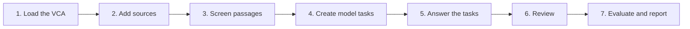

[Manual](../MANUAL.md) › The SDG pack

# The SDG pack: impact claims and the Value Chain Assessment

> **In short**
> - The pipeline built for ENLENS's first application, the green hydrogen Value Chain Assessment (VCA) by Peyerl and
>   van der Zwaan (2024, *Discover Sustainability* 5:199), included as a pack.
> - It turns source documents into **impact claims** tagged with UN SDG targets, compares them with an expert VCA, and
>   writes a report.
> - It runs on the command line. For checking hypotheses about any subject, no pack is needed:
>   [Check a hypothesis](check.md).

**Contents:** [What it asks](#what-it-asks) · [Quick start](#quick-start-with-the-offline-baseline) ·
[The full workflow](#the-full-workflow) · [Reading the report](#reading-the-report) ·
[Models and configuration](#models-and-configuration) · [The pack's tables](#the-packs-tables) ·
[Other value chains](#other-value-chains-and-policy-documents)

## What it asks

An **impact claim** is a statement that an activity in a value chain affects a UN SDG target, in a direction, in a
segment of the chain, at a place and time, under a condition, each with the exact words from the source. The pack
asks five questions of the literature:

1. Does the cited literature support the VCA's judgements? (Each justification is split into claims and checked.)
2. Which SDG targets does green hydrogen affect, in which direction and in which segment?
3. Where do synergies and trade-offs between targets appear?
4. When do the effects occur, and where do they land (producer or importer, which countries)?
5. Under which conditions do effects change, and which policy levers are named?

It also measures how well evidence extracted from the sources rebuilds the VCA's own labels, so you can judge whether
the method is good enough to extend the VCA to other value chains.

<details>
<summary>The vocabularies</summary>

- Segments: `production`, `transportation`, `end_use`, plus `whole_chain` and `unclear`.
- Direction: `positive` (helps progress on the target), `negative` (hinders it), `mixed`, `no_effect`.
- Influence: `direct`, `indirect`, `unclear` (VCA definitions).
- Horizon: `short_term` (to 2030), `medium_long_term` (after 2030), `not_stated`.
- Interaction scores between targets: the Nilsson et al. (2016) scale, from −3 (cancelling) to +3 (indivisible).
- Targets: all 169 SDG targets, including lettered ones such as `7.b` and SDG 17
  (`src/enlens_claims/data/sdg_targets.csv`).
- Status of an extracted claim: `auto` (accepted automatically), `needs_review`, `accepted`, `changed`, `rejected`.
- Task kinds: `split` (justification to VCA claims), `extract` (passage to impact claims), `verify_set` (which of up to
  six passages from the cited sources support a VCA claim), `verify` (one passage, one claim: second checks), and for
  hypotheses `decompose`, `expand` and `check`.

The pack keeps the passage selection of 0.4 exactly (its own tokenizer), so re-running `make-tasks` on a 0.4
workspace queues no new work.

</details>

## Quick start with the offline baseline

The `baseline` backend is a keyword heuristic with the same output format as the models. It needs no key and no
network, so it is the fastest way to see the whole pipeline work. Its results are a floor, not findings.

```bash
enlens --ws demo init
enlens --ws demo load-vca path/to/43621_2024_374_MOESM1_ESM.xlsx
enlens --ws demo ingest path/to/sources.zip          # folders and zips are searched
enlens --ws demo match-sources
enlens --ws demo screen
enlens --ws demo make-tasks split
enlens --ws demo run split --backend baseline
enlens --ws demo make-tasks verify-vca
enlens --ws demo run verify_set --backend baseline
enlens --ws demo make-tasks extract
enlens --ws demo run extract --backend baseline
enlens --ws demo report                               # demo/report/report.html
```

## The full workflow



### Step 1. Load the VCA

```bash
enlens --ws pilot init
enlens --ws pilot load-vca 43621_2024_374_MOESM1_ESM.xlsx
```

The loader reads the sheet "(T3) SDGs & Targets - Analyses". Its influence cells are empty: the sign is the cell
colour (red negative, green positive, bold colour direct, light colour indirect). The command prints totals. For the
published workbook they must read **169 targets, 61 justified, 30 direct, 119 indirect, 86 positive, 63 negative, 47
short term and 14 medium to long term**, as in the paper. If they do not, the colours were not read correctly: see
[Troubleshooting](troubleshooting.md#the-sdg-pack).

### Step 2. Add sources

```bash
enlens --ws pilot ingest uploads/sources.zip more_reports/
enlens --ws pilot match-sources
enlens --ws pilot coverage
```

- **Any file names work.** Files are matched to the VCA references by DOI (from the file name, metadata or first
  pages) or by the words of the reference (title, organisation, year).
- **`coverage`** lists, for each justified target, how many of its cited sources are available. Targets with none
  are reported as "source missing" everywhere, never as unsupported, and are left out of the agreement scores. It also
  flags very short documents: a web landing page or an event agenda saved instead of the report still matches the
  reference, but holds no evidence. Mostly unreadable documents do not count as available.
- **A `manifest.csv`** next to the files (columns `file`, `reference`, `doi`; more columns are ignored) says exactly
  which reference each file is. Several rows may point at one file when the same work is cited in different ways; every
  row is linked. Manifest links take precedence over DOI and title matching. When a manifest is present, `ingest`
  lists files it does not mention under `not_in_manifest`.
- **The VCA's reference lists contain a few errors** (cut-off or wrong DOIs, the same work cited twice). The loader
  applies `src/enlens_claims/data/reference_fixes.csv` (actions `doi` and `same_as`) and then merges references whose
  title words overlap strongly; `load-vca` reports how many were fixed and merged. Add rows to that file when you find
  more.
- **What is skipped**: duplicate files (same bytes); notes that travel with a corpus (`problems.txt`, `README.md`,
  `notes.txt`); files matching `--exclude PATTERN` (for example a download that turned out to be the wrong document:
  `enlens --ws pilot ingest enlens_text.zip --exclude 'A_18_*'`; repeat it for several patterns). A file that cannot
  be read (damaged or password-protected, also inside a zip) is listed under `failed` with the reason, and the others
  are added; the connector's `create_project` and `add_sources` return them as `could_not_read`.
- **Unreadable text.** Scanned PDFs without a text layer come out empty: run OCR first. Text layers without a character
  map come out as `(cid:53)` codes or as shifted letters (`5HQHZDEOH DQG` for `Renewable and`): such passages get
  section `unreadable` and are never sent to a model, and `ingest` lists documents that are mostly unreadable. Get
  another copy of the file (the publisher's version often has a proper text layer) or run OCR.

**Large PDF folders.** `tools/pdf_to_text.py` turns a folder of PDFs into small text files, with one form-feed
character between pages so page numbers survive. It copies HTML files and `manifest.csv` and writes `enlens_text.zip`
next to the folder, which `ingest` reads like the PDFs. It needs only `pypdf`:

```bash
pip install pypdf
python3 tools/pdf_to_text.py path/to/sources path/to/manifest.csv
```

**Adding sources later.** Ingest the new files into the same workspace, then run `match-sources`, `screen` and the
`make-tasks` commands again. Task ids are fixed by their content, so only new work is created: passages that now rank
among the top N for a target, and VCA claims whose best passages changed (they get a further task for the new set;
earlier answers are kept and counted together). Nothing already answered is asked again.

**Starting over with another copy of the corpus.** `enlens --ws pilot reset-corpus --yes` removes the documents and
everything derived from them (passages, claims, verifications and their tasks) but keeps the VCA and its split claims,
so the split does not have to be paid for again.

### Step 3. Screen passages

```bash
enlens --ws pilot screen
```

A transparent heuristic marks passages that mention hydrogen (or its derivatives) and impact terms, and scores them
against the SDG target texts. Only screened passages go to extraction, unless you pass `--all-passages`. This step
stands in for a fast decision model ([below](#models-and-configuration)). Lower `thresholds.screen_min_score` in
`config.json` (default 2.0) to let more passages through.

### Step 4. Create model tasks

```bash
enlens --ws pilot make-tasks split                    # 61 justifications to VCA claims
enlens --ws pilot make-tasks extract --per-target 6   # the 6 best passages for each of the 169 targets
```

Extracting every screened passage of a large corpus is expensive (the pilot corpus has 7,600). `--per-target N` ranks
passages against each SDG target's text and keeps the top N per target, so every target, not only the VCA's, gets the
same chance. Only passages that name hydrogen or a derivative (or whose preceding passage does, which the task shows
as context) are ranked; without that rule, general energy passages crowd out the value chain. `--any-passage` drops
the rule; leaving out `--per-target` extracts every screened passage.

After the split tasks have answers:

```bash
enlens --ws pilot make-tasks verify-vca --k 6    # one task per VCA claim, with its 6 best passages from cited sources
```

Each `verify_set` task shows one VCA claim and up to `--k` passages (default `thresholds.verify_top_k`), at most
`--per-doc` (default 2) from one document before the rest are filled by score, so one long report cannot crowd out the
others. The model grades only the passages that bear on the claim:

| Grade | Means |
| --- | --- |
| `supports` | The passage states the effect. |
| `partially_supports` | A necessary part of the claim is stated and one inference remains: the mechanism without its effect on the target, the converse case, or the same effect for another segment or for renewables in general. |
| `refutes` | The passage states the opposite. |
| (left out) | Not enough information. |

`--pairwise` makes the older design instead: one `verify` task per claim and passage, with three verdicts. In the
pilot, 72 of 75 pairwise checks found no support, often because the passage stated part of the claim; set-wise checks
with a partial grade read the same text and say more.

Other options: `--model` records a different model on the tasks; `--limit N` creates only N tasks (for a trial);
`--beyond-cited` searches all documents, not only those the VCA cites.

**Second opinions with another model:**

```bash
enlens --ws pilot make-tasks audit-vca --sample 0.1 --model claude-fable-5-1      # 10% of answered VCA checks
enlens --ws pilot make-tasks verify-claims --sample 0.1 --model claude-fable-5-1  # 10% of extracted claims
```

Audit answers to VCA checks are stored apart (`subject_kind` `vca_claim_audit`) and never change a claim's status;
`evaluate` and the report compare them with the first answers. `refresh KIND --model M` switches the main tasks to M
but leaves audits and second checks with the model they were made for.

### Step 5. Answer the tasks

Four ways, which can be mixed per kind of task:

| Way | Where the text goes | Best for |
| --- | --- | --- |
| [Claude Code on your plan](#claude-code-on-your-own-plan) | The passages handed out go to Anthropic. | The default: helpers on the right model per kind. |
| [The Claude API](#the-claude-api) | The passages go to Anthropic. | Unattended runs on a team key. |
| [A local model](#a-local-model) | Stays on your computer. | Privacy; weaker, so test it first. |
| [The file queue](#the-file-queue) | Wherever your worker runs. | Any worker, including Claude in a chat or an agent. |

#### Claude Code on your own plan

`prepare` makes the tasks as `make-tasks` does and puts them in the queue; `/enlens-run` answers them with a helper per
kind:

```bash
enlens --ws pilot prepare split                       # Opus (enlens-extractor), one task per VCA target
enlens --ws pilot prepare verify-vca --k 6            # Opus (enlens-checker), one VCA claim and its passages
enlens --ws pilot prepare extract --per-target 6      # Sonnet (enlens-extractor); unsure claims go to Opus
enlens --ws pilot prepare audit-vca --sample 0.1      # the auditor (Opus, or Fable when switched on)
enlens --ws pilot prepare verify-claims --sample 0.1 --model fable   # a second check of extracted claims
# then in Claude Code:  /enlens-run pilot   (or /enlens-run pilot extract)
```

`--model haiku|sonnet|opus|fable` keeps one model for those tasks instead of the routed one. The audits keep their
model and never step up, so they stay a second model's reading. The pack's tasks enter the queue only through
`prepare`: `make-tasks` and `run` work as before. `enlens queue run --backend anthropic` answers the same queue
unattended with the same models.

#### The Claude API

```bash
export ANTHROPIC_API_KEY=...
enlens --ws pilot run split --backend anthropic
enlens --ws pilot run extract --backend anthropic
enlens --ws pilot run verify_set --backend anthropic
```

The tasks record the model of `config.json` (`claude-opus-5-5` …), and the Claude API uses that model.

#### A local model

```bash
ollama pull qwen3:8b                                        # once
enlens backend-check --backend ollama --model qwen3:8b      # is it running, is the model there?
enlens --ws pilot run verify_set --model qwen3:8b
```

Without `--model`, a local backend uses the first chat model its server offers (the Claude model names stored on the
tasks do not exist on a local server). The context length is set on every request (`--num-ctx`, default 16,384), and
the answer is forced into the task's JSON format. `--think off` switches off the reasoning of thinking models, which
is faster. Other OpenAI-compatible servers (LM Studio, llama.cpp, Jan, vLLM) work with
`--backend local --url http://localhost:1234/v1`: the answer format is passed as a JSON schema where the server accepts
it (`json_object` or none otherwise); set the context length on the server, because that endpoint cannot pass it.
Local models are cheaper and private but weaker: [test them before trusting them](local-models.md#test-a-model-before-trusting-it).

#### The file queue

```bash
enlens --ws pilot export-tasks extract --batch-size 25
# the worker reads tasks/extract/SYSTEM.md and WORKER_GUIDE.md, answers each line of tasks/extract/batch_*.jsonl,
# and writes results/extract/batch_*.jsonl lines: {"task_id": ..., "model": ..., "output": {...}}
enlens --ws pilot check-results pilot/results/extract/batch_0001.jsonl   # the worker checks its own file
enlens --ws pilot import-results pilot/results/extract
enlens --ws pilot requeue extract       # put exported tasks that got no answer back in the queue
```

`check-results` applies every check the import applies (schema, quotes, passage numbers) without storing anything,
and lists the problems per line, so a worker can fix its file before handing it back. The worker guide asks workers to
judge every task themselves and use code only to write and check JSON.

> [!WARNING]
> Running several workers at once (the pilot ran up to 15 Claude agents in parallel): give each worker its own batch
> file, its own results file and its own folder for helper scripts. In the pilot, two workers that shared a scratch
> folder overwrote each other's helper scripts, and one wrote lines into the other's results file. Before importing,
> check that every results file holds exactly the task ids of its batch.

#### Every answer is validated

Whatever the route, before it is stored:

- The JSON must match the schema; loose spellings ("end-use", "SDG 6.4") are normalised.
- Every quote must be found in the text the model was given. Matching ignores case, typographic quotes and dashes,
  ligatures and whitespace (PDF text often splits words), but nothing else: a paraphrase or an added number fails.
- A claim whose main quote is not found is dropped. A task with no usable answer is retried, with the problems listed
  in the next prompt, up to three attempts. An answer that is not accepted changes nothing stored before.
- Claims with confidence below `thresholds.accept_confidence` (default 0.8) get status `needs_review`.

Check progress at any time with `enlens --ws pilot status`.

### Step 6. Review

```bash
enlens --ws pilot review-export queue.csv --audit 0.05
```

The CSV holds the claims that need review, a random 5% audit sample of auto-accepted claims, and VCA claims found
unsupported or contradicted. Fill in `decision` with `accept`, `change` or `reject`. For `change`, give any of:

| Column | Example |
| --- | --- |
| `corrected_targets` | `6.4:negative:direct; 2.4:negative:indirect` |
| `corrected_segment` | one of the segment values |
| `corrected_horizon` | one of the horizon values |

```bash
enlens --ws pilot review-import queue.csv --reviewer "initials"
enlens --ws pilot gold-export gold.jsonl
```

Rows with an invalid correction (also an unknown direction or influence) are reported and change nothing. The file may
be saved by Excel (UTF-8 with or without byte-order mark, or Windows-1252). Reviewed items do not reappear in later
queues. When a task is answered again (`refresh`), a reviewed claim with the same text keeps the decision; a claim
whose text changed has its review marked superseded and comes back to the queue. `gold.jsonl` is the growing gold set:
use it to compare prompts, models and thresholds.

### Step 7. Evaluate and report

```bash
enlens --ws pilot evaluate             # metrics as JSON
enlens --ws pilot report               # pilot/report/report.html plus CSVs
enlens --ws pilot report --strict      # only auto-accepted and reviewed claims
```

## Reading the report

The report has one section per question. Every number traces to `claims.csv`, which holds each claim with its quote,
source and page.

**1. Does the cited literature support the VCA's judgements?** The status of each VCA claim:

| Status | Meaning |
| --- | --- |
| supported | At least one passage from a cited source states the effect (grade supports, confidence at least `support_confidence`, default 0.6). |
| partially_supported | No passage states the whole effect, but one states a necessary part of it, so one inference step remains. |
| contradicted | A passage states the opposite and none supports it, fully or partly. |
| unsupported | Sources were available and checked, but no passage states the effect. The judgement may rest on reasoning beyond the sources, or retrieval missed the passage. |
| source_missing | None of the cited sources was provided, or the ones provided are unreadable. |
| not_checked | Verification tasks have not been answered yet. |

A second table shows the same statuses at other confidence thresholds. Partial grades usually carry lower confidence
than full support, so the share of partially supported claims depends strongly on the threshold: read the whole table
rather than one row.

**Do the VCA's texts and colours agree?** Each VCA claim with a clear direction is compared with the colour of the
VCA's own cell for its segment. Claims that point the other way are listed for the authors. Many are mitigations
inside the justification of a negative cell ("local manufacturing reduces the risk"); some are real mismatches.

**Can the method rebuild the VCA labels?** Claims extracted independently are aggregated per target and segment and
compared with the VCA:

- *Target has an effect*: over all 169 targets, so the targets the VCA leaves empty are the negatives. Precision (the
  share of targets the evidence marks that the VCA also marks), recall (the share of VCA targets the evidence finds),
  F1, and Cohen's κ (agreement beyond chance).
- *Cell*: the same per target × segment, within the justified targets that have a source available.
- *Sign*, *direct or indirect*, *time horizon*: agreement where both mark something.

Low recall with high precision usually means the sources were incomplete or the screen was too strict. Disagreement on
sign is the most informative: read those claims in `claims.csv`.

| Section | What it shows |
| --- | --- |
| **2. Effects** | One row per target, one column per segment: the sign and the number of documents. The sign is positive or negative when one side has at least twice the documents of the other, otherwise mixed. |
| **3. Synergies and trade-offs** | *Stated* interactions are those a passage states, scored on the Nilsson scale. *Inferred* pairs come from one document linking the same activity, segment and place to two targets: synergy (both helped), trade-off (one helped, one hindered), shared pressure (both hindered). Inferred pairs are candidates for expert scoring, not findings. The report lists only pairs found in two or more documents, because one long document can link dozens of targets; all pairs are in `interactions.csv`. |
| **4–6. Timing, geography, conditions** | Claims by horizon and direction; the countries named and whether effects land with producers or importers; the conditions and policy levers that change an effect. |
| **7. Gaps** | Target and segment cells the VCA leaves empty but two or more documents mark, and targets with no sources. |
| **Sources** | Every document with its pages, passages, number of claims and the VCA targets that cite it, with checks for unreadable or very short files. |
| **Method notes** | How the evidence was produced, and the agreement between the first answers and the second-model audits. |

## Models and configuration

`config.json` in the workspace:

```json
{
  "models": {"screen": "heuristic", "split": "claude-fable-5-1", "extract": "claude-opus-5-5", "verify": "claude-opus-5-5"},
  "thresholds": {"screen_min_score": 2.0, "accept_confidence": 0.8, "support_confidence": 0.6, "verify_top_k": 6},
  "passages": {"max_chars": 1100, "min_chars": 200}
}
```

The suggested split follows Anthropic's guidance that Opus 5.5 is the default and Fable 5.1 is for work where Opus
falls short: Opus 5.5 for the high-volume extraction and verification; Fable 5.1 for the 61 justification splits, for
resolving conflicts, and for a second check on a sample (`make-tasks verify-claims --sample 0.1 --model
claude-fable-5-1`), which measures whether the more expensive model changes outcomes. A cheaper model (Haiku 5.5) or a
dedicated classifier can replace the screen once it is benchmarked on reviewed passages.

Every stored result records the model and the prompt version (`extract-v1`, `split-v2`, `verify-v2`, `verify-set-v2`;
for hypotheses `decompose-v1`, `expand-v2`, `check-v5`). When you change a prompt in `prompts.py`, bump its version so
old and new results stay distinguishable, then queue the affected tasks again with `enlens refresh KIND` (add
`--model` to switch model at the same time). Earlier answers stay in the `results` table.

## The pack's tables

Open the workspace's `enlens.sqlite` with any SQLite tool. Offsets in `evidence` and `verifications` index into
`documents.text`.

| Table | Holds |
| --- | --- |
| documents, pages, passages | Source text, page spans, passages with `section` (body, references, reference_like, unreadable) and screen score |
| vca_targets, vca_refs, doc_refs | Gold labels, cited references, and which document matched which reference (method manifest, doi, title, or manual: rows you add by hand with method `manual` survive `match-sources`) |
| tasks, results | Every task, its payload and status; every answer with model, prompt version, validity and errors |
| claims, claim_targets, evidence | Extracted claims, their targets with direction and influence, and quotes with offsets and page |
| interactions | Stated interactions (with quote) and inferred candidate pairs |
| vca_claims, verifications | Split justifications; one row per checked passage with its grade and quote. `subject_kind` is `vca_claim`, `vca_claim_audit` (second opinion) or `claim` (second check of an extracted claim) |
| reviews | Reviewer decisions and corrections |

## Other value chains and policy documents

- **Another value chain**: you need the screen terms (`H2_RE` in `retrieve.py`), the segment definitions
  (`prompts.py`) and, for evaluation, an expert table in the same layout, or reviewed claims as gold.
- **Policy documents**: ingest them like any source. Policy levers and conditions are extracted from them as from
  papers. For a policy layer, run `make-tasks extract --docs <ids>` on those documents only and read section 6 of the
  report.
- **The Netherlands angle**: no VCA justification mentions the Netherlands; Dutch and EU policy documents and national
  studies have to be added as sources first.

The pack's limits are in [Troubleshooting and limits](troubleshooting.md#limits).
