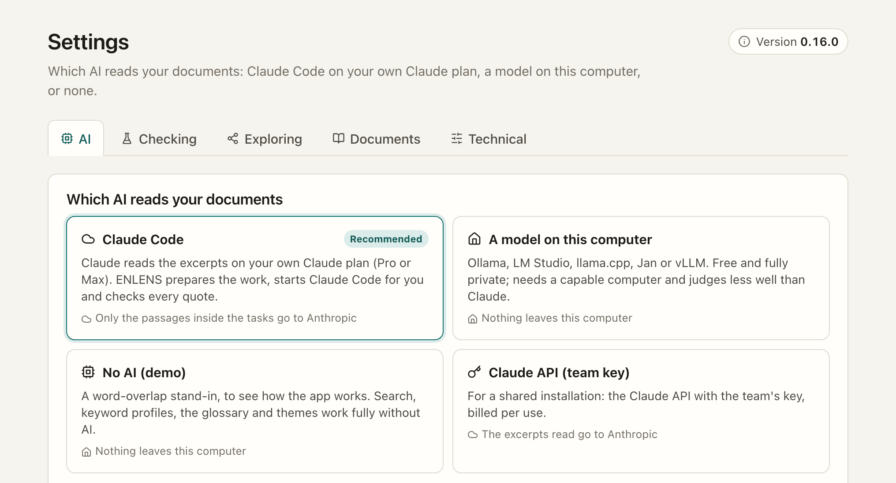

[Manual](../MANUAL.md) › Settings

# Settings, and setting ENLENS up for others

> **In short**
> - *Settings* has five tabs: **AI**, **Checking**, **Exploring**, **Documents** and **Technical**.
> - The version of ENLENS is at the top right of every tab; click it to look for updates.
> - Whoever installs ENLENS for others can make sure nothing ever leaves the computer.

## The five tabs

| Tab | What you set there |
| --- | --- |
| **AI** | **Work waiting for Claude Code** (what waits, in order: *Do first*, *Hold*, *Remove*; the speed and the helpers; [Claude Code](claude-code.md#following-the-work)). Which AI reads your documents, as four choices: **Claude Code** (recommended: your own Claude plan), **A model on this computer** (automatic, Ollama, or an OpenAI-compatible server such as LM Studio, with its address, model and reasoning switch), **No AI (demo)**, and the **Claude API (team key)** for a shared installation, behind a confirmation and *Allow cloud models*. With Claude Code: the set-up checklist with *Set up Claude*, *Let the auditor use Fable* and *Speed of Claude Code*. With a local model: *Install Ollama* (or *Start Ollama*) when no model server runs, *Download qwen3:8b* when none is installed, and the *Local model for restricted documents*. *Save and test* says whether the AI answers (with Claude Code, whether it is set up). |
| **Checking** | The **strictness**: how sure the AI must be before a judgement counts. It saves at once, applies to every result, and reports which answers and counts changed; *Back to normal (60%)*. Beside it, **how often you agreed with the AI, by its certainty**: a small chart from the excerpts you judged, and after 20 judgements perhaps a suggestion ("When the AI was at least 70% sure, you agreed with it in 85% … *Use 70%*"). Also how new checks start: other words, parts, how many excerpts to read, and at most how many from one document. |
| **Exploring** | The codebook of *By document* and how many themes a new set looks for. A link to *Codes* › *Codebooks* leads to the page where you make, change and remove codebooks ([Make your own codebook](codebooks.md)). |
| **Documents** | **Reading scanned PDFs** (on or off, and the languages), and the embedding model for **search by meaning** (with *Download nomic-embed-text* when Ollama has none). |
| **Technical** | **AI model per task** ([Which model does what](models.md)): the model of each kind of task, what it steps up to, the helper on Claude Code, *Use the recommended models*, *The recommendations follow* your plan, and for local servers the small model for labels and links. With a local model, the **model for second opinions** and the **context length** (automatic by default), with *Sort the best excerpts again by wording* (off). **Repeatable results**: the seed (42 by default) and a test of whether the server gives the same answer twice. *Test a model* ([how](local-models.md#test-a-model-before-trusting-it)). **Updates** (*Check for updates*, how this copy was installed), **Your link to ENLENS** (*Copy my link*: the link with this run's key, for a bookmark; it works until ENLENS stops, and opens ENLENS for whoever has it, see [Privacy](privacy.md#what-goes-where)), where your data is, *What was sent to Claude*, **Which new versions to offer** and **Copy technical details**. |

Old links to a section (`#/settings/second`, `#/settings/calibration`…) open its tab.

## Trying new versions early

ENLENS offers full releases only, by default. From 0.16 on, a **release candidate** (a try-out of the next version)
comes out at least a week before each new version. To be offered candidates, choose *Try new versions early*
under *Settings → Technical → Which new versions to offer*; *Stable (recommended)* goes back. A copy installed from
git follows its branch and has no such choice.

> [!WARNING]
> Try a candidate on a project you do not share with colleagues: going back to the stable version can show sync
> clashes on what the candidate made (nothing is lost).

## Reporting a problem

*Settings → Technical → Copy technical details* copies a few lines for a problem report: the ENLENS version, how it
was installed, the system and Python, the AI route, whether cloud models are switched off, and the update channel.
Never a path, a project or document name, or a key. *Report a problem* opens a short form on GitHub (a free GitHub
account is needed) to paste them in; please paste no text from documents that must stay private.

A **security or privacy problem** is reported privately instead: see [SECURITY.md](../../SECURITY.md).

## For whoever installs ENLENS

- **The AI.** A new installation uses Claude Code on the researcher's own plan. To use a model on this computer
  instead, choose it once in *Settings → AI* (or let *automatic* find Ollama or LM Studio) and press *Save and test*;
  with Ollama running, *Download qwen3:8b* there gets a model without a terminal. An installation that already chose a
  local model keeps it when it is updated. With an embedding model set (*Settings → Documents*), new documents are
  indexed for search by meaning right away.
- **Nothing may ever leave the computer.** Start the app with `enlens-gui --local-only`, set `ENLENS_LOCAL_ONLY=1`,
  or create an empty file named `local_only` in the data folder. The cloud options (the Claude API and Claude Code)
  are then hidden, the default becomes the local model (*automatic*), the app and its API refuse to switch to them,
  ENLENS never starts Claude Code, and the connector refuses to hand out queued tasks.
- **Backups.** Keep the data folder (`--home`) somewhere that is backed up: it holds the projects, their results and
  the settings.
- **The icon.** Install with the one-line install ([Install](install.md)): it makes the icon. With
  `ENLENS_LOCAL_ONLY=1` and `ENLENS_HOME=<folder>` before `sh`, both are built into the icon. From a git copy, make
  the icon with `enlens-gui --make-launcher`, with the same `--home` and `--local-only` you would start it with.
- **Scanned PDFs** need Tesseract ([Install](install.md#scanned-pdfs-optional)). Settings shows whether it is
  available.
- **Starting it by hand**: `enlens-gui` and its options are in [The command line](command-line.md#the-app).
