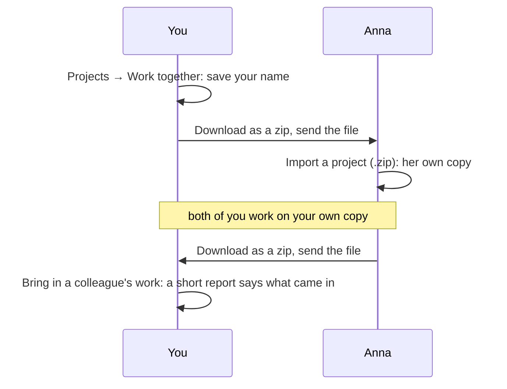

[Manual](../MANUAL.md) › Work together

# Work together, and move to another computer

> **In short**
> - Two or more researchers can work on one project, each on their own computer and their own Claude plan.
> - You exchange work as a file: no server, no account, and nothing goes anywhere you do not send it yourself.
> - When you both changed the same thing, both versions are kept (a *sync clash*), so nothing is lost.

## Sharing a project with colleagues

1. **Your name.** On the *Projects* page, under *Work together*, type the name colleagues should see beside your
   judgements and press *Save*. Judgements you made before are yours: they get your name the first time you send the
   project.
2. **Send your work.** *Download as a zip* on the project, and send the file (e-mail, a shared folder, a USB stick).
   The file says which project it is and who sent it.
3. **Bring in a colleague's work.** The first time, your colleague chooses *Import a project (.zip)*, which makes
   their copy. From then on, each of you chooses *Bring in a colleague's work* on the same project and picks the
   other's newest file. A short report says what came in.

A file from another project (or from an ENLENS before 0.14, which cannot say) is brought in only after you confirm,
for when you mean to combine two projects.

## How two copies come together

| What | What happens |
| --- | --- |
| **Something new** | Comes in: documents with their original files, results, sets of themes, codebooks (also those kept for all your projects), the AI's labels and reference chains, links between terms, and the bibliography (when you have none, or it comes from the same Zotero collection or file). |
| **A newer version** | Replaces the older one. A result your colleague changed (a note, excerpts read again, more excerpts) and you did not is brought up to date, and the other way round. Colleagues on different ENLENS versions work together as well. |
| **Both of you changed it** | A **sync clash**: both are kept ([below](#a-sync-clash)). |
| **The same file, read into other text** | When you both added the same file but the two computers read it differently (another ENLENS version, or text recognition on one computer only), your colleague's reading comes in as a document of its own, marked *sync clash · Anna's reading* on the *Documents* page, and their results point at it. |
| **Judgements** | Each is kept under the name of who made it ([below](#each-persons-judgements)). |
| **Reviews** of labels, links between terms and themes | Yours count over a colleague's on the same thing. *Clear* and *Undo* take back only your own. |
| **AI work you both did** on the same document (labels of a codebook, reference chains) | Not doubled: yours is kept. |
| **Who may read a document with AI** | The stricter setting wins: *No AI* over *Only a local AI* over *Claude may read it*, and the report says so. New documents get your copy's setting for new documents when it is stricter than theirs. |
| **Something you removed** | Stays removed: a document, result or set of themes, or a colleague's reading of a file you removed. When your colleague removed something you still have, the report names it and leaves it in your copy. |
| **Not brought in yet** | A check still running in your colleague's copy (bring in a later file when it is done), and the vectors of search by meaning (your computer makes them for the new documents). |

### A sync clash

When you both changed the same result, set of themes or codebook, your colleague's version comes in as a copy beside
yours, marked *sync clash · Anna's version* in the *Results* list, with a notice and a link to the other version on
the result.

- Compare them, keep the one you want and delete the other: the *sync clash* mark goes.
- Bringing in the same file again makes no second copy. When your colleague changes their version again, your copy
  of it is brought up to date.
- A copy you deleted does not come back unless they change it again. When you kept theirs and deleted yours, it goes
  on following their changes.
- A result or set of themes still running in **your** copy (waiting for Claude Code, or being read) keeps your version
  for now, even when your colleague's is newer, and the report says so. Bring in their file again when it is done,
  and their version comes in beside yours.

### Each person's judgements

- In your copy, **your** judgements count.
- Where you have not judged an excerpt, the latest colleague's judgement counts, and the card says *Anna's
  judgement*. A comment of yours is not a judgement, so it does not set hers aside.
- When others judged an excerpt too, the card lists them (*Also judged: Anna contradicts*), marked where you differ.
- *Take back* removes only your own judgement: a colleague's then counts again.
- *How often you agreed with the AI* (*Settings → Checking*) counts only your own judgements.
- The *Projects* page says how often you and each colleague judged the same excerpts alike, with Cohen's kappa once
  you share 10 or more.

### Who may read with AI, across copies

Your colleague's reading of a file you have (*sync clash · Anna's reading*) is never less restricted than your
document of that file: make yours stricter and theirs follows. When your colleague's copy let Claude read a document
you keep from Claude, what Claude made of it there comes in with the rest, and the report says how many excerpts
Claude read. Bringing work in sends nothing anywhere.

### Safety

Before bringing work in, ENLENS keeps a copy of the project's database as it was: `backups/before-bringing-in.sqlite`
in the project folder, replaced each time. To go back, quit ENLENS and put that file in place of `enlens.sqlite`.

> [!WARNING]
> Bring in files only from colleagues you work with. Nothing in a file can reach files outside the project, loosen who
> may read a document with AI, or replace a judgement or review under your name. But a file is trusted with what
> people decided, so a crafted one could take back judgements or reviews made under your name.

From a terminal, `enlens --ws <project folder> bring-in <zip>` does the same as the button (`--anyway` for a file not
known to be this project).

## Project zips

On the *Projects* page (the project menu → *Manage projects*):

- **Download as a zip** puts the whole project in one file: the database, the documents and their original files,
  the codebooks. The file of a document you removed is not in it. *Download the whole project (.zip)* is also on the
  Results page.
- **Import a project (.zip)** opens such a file as a new project. A damaged zip, or one whose database cannot be
  read, is refused with a plain message and leaves nothing behind.

## Moving to another computer

*Projects → Move ENLENS to another computer → Download everything (.zip)* makes one file with every project (each as
its own project zip, with the original file of each document) and the settings. A saved Claude API key is left out,
and so are quick looks you did not keep; projects used in place from another folder come along as copies.

On the new computer, install ENLENS and choose the file under *Import from another computer* on the first screen (or
*Projects → Import a project (.zip)*, which takes both kinds of zip). Each project keeps its name (`name (2)` when the
name is taken). The settings come along only when the new computer has no project yet, and on an installation without
cloud AI (`--local-only`) never the choice of a cloud AI.

> [!IMPORTANT]
> To move yourself, use *Move ENLENS to another computer*, not a single project zip: it keeps who you are. A new
> installation is a new person, and your own judgements would come back under your old name.

---

Next: [Privacy: what leaves your computer →](privacy.md)
