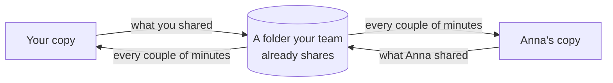
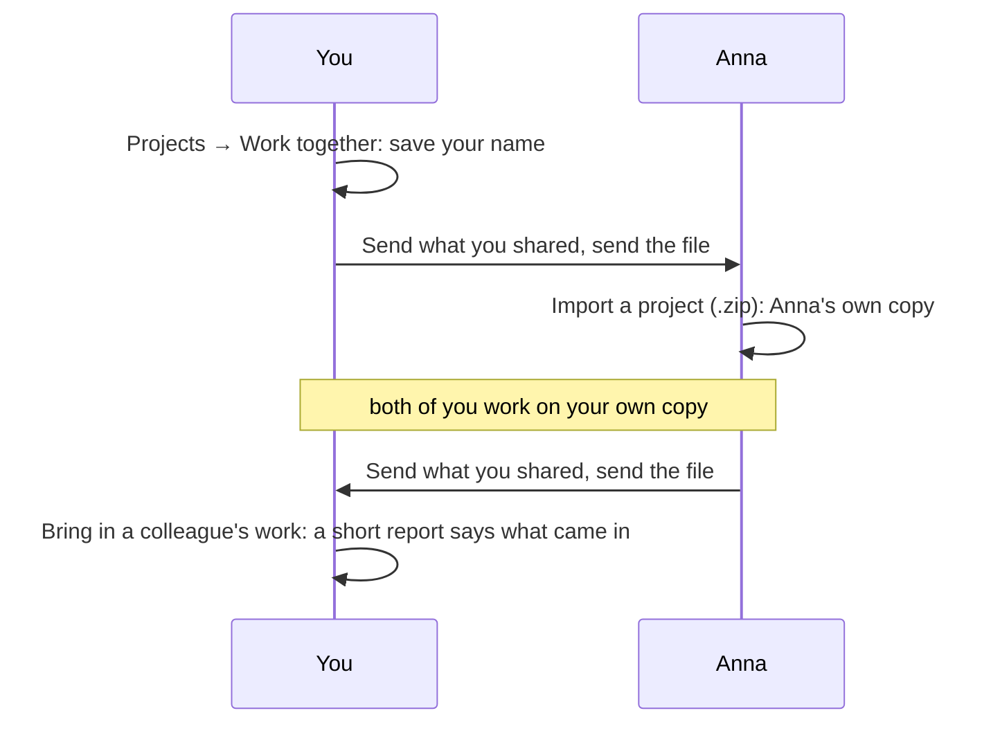

[Manual](../MANUAL.md) › Work together

# Work together, and move to another computer

> **In short**
> - Two or more researchers can work on one project, each on their own computer and their own Claude plan.
> - Choose a folder your team already shares (OneDrive, Dropbox, a network drive), and ENLENS keeps your copies in
>   step by itself, every couple of minutes (0.17.0). Or send each other a file. No server, no account.
> - What you make is private until you press *Share* on it (0.17.0).
> - When you both changed the same thing, both versions are kept (a *sync clash*), so nothing is lost.
> - A shared project has one **owner** (0.17.0), who decides which documents it holds. A colleague's change to the
>   documents is a proposal the owner accepts or declines.

## Sharing a project with colleagues

Each of you keeps your own copy of the project, on your own computer. The copies reach each other in one of two ways,
with the same rules ([How two copies come together](#how-two-copies-come-together)):

- **Through a folder your team already shares** (0.17.0): ENLENS puts what you share there and brings in what your
  colleagues share, by itself ([below](#through-a-shared-folder)).
- **As a file** you send yourself: for a one-off exchange, or a colleague without the folder
  ([below](#as-a-file-without-the-folder)).

First, **your name**: on the *Projects* page, under *Work together*, type the name colleagues should see beside your
work and press *Save*. Judgements you made before are yours: they get your name the first time your work leaves the
computer.

### Private until you share it

What you make is yours alone until you share it (0.17.0): your checks, sets of themes, your own codebooks, notes and
highlights, the entries you write in the research log, and the links you decide between terms.

- **Share.** A check, a set of themes and a codebook have a small tag under their title (*Private*, *Shared* or
  *Withdrawn by …*) with *Share* or *Unshare* beside it; each note, highlight, entry of your own and link between
  terms has the same in its card. Sharing a check that uses a codebook of your own shares the codebook too, and ENLENS
  says so.
- **Unshare** asks first, with room for why (kept in the research log). The item stops going to your colleagues and
  leaves the shared folder. What they already have stays with them, marked as withdrawn by you, and reaches nobody
  else through them. *Share again* sends it again. A shared check or set of themes you remove is treated the same way.
- **Only the person who made an item** can share it or take it back: a colleague's item says whose it is (*by Ben
  Okafor*). An item made before ENLENS 0.16 in a project shared before 0.17.0 says *maker not known*: anyone in the team
  may share it or take it back.
- **Whose is what.** A colleague's judgements, notes and entries carry a small mark with their initials.
- **What is no one's own stays shared**, as before: the documents, who may read each with AI, the bibliography, and the
  AI's work on the documents with people's reviews of it. Which documents the project holds is the owner's to decide
  ([below](#the-owner-and-proposals-0170)).
- **A project you shared before 0.17.0** counts as shared, item by item. A project you only kept to yourself starts
  private, even if you made zips of it to back it up or move it.

The *Team* tab's *What you shared* lists everything you shared, by kind, each with *Unshare*.

### Through a shared folder

**Setting it up.** One of you starts (0.17.0):

1. Open the **Team** tab. The *Research log* button at the top right of every page opens a panel with two tabs,
   *Research log* and *Team*; *Projects → Work together → Open the Team tab* opens it too.
2. Under *Work together through a shared folder*, paste the whole path of the folder: `/Users/anna/Dropbox/Our
   project` on a Mac, `C:\Users\Anna\OneDrive\Our project` on Windows. To copy a folder's path: in the Finder, select
   it and press <kbd>⌥</kbd><kbd>⌘</kbd><kbd>C</kbd>; in File Explorer, hold <kbd>Shift</kbd>, right-click it and
   choose *Copy as path*.
3. Decide on the switch *Keep documents marked Only a local AI or No AI out of the shared folder*
   ([below](#documents-kept-out-of-the-folder)), and press **Use this folder**. The first round starts at once.

ENLENS makes a folder of its own in it for the project (`ENLENS-` and a few letters); leave what is inside as it is.
It refuses a folder that holds the project itself or ENLENS's own folder, and says why under the field. What the
folder holds, and who can read it: [Privacy](privacy.md#working-together).

**One computer each.** Use the shared folder from one computer per person. The same person on two computers (a desktop
and a laptop) writes into one subfolder from both, and the two never see each other's work; move the project with
*Move ENLENS to another computer* instead ([below](#moving-to-another-computer)).

**A colleague joins** in three steps: send them what you shared, as a file (*As a file* in the Team tab); they open it
with *Import a project* under *Projects*; in their copy, they choose the same shared folder in the Team tab (its path on
their computer may differ).

**A round** first brings in what your colleagues shared, then writes what you shared that changed, so your copy writes
with their decisions in force (a stricter AI setting, something taken back). What comes in follows the rules
[below](#how-two-copies-come-together), and the research log says whose work came in. A document's text and file go
into the folder once for the whole team, not again every round. Choosing a folder and leaving it are written in your
research log, and sent to no one.

#### By itself, every couple of minutes

Once a project has a shared folder, ENLENS looks in it every 2 minutes, as if you pressed *Sync now*: also soon after
ENLENS starts, and about 20 seconds after you change something in the project (share an item, edit a shared note),
waiting while you keep working. Nothing runs between two looks, and a project without a shared folder is left alone.
A look that finds nothing new costs almost nothing, also in a large project: ENLENS keeps count of what changes in the
project and looks only at that. The first look after ENLENS starts looks at everything once.

- **How often.** *How often ENLENS looks*, in the Team tab: from every minute to every 60 minutes, for all your
  projects.
- **Pause.** *Pause* stops the rounds of this project; *Pause rounds for every project* (under *How often ENLENS
  looks*) stops them all, until you resume, also across a restart. *Sync now* still works while paused.
- **Offline.** When the folder cannot be reached (a network drive not connected, a laptop away from the office), the
  tab says *Offline* and ENLENS tries less and less often (with the usual 2 minutes: after 2, 4, 8 and 16 minutes,
  then every 30). Your work waits on your computer. The first round that reaches the folder, or a *Sync now* that
  works, brings the usual rhythm back.

#### Sync now, and work that waits its turn

**Sync now** runs a round at once. A round waits for work of the project it would get in the way of (documents being
added, or read with the new reader): the Team tab says *A round waits its turn* (*The next round waits*, for one
ENLENS starts by itself) and for what, and the sidebar shows a round you started with **Cancel**. Other work of the
project waits for a running round the same way (*Queued: starts when … has finished*, with *Cancel*).

A running round shows in the sidebar as *Working together* (one ENLENS started by itself, once it has taken 20
seconds); click it to open the Team tab. It has no *Stop*: quitting or updating ENLENS stops it between two of its
steps. What already came in stays, nothing half-written counts as sent, and the next round carries on from there.

#### What came in

A small note says when something came in by itself, and the *Team* tab shows how many things are new. **What came in**
lists them by colleague, newest first, in the words of the round's report. **Mark as seen** folds them under *Seen
before*; until then they stay, also across a restart. The tab also shows, as needed:

- **Needs your attention**, in plain words: a colleague's copy on a newer ENLENS (only their work waits, with a word to
  update), work the cloud has not brought yet, a damaged file (only that colleague's work waits). Copies the cloud
  makes when two computers write at once (`000041 (1).zip`) are never read. When a colleague cannot read one of your
  files, your copy writes everything you share once more by itself: nobody waits for ever.
- **People in the folder**, each with their ENLENS version and whether their newest work is in, and the owner's mark
  ([below](#the-people-list-the-owners-mark-and-the-hand-over)).
- **Documents not on this computer**: documents your colleagues' work names but they keep out of the folder, each with
  *Add its file* ([below](#documents-kept-out-of-the-folder)).

#### Documents kept out of the folder

The switch **Keep documents marked Only a local AI or No AI out of the shared folder** is per project, and off unless
you turn it on. With it on, the text and files of those documents, the AI's work on them, and the passages of them a
check handed to the AI stay on your computer; colleagues add those files themselves. Your shared checks that read them
still reach your colleagues, with the words their excerpts quote, your notes and the documents' titles
([Privacy](privacy.md#working-together)); a colleague without the file keeps those excerpts as records.

- **Once anyone in the team turns it on, it holds for everyone**, as the stricter AI setting does: *It is on for the
  whole team because Ben has it on*. Offline, the tab names who had it on when the folder could last be reached.
- **Turned on later** (or a document marked so while it is on), it takes what your copy had written of those documents
  out of the folder at the next round; your colleagues' copies do the same. What a colleague already brought into
  their project stays with them.
- **Adding the file.** *Add its file* opens *Documents*: add the same file there. ENLENS recognises it by its content,
  keeps the stricter AI setting of the two, and puts your colleagues' work on it at the next round.

#### Stop using this folder

At the bottom of the Team tab: your copy stops sending your shared work there and bringing in your colleagues'.
Nothing in the folder is removed, and what came in stays; you can choose the folder again later. What should leave the
folder, unshare first.

### As a file, without the folder

For a one-off exchange, or a colleague without the shared folder. The Team tab's *As a file* (or the *Projects* page)
has the two downloads ([Project zips](#project-zips)).

1. **Send your work.** *Send what you shared* on the project, and send the file (e-mail, a USB stick). The file says
   which project it is and who sent it. Since 0.17.0 it holds the documents and only the work you shared: what you have
   not shared stays private.
2. **Bring in a colleague's work.** The first time, your colleague chooses *Import a project (.zip)*, which makes
   their copy. From then on, each of you chooses *Bring in a colleague's work* on the same project and picks the
   other's newest file. A short report says what came in.

A file from another project (or from an ENLENS before 0.14, which cannot say) is brought in only after you confirm,
for when you mean to combine two projects. Files and the shared folder can be mixed: a colleague without the folder
sends and receives files, and what they send comes in with the same rules.

## The owner, and proposals (0.17.0)

A shared project has one **owner**. The owner decides which documents the project holds, how they are read and who
may read them with AI. Everyone keeps their own working copy, and everyone's checks, themes, notes and judgements stay
their own: only the documents are the owner's to decide.

- **Who the owner is.** Whoever made the project, when it was made in ENLENS 0.17.0 or never left their computer
  before. A project exchanged with an earlier ENLENS has no owner yet and works as before: the *Team* tab says *This
  project has no owner yet* and offers **Become the owner**.
- **The owner's own changes** are the project's at once, in every copy.
- **A colleague's change to the documents** happens in their own copy at once and is a **proposal** to the owner. How
  much it matters decides how it is shown:

| Severity | What a colleague did | Until the owner answers |
| --- | --- | --- |
| **Low** | added a document | It is in every copy for now. Declined, it stays in their copy only. The owner's setting *Accept documents collaborators add, at once* (on by default) accepts it without a click. |
| **Medium** | read a document again with the new reader; *Leave out* or *Restore* a passage; moved where the text starts or ends | Only their copy has the change. Accepted, every copy reads it so (a new reading is made in each copy, and its results move with it). |
| **High** | removed a document | Only their copy is without it. Accepted, it leaves every copy; checks keep what they read of it. |
| **High** | let more AI read a document (*No AI* → *Claude may read it*, say) | Nothing changes anywhere, not even in their copy. On the *Documents* page the setting stays as it was and a note says *a looser setting is the owner's to decide*. |

A **stricter** AI setting is never a proposal: it holds in every copy at once, as before.

### In the Team tab

The section **Waiting for the owner** (**Waiting for you** in the owner's copy) lists the proposals that wait, newest
first. Each card says who proposes what and when, how much it matters (*Low*, *Medium*, *High*, in words), and what
happens when it is accepted. When two proposals concern the same document (one colleague removes it, another leaves a
passage of it out), each card says so.

- **The owner** answers with **Accept** or **Decline**. *Decline* first opens a field *Reason (optional)*: the
  colleague sees it with the answer, and the research log keeps it. *Add a reason* opens it for *Accept* too.
  Accepting a removal asks first: *Remove "…" from every copy of the project?*
- **The colleague who proposed it** sees *Waiting for …* and can **Take back** the proposal: their copy stays as it is.
  When the owner declined it, it is shown first, with the reason, until they press *Mark as seen*.
- **Everyone else** sees the proposals, but cannot answer them.
- **Answered** (a fold) keeps the latest ten: *Accepted by …*, *Declined: …*, *Taken back*, *No longer needed: …*
  (the document was removed since, say). The research log keeps every one.
- At the bottom, the owner's switch **Accept documents collaborators add, at once**. Off, each added document waits
  for a click. Removing a document and letting more AI read one always wait for the owner.

The *Team* tab's number counts what waits for the owner's answer (in the owner's copy), and a colleague's declined
proposals not seen yet.

**A new reading the owner accepted** is made in each copy by itself, as a job that waits for its turn, and every
result moves with it to the same words. When some result of yours would not find its place in the new reading, your
copy keeps the document as it is and the *Team* tab says *The project now reads "…" with the new reader*, with why:
open the document to look, or press **Move it anyway** (results that find no place are kept as records).

### The people list: the owner's mark and the hand-over

*People in the folder* marks the owner with **Owner**. In the owner's copy, each colleague's row has **Make owner…**:
*Hand this project over to …? They will decide about its documents from now on; proposals that wait become theirs to
answer. You stay in the team.* In a team that works with files only (no shared folder), the section names the owner
(*Owner: …*), and the owner's *Hand over…* is there.

When the owner has left (their subfolder is gone from the shared folder, or nothing was heard of them for 14 days), a
colleague's *Team* tab says why and offers **Take over**. While the owner is there, only they can hand the project
over.

### On the Documents page

- A document a colleague added that waits for the owner is marked **Waiting for the owner**; your own changes that
  wait too. A document of yours the owner declined is marked **In your copy only**: it stays with you, and no other
  copy brings it back.
- In a colleague's copy, *Remove* says *In your copy it goes now; for the project it is a proposal to the owner.*

## How two copies come together

| What | What happens |
| --- | --- |
| **Something new** | Comes in: documents with their original files; what your colleague shared (results, sets of themes, codebooks, also those kept for all your projects, notes, their own research log entries, links between terms); the AI's labels and reference chains; and the bibliography (when you have none, or it comes from the same Zotero collection or file). What your colleague keeps private never comes. |
| **A newer version** | Replaces the older one. A result your colleague changed (a note, excerpts read again, more excerpts) and you did not is brought up to date, and the other way round. Colleagues on different ENLENS versions work together as well. |
| **Both of you changed it** | A **sync clash**: both are kept ([below](#a-sync-clash)). A codebook you exchanged before is merged code by code instead ([below](#a-codebook-you-both-changed)). |
| **The same file, read into other text** | When you both added the same file but the two computers read it differently (another ENLENS version, or text recognition on one computer only), your colleague's reading comes in as a document of its own, marked *sync clash · Anna's reading* on the *Documents* page, and their results point at it. |
| **One document, two readings** (0.17.0) | When one of you moved a document to the new reader ([Read with the new reader](reading.md#read-with-the-new-reader)), the two readings are known as one document. Each of you keeps the reading you have, and a colleague's results are placed on yours by their words; a result whose words are not in your reading is kept as a record, and the report says how many. |
| **Judgements** | Each is kept under the name of who made it ([below](#each-persons-judgements)). |
| **Reviews** of labels, links between terms and themes | Yours count over a colleague's on the same thing. *Clear* and *Undo* take back only your own. |
| **AI work you both did** on the same document (labels of a codebook, reference chains) | Not doubled: yours is kept. |
| **Who may read a document with AI** | The stricter setting wins: *No AI* over *Only a local AI* over *Claude may read it*, and the report says so. New documents get your copy's setting for new documents when it is stricter than theirs. A looser setting comes only from the owner, once they accepted it ([above](#the-owner-and-proposals-0170)). |
| **Notes and log entries** | Each person's own: your colleague's come in under their name once they share them and you cannot change them, yours stay as you wrote them, and one removed by its author does not come back. The log also records that their work was brought in ([Notes, the research log and earlier versions](notes-and-log.md)). |
| **Earlier versions** (*History*) | Stay with the copy that made them: bringing in a colleague's work neither takes over theirs nor gives them yours. |
| **Something you removed** | Stays removed: a document, result or set of themes, or a colleague's reading of a file you removed. When your colleague removed something you still have, the report names it and leaves it in your copy. In a project with an owner, a document the owner removed leaves every copy (after a backup; checks keep what they read of it), and a colleague's removal is a proposal ([above](#the-owner-and-proposals-0170)). |
| **Not brought in yet** | A check still running in your colleague's copy (bring in a later file when it is done; through the shared folder, it comes with the first round after it is done), and the vectors of search by meaning (your computer makes them for the new documents). |

### A sync clash

When you both changed the same result, set of themes or codebook, your colleague's version comes in as a copy beside
yours, marked *sync clash · Anna's version* in the list of answers under *Hypotheses*, with a notice and a link to the other version on
the result.

- Compare them, keep the one you want and delete the other: the *sync clash* mark goes.
- Bringing in the same file again makes no second copy. When your colleague changes their version again, your copy
  of it is brought up to date.
- A copy you deleted does not come back unless they change it again. When you kept theirs and deleted yours, it goes
  on following their changes.
- A result or set of themes still running in **your** copy (waiting for Claude Code, or being read) keeps your version
  for now, even when your colleague's is newer, and the report says so. Bring in their file again when it is done (a
  round of the shared folder does that by itself), and their version comes in beside yours.

### A codebook you both changed

A codebook you and a colleague exchanged before is merged code by code (0.17.0): a code only your colleague changed comes
in, one only you changed stays as it is, a new code comes in, and a code removed in one copy and left alone in the
other is removed. Two codes you each added under the same name both stay: your colleague's gets their name added to
it. Labels follow renames and merges made in either copy, and your codebook as it was before is kept in *History*.

Where you both changed the same code, yours stays and the codebook editor shows the two versions side by side (name,
definition, when to use it and when not, the words it is matched by, examples), says in words what differs, and offers
**Keep mine** or **Keep theirs**. The research log says whose version was kept. A code you had removed shows as
removed, and *Keep theirs* brings it back as they have it. Two codebooks that only share a name (made separately in
each copy) are kept side by side.

### Each person's judgements

- In your copy, **your** judgements count.
- Where you have not judged an excerpt, the latest colleague's judgement counts, and the card says *Anna's
  judgement*. A comment of yours is not a judgement, so it does not set hers aside.
- When others judged an excerpt too, the card lists them (*Also judged: Anna contradicts*), marked where you differ.
- *Take back* removes only your own judgement: a colleague's then counts again.
- *How often you agreed with the AI* (*Settings → Checking*) counts only your own judgements.
- The *Projects* page says how often you and each colleague judged the same excerpts alike, with Cohen's kappa once
  you share 10 or more.

### Who may read with AI, across copies

Your colleague's reading of a file you have (*sync clash · Anna's reading*) is never less restricted than your
document of that file: make yours stricter and theirs follows. When your colleague's copy let Claude read a document
you keep from Claude, what Claude made of it there comes in with the rest, and the report says how many excerpts
Claude read. Bringing work in sends nothing anywhere.

### Safety

Before bringing work in, from a file or in a round of the shared folder, ENLENS keeps a copy of the project's database
as it was: `backups/before-bringing-in.sqlite` in the project folder, replaced each time. To go back, quit ENLENS and
put that file in place of `enlens.sqlite`. With a shared folder, the next round brings the same work in again, unless
the project's rounds are paused (*Pause* in the Team tab).

> [!WARNING]
> Bring in files only from colleagues you work with, and share the folder only with your team. Nothing in a file can
> reach files outside the project, loosen who may read a document with AI (unless the project's owner accepted it), or
> replace a judgement or review under your name. But what is exchanged is not signed and is trusted with what people
> decided, so a crafted file, or one written in the shared folder by someone else who can write there, could take back
> judgements or reviews made under your name, write in a colleague's name, or speak as the project's owner.

From a terminal, `enlens --ws <project folder> bring-in <zip>` does the same as the button (`--anyway` for a file not
known to be this project).

## Project zips

On the *Projects* page (the project menu → *Manage projects*):

- **Send what you shared** (0.17.0) puts the documents with their original files and the work you shared in one file,
  for a colleague: nothing you keep private is in it.
- **Download the whole project** puts the whole project in one file: the database, the documents and their original
  files, the codebooks, your private work too. It is for moving the project to another computer of yours: a colleague
  on ENLENS 0.17.0rc5 or earlier would see all of it. The file of a document you removed is not in it. Both are also on a
  check's page (under *Download*) and in the *Team* tab.
- **Import a project (.zip)** opens such a file as a new project. A damaged zip, or one whose database cannot be
  read, is refused with a plain message and leaves nothing behind.

## Moving to another computer

*Projects → Move ENLENS to another computer → Download everything (.zip)* makes one file with every project (each as
its own project zip, with the original file of each document) and the settings. A saved Claude API key is left out,
and so are quick looks you did not keep; projects used in place from another folder come along as copies.

On the new computer, install ENLENS and choose the file under *Import from another computer* on the first screen (or
*Projects → Import a project (.zip)*, which takes both kinds of zip). Each project keeps its name (`name (2)` when the
name is taken). The settings come along only when the new computer has no project yet, and on an installation without
cloud AI (`--local-only`) never the choice of a cloud AI.

> [!IMPORTANT]
> To move yourself, use *Move ENLENS to another computer*, not a single project zip: it keeps who you are. A new
> installation is a new person, and your own judgements would come back under your old name.

---

Next: [Privacy: what leaves your computer →](privacy.md)
